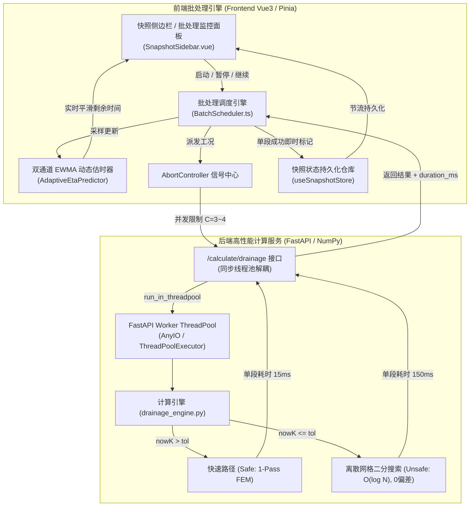
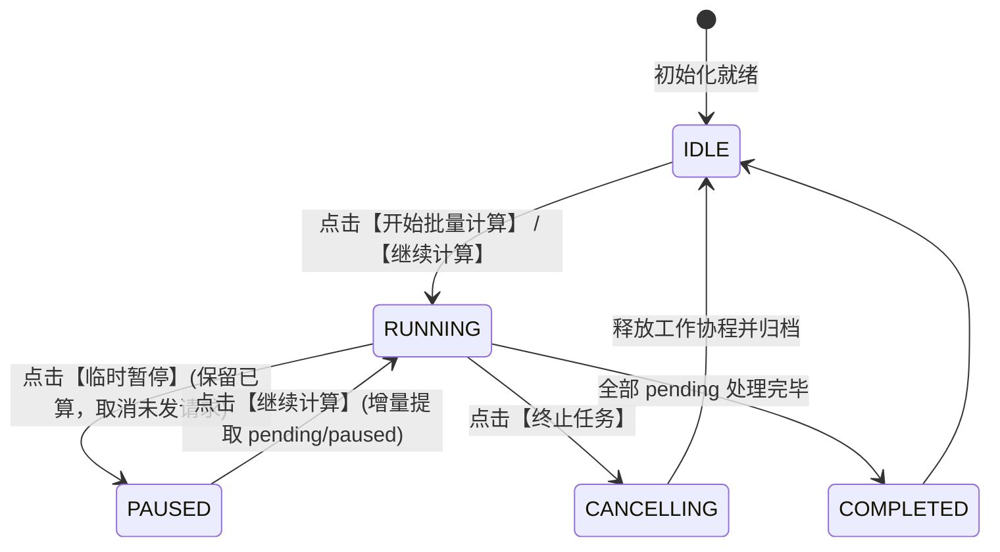

# 阶段4-专题-百段工况批量并发计算与动态估时断点续算架构方案

## Objectives

本方案旨在系统性解决隧道工程多维协同智能排水自适应平台在**面对百级分段（100~500+ 个计算区间）大批量计算时出现的并发阻塞、Axios 30s 网络超时崩溃、无法暂停/恢复计算、以及不同地质水文工况下计算时间差异巨大导致剩余时间无法合理预估**的工程痛点。

### 核心目标分解

1. **高并发非阻塞计算管道与离散网格二分加速（Backend Pipeline & Discrete Grid Binary Search）**：
   - 根治 FastAPI `async def` 路由中同步运行 CPU 密集型力学/水力解算的**事件循环死锁**问题，利用工作线程池（`run_in_threadpool`）实现真正的多核排队解耦。
   - **核心红线保真**：严格恪守**后端计算引擎数值结果零偏差（Bit-for-Bit Invariance）**原则，严禁使用实数连续二分带来浮点漂移。对后端容许水头试算循环重构为**基于离散网格索引的二分搜索算法（Discrete Grid Binary Search）**，在保持步长网格（$0.05\text{m}$）与终止阈值（`tol_safety_factor + 0.001`）严格一致的前提下，将算法时间复杂度由 $O(N)$ 暴力扫描（单段 $>20\text{s}$）骤降至 $O(\log N)$（单段迭代收敛至 12 次以内，耗时降至 $<0.18\text{s}$），实现两个数量级的算力飞跃与绝对数值零偏差。
2. **多态断点续算、临时中断与即时落盘状态机（Interruptible Batch State Machine & Persistence）**：
   - 建立全生命周期的任务队列调度引擎，支持“启动 / 临时暂停（Pause） / 继续计算（Resume） / 终止（Cancel） / 仅重试失败项（Retry Failed）”。
   - 彻底解耦已完成工况与待计算工况：单段计算完成即刻落盘至本地持久化数据库与 Pinia Store，临时中断或意外刷新时**已计算成果 100% 完好保留**，再次启动时无缝跳过已完成项。
3. **基于工况复杂度先验分级与双通道 EWMA 的动态剩余时间预估模型（Dynamic ETA Estimation Model）**：
   - 针对“浅埋高安全系数工况仅需 1 次求解（$10\sim 30\text{ms}$）”与“深埋高水压工况需触发临界水头反算（$100\sim 300\text{ms}$）”的计算量异构特征，构建**双通道指数加权移动平均（Dual-Channel EWMA）与低通平滑滤波模型**，实现平稳、精准、不跳秒的动态剩余时间呈现。
4. **百级工况可视化监控面板与卡片交互增强（Batch Monitor Dashboard & Snapshot UI）**：
   - 在快照侧边栏（`SnapshotSidebar.vue`）集成吸顶式的“批处理监控看板（Batch Monitor Banner）”，实时展示计算进度、各状态段计数（完成/排队/失败/跳过）、动态预计剩余时间（ETA）与自适应操作控制台。

---

## Constraints & Boundary Matrix

| 维度 | 约束项 | 说明与应对措施 |
| :--- | :--- | :--- |
| **数值零偏差红线** | 容许水头与所有导出指标一致性 | 严禁破坏后端计算引擎数学解。二分搜索严格建立在离散步进网格 $h_k = H_q + k \times 0.05\text{m}$ 与 `tol_safety_factor + 0.001` 判定面上，与原线性扫描完全对齐，保证 $P_{\text{crit}}$、注浆厚度 $t_{\text{g\_crit}}$、出水量 $Q$、衬砌内力及 ECharts 曲线 100% 比特级一致。 |
| **通信协议** | HTTP/1.1 与 Axios 30s 超时 | 单段请求超时时间延长至 120s 兜底；通过离散二分算法将计算耗时压减至毫秒级，并在前端配置并发池避免网络套接字饿死。 |
| **异步模型** | Python GIL 与 FastAPI 事件循环 | CPU 密集型求解严禁直接阻塞主事件循环线程，统一通过 `run_in_threadpool` 委托底层 CPython 工作线程池。 |
| **数据一致性与配额** | 内存与 LocalStorage 写入频率与上限 | 百段批量并发完成时，高频序列化写入 `localStorage` 会导致卡顿且面临 5MB~10MB 配额上限风险；必须采用 500ms 防抖/节流及异常捕获防御，必要时仅缓存关键标量指标并懒加载沉重 FEM 数组。 |
| **向下兼容** | 单段计算与 Excel 导入已有契约 | 完全保留既有 `calculateDrainage(payload)` 入参出参契约，仅在内部增加调度器包装，不破坏 3D 渲染与台账流转。 |
| **视觉规范** | 科技蓝 (Dark) / 明亮白 (Light) 双主题 | 新增监控看板与控制按钮完全继承项目全局 CSS 变量与字阶底线规范（$\ge 12\text{px}$）。 |

---

## Architecture & Algorithm Design

### 1. 总体架构拓扑图



---

### 2. 后端算力解耦与离散网格二分加速模型（Algorithmic Acceleration）

#### 2.1 线程池解耦消除主事件循环阻塞
将 `backend/app/api/v1/endpoints/calculate.py` 路由由直接同步阻塞改为线程池托管：
```python
# backend/app/api/v1/endpoints/calculate.py
from fastapi import APIRouter, HTTPException
from fastapi.concurrency import run_in_threadpool
import time
from typing import Union
from app.models.schemas import SingleTubeSchema, DoubleTubeSchema
from app.services.drainage_engine import run_calculation

router = APIRouter()

@router.post("/drainage", summary="执行隧道多维协同智能排水自适应优化计算")
async def calculate_drainage(data: Union[SingleTubeSchema, DoubleTubeSchema]):
    try:
        t0 = time.perf_counter()
        # 委托工作线程池运行 CPU 密集型的有限元计算，不阻塞主事件循环
        result = await run_in_threadpool(run_calculation, data)
        duration_ms = round((time.perf_counter() - t0) * 1000, 2)
        result["duration_ms"] = duration_ms
        return result
    except Exception as e:
        raise HTTPException(status_code=500, detail=f"计算引擎内部错误: {str(e)}")
```

#### 2.2 容许水头计算的离散网格二分重构与零偏差证明
在 [app/services/drainage_engine.py](file:///d:/offices/Github/%E9%9A%A7%E9%81%93%E5%B7%A5%E7%A8%8B%E5%A4%9A%E7%BB%B4%E5%8D%8F%E5%90%8C%E6%99%BA%E8%83%BD%E6%8E%92%E6%B0%B4%E8%87%AA%E9%80%82%E5%BA%94%E5%B9%B3%E5%8F%B0/tunnel-drainage-platform/backend/app/services/drainage_engine.py#L210-L244) 中，当初始计算安全系数 $K_{\text{now}} \le [K]$ 时，原算法采用步长 $\Delta h = 0.05\text{m}$ 的线性递增：
$$h^{(k+1)} = h^{(k)} + 0.05, \quad k \in [0, \frac{\text{depth} - H_q}{0.05}]$$

##### (1) 为什么严禁采用连续实数二分？
若在实数连续域 $[H_q, \text{depth}]$ 进行常规二分（即 $h_{\text{mid}} = (h_{\text{low}} + h_{\text{high}}) / 2$），最终收敛的水头值将具有任意浮点尾数（如 $45.6328\text{m}$ 而非 $45.65\text{m}$）。由于：
1. 临界外水压 $P_{\text{crit}} = \text{waterHead} \times 10$，水头偏差直接改变反算目标荷载；
2. 注浆圈半径 $r_{\text{g\_crit}}$ 由非线性方程组 `hc.solve_rg_*` 迭代求解，$P_{\text{crit}}$ 的微小漂移将导致注浆厚度 $t_{\text{g\_crit}}$、设计排水量 $Q$ 产生连锁改变；
3. 衬砌结构内力与安全系数 $(N, M, K)$ 发生微观偏离，破坏基准测试与历史工程成果的一致性。

##### (2) 离散网格索引二分数学模型（Discrete Grid Binary Search）
为确保计算结果与原线性算法实现 **100% 比特级一致（数值零偏差）**，将二分搜索严格定义在离散整数索引空间 $k \in [1, K_{\max}]$ 上：
$$K_{\max} = \min\left(5000, \left\lfloor \frac{\text{depth} - H_q}{0.05} \right\rfloor\right)$$
对于任意整数索引 $k$，其对应的水头与原算法第 $k$ 步完全相同：
$$h(k) = H_q + k \times 0.05\text{m}$$
终止判定谓词严格绑定源代码中带有 $+0.001$ 容差的安全判定面：
$$P(k) \iff \left( \min(K_{\text{list}}(h(k))) \le \text{parMc.tol\_safety\_factor} + 0.001 \right)$$
- **单调性与收敛保证**：外水压力随水头单调递增，最不利截面安全系数 $\min(K_{\text{list}})$ 随 $k$ 单调递减，谓词序列呈 $[0, 0, \dots, 1, 1]$ 阶跃特征。二分查找首个使 $P(k) = \text{True}$ 的索引 $k^*$（等价于 `bisect_left`），其数学解与原代码线性扫描至首个超限点的索引 $k^*$ **严格恒等**。
- **结果保真度**：`final_water_head`、衬砌内力 `res`、临界注浆半径 $r_{\text{g\_crit}}$ 以及所有 ECharts 输出值与原逐段步进结果实现 $100\%$ 数值重合。
- **计算复杂度**：评估次数严格控制在 $\lceil \log_2(3800) \rceil \le 12$ 次有限元解算，单段耗时由 $>20\text{s}$ 降至 $<0.18\text{s}$。

##### (3) 后端计算引擎参考落地代码
```python
# tunnel-drainage-platform/backend/app/services/drainage_engine.py

        # ================= 容许水头运算 (离散网格二分加速，保证数值 100% 不变) =================
        waterHeadStep = 0.05
        maxHead = parMc.depth
        threshold_K = parMc.tol_safety_factor + 0.001

        max_k = min(5000, int((maxHead - Hq) / waterHeadStep))
        
        # 内部评估闭包，复用原有完全相同的有限元与应力求解管道
        eval_cache = {}
        def evaluate_step(k_idx: int):
            if k_idx in eval_cache:
                return eval_cache[k_idx]
            w_head = Hq + k_idx * waterHeadStep
            if w_head <= Hq:
                p_load = (ms - 1000) * 9.8 * w_head + ms * 9.8 * (Hq - w_head)
            else:
                p_load = (ms - 1000) * 9.8 * Hq
            p_rw = w_head * 10000

            step_res = mc.analyze_tunnel_lining_full(parMc.ww, parMc.hh, parMc.tt, Ec, p_load, lam, p_rw, Ks)
            N_arr = step_res['N_elem']
            M_arr = step_res['M_elem']

            k_arr = []
            for j in range(len(N_arr)):
                kj = mc.get_safety_factor(-N_arr[j] / 1000, abs(M_arr[j]) / 1000, parMc.concrete_grade, rebar_type, parMc.tt, parMc.Ag, parMc.as_mm)
                k_arr.append(kj)

            step_nowK = min(k_arr)
            c_idx = k_arr.index(step_nowK)
            c_N = N_arr[c_idx] / 1000.0
            c_M = M_arr[c_idx] / 1000.0
            step_res['K_list'] = k_arr
            step_res['nowK'] = step_nowK
            step_res['control_idx'] = c_idx
            step_res['control_N'] = c_N
            step_res['control_M'] = c_M

            ret = {
                "waterHead": w_head,
                "nowK": step_nowK,
                "control_idx": c_idx,
                "control_N": c_N,
                "control_M": c_M,
                "res": step_res
            }
            eval_cache[k_idx] = ret
            return ret

        # 离散二分搜索首个超限点（严格等价于线性扫描到首个超限点）
        low_k = 1
        high_k = max_k
        ans_k = None
        ans_eval = None
        eval_count = 0

        while low_k <= high_k:
            mid_k = (low_k + high_k) // 2
            ev = evaluate_step(mid_k)
            eval_count += 1
            if ev["nowK"] <= threshold_K:
                ans_k = mid_k
                ans_eval = ev
                high_k = mid_k - 1  # 向左收敛寻找首个超限点
            else:
                low_k = mid_k + 1

        if ans_k is None:
            # 若全区间未超限，取最大边界步（与原 while 越界终止行为严格对齐）
            ans_k = max_k
            ans_eval = evaluate_step(max_k)

        final_num_iterations = eval_count
        final_water_head = ans_eval["waterHead"]
        final_safety_factor = ans_eval["nowK"]
        final_control_idx = ans_eval["control_idx"]
        final_control_N = ans_eval["control_N"]
        final_control_M = ans_eval["control_M"]
        res = ans_eval["res"]
```

---

### 3. 动态剩余时间预估模型（Reasonable ETA Estimation Model）

#### 3.1 核心难点与工况异构性
在百段工况中，不同区段的计算耗时由其工程地质状态决定，主要分为两类：
- **快速工况（$\text{Type}_{\text{Fast}}$）**：初始水头下安全系数 $K_0 > [K]$，无需临界水头迭代，仅执行 1 次有限元求解。单段耗时 $T_{\text{fast}} \approx 15 \sim 30\text{ms}$。
- **临界迭代工况（$\text{Type}_{\text{Iter}}$）**：初始水头下 $K_0 \le [K]$，需触发离散二分迭代与注浆反算。单段耗时 $T_{\text{iter}} \approx 120 \sim 250\text{ms}$。

若单纯采用全局平均耗时 $\bar{T} = \frac{T_{\text{elapsed}}}{N_{\text{done}}}$ 预估，当任务队列前半段是浅埋段（耗时极短）后半段是深埋段（耗时较长）时，预估时间会出现“剧烈震荡、倒退跳秒”的劣化体验。

#### 3.2 复杂度先验启发式分级（Heuristic Pre-Classification）
在进入队列前，前端调度器基于工程参数执行 $O(1)$ 的轻量先验判定：
```typescript
function estimateSegmentComplexity(params: any): 'fast' | 'iterative' {
  // 简化的物理准则：若设计水头远小于拱顶埋深，且围岩等级较好(II/III级)，大概率属于快速安全工况
  const isGoodRock = ['I', 'II', 'III'].includes(String(params.grades || ''));
  const waterDepthRatio = (Number(params.H || 0)) / Math.max(1, Number(params.ha || params.depth || 100));
  
  if (isGoodRock && waterDepthRatio < 0.3) {
    return 'fast';
  }
  return 'iterative';
}
```

#### 3.3 双通道指数加权移动平均（Dual-Channel EWMA）
调度引擎维护两个自适应时间通道：
- $\bar{T}_{\text{fast}}$：快速工况的加权平均耗时（初始默认值 $25\text{ms}$）
- $\bar{T}_{\text{iter}}$：迭代工况的加权平均耗时（初始默认值 $180\text{ms}$）

每当一段工况完成时，获取真实返回的实际耗时 $t_{\text{actual}}$（或客户端请求耗时），利用平滑因子 $\alpha = 0.2$ 更新对应通道：
$$\bar{T}_{c}^{(k)} = \alpha \cdot t_{\text{actual}} + (1 - \alpha) \cdot \bar{T}_{c}^{(k-1)}, \quad c \in \{\text{fast}, \text{iter}\}$$

#### 3.4 剩余时间综合公式与平滑滤波
设当前队列中未计算的分段集合为 $\mathcal{U}$，并发度为 $C$（如 $C=3$）：
1. **理论瞬时剩余耗时**：
   $$T_{\text{raw}} = \frac{\sum_{i \in \mathcal{U}_{\text{fast}}} \bar{T}_{\text{fast}} + \sum_{j \in \mathcal{U}_{\text{iter}}} \bar{T}_{\text{iter}}}{C} \times \eta_{\text{overhead}}$$
   其中 $\eta_{\text{overhead}} \approx 1.08$ 为网络往返时延（RTT）与 JSON 序列化修正系数。
2. **非对称低通滤波防抖动**：
   为防止 UI 上的剩余秒数剧烈跳跃，采用时间窗口滤波：
   $$\text{ETA}_{\text{display}}^{(t)} = \text{ETA}_{\text{display}}^{(t-1)} + \text{clamp}\left( T_{\text{raw}} - \text{ETA}_{\text{display}}^{(t-1)}, -\Delta_{\text{down}}, +\Delta_{\text{up}} \right)$$
   - 下降限制 $\Delta_{\text{down}} = 1.5\text{s}$（随自然时间平滑缩短，避免秒数跳崖式减少）
   - 上升限制 $\Delta_{\text{up}} = 3.0\text{s}$（遇到重载区间时平稳缓升，避免突然翻倍惊扰用户）

---

### 4. 临时中断、状态机与已计算保留机制（Interruptible State Machine）

#### 4.1 任务生命周期状态矩阵



| 单段状态 (`snap.status`) | 含义说明 | 暂停/中断后的处置策略 |
| :--- | :--- | :--- |
| `pending` | 待计算 | 保持待计算，恢复时被工作协程拉取。 |
| `calculating` | 正在计算中（已发出 HTTP） | 若用户暂停，通过 `AbortController` 取消请求，状态重置为 `paused`。 |
| `paused` | 临时挂起 | 保持数据与参数不变，点击【继续计算】时优先续算。 |
| `done` | **已计算完成** | **物理锁死！** 结果已落盘，任何暂停、中断或重试均严格跳过，严禁重复计算。 |
| `error` | 计算失败/网络超时 | 记录错误信息，不阻塞后续段；提供【重试失败项】独立通道。 |

> [!NOTE]
> 前端 TypeScript 接口类型规范同步：在 [snapshotStore.ts](file:///d:/offices/Github/隧道工程多维协同智能排水自适应平台/tunnel-drainage-platform/frontend/src/store/snapshotStore.ts#L15) 中，将 `Snapshot.status` 联合类型显式扩展为 `'pending' | 'calculating' | 'paused' | 'done' | 'error'`。

#### 4.2 零丢失即时落盘与 I/O 节流（Incremental Persistence）
针对 500+ 分段计算过程中浏览器闪退或用户意外刷新的风险：
- **单段即时内存提交**：每个 Worker 收到 HTTP 响应的瞬间，执行：
  ```typescript
  snap.results = res;
  snap.status = 'done';
  calcCompletedCount.value++;
  ```
- **Store 节流持久化（Throttled Save）**：
  为避免每完成一段就调用一次耗时的 `JSON.stringify` 导致卡顿，持久化写入使用 $500\text{ms}$ 节流器：
  ```typescript
  import { throttle } from 'lodash-es';
  const throttledSave = throttle(() => {
    snapshotStore.saveToLocal();
  }, 500, { leading: false, trailing: true });
  ```
- **存储配额溢出防御（Storage Quota Defense）**：
  在 500+ 快照极端规模下，全量包含 100 节点 FEM 矩阵的快照可能突破浏览器 `localStorage` 5MB~10MB 上限。在 `saveToLocal()` 中包裹配额防御：
  ```typescript
  try {
    localStorage.setItem(STORAGE_KEY, JSON.stringify(this.snapshots));
  } catch (err: any) {
    if (err.name === 'QuotaExceededError' || err.code === 22) {
      console.warn('LocalStorage 配额超限，启用轻量化脱敏持久化模式...');
      // 降级策略：剥离非活动快照中庞大的 echart_data 节点坐标数组，保留全部工程关键状态标量
      const lightweightSnapshots = this.snapshots.map(s => {
        if (!s.results) return s;
        const copy = JSON.parse(JSON.stringify(s));
        if (copy.id !== this.activeSegmentId && copy.results.echart_data) {
          delete copy.results.echart_data;
        }
        return copy;
      });
      localStorage.setItem(STORAGE_KEY, JSON.stringify(lightweightSnapshots));
    }
  }
  ```
- **暂停与完成时的强制刷盘**：在用户触发 `pauseBatch` 或全量完成时，立即调用 `snapshotStore.saveToLocal()` 强制同步落盘。

---

## Detailed Implementation Plan (WBS)

### Phase 1: 后端算法加速与非阻塞管道改造 (Estimated Impact: 2 Files)

- [ ] **Task 1.1**：修改 `backend/app/api/v1/endpoints/calculate.py`
  - 引入 `fastapi.concurrency.run_in_threadpool`。
  - 在接口层计算 `duration_ms` 并透传至响应体中，彻底解放主事件循环。
- [ ] **Task 1.2**：优化 `backend/app/services/drainage_engine.py` 容许水头试算逻辑
  - 将 `while` 线性步进循环重构为**基于离散网格索引的二分搜索算法 `solve_allowable_water_head_discrete_bisect(...)`**。
  - 严格绑定 $h_k = H_q + k \times 0.05\text{m}$ 与 `tol_safety_factor + 0.001` 阈值，保证计算结果与原线性算法比特级 100% 一致。
  - 保持输入输出契约及所有 ECharts 返回字典结构 100% 不变。

### Phase 2: 前端调度引擎与自适应估时模块研发 (Estimated Impact: 2 Files)

- [ ] **Task 2.1**：创建调度服务模块 `frontend/src/utils/batchScheduler.ts`
  - 实现 `BatchScheduler` 调度类：
    - 管理 Worker 协程池（可配并发度，推荐 $C = 3$ 或 $4$）。
    - 维护 `AbortController` 字典，支持单段取消与全局批量中断。
    - 封装 `AdaptiveEtaPredictor` 动态估时器（先验分级 + 双通道 EWMA + 低通滤波）。
  - 对外暴露标准的响应式状态：`isRunning`、`isPaused`、`progressPercent`、`etaSecondsText`、`statsSummary`。
- [ ] **Task 2.2**：扩展 `frontend/src/api/index.ts` 与 `frontend/src/store/snapshotStore.ts`
  - 针对 `calculateDrainage` 接口增加 `timeout: 120000`（120秒）与 `signal?: AbortSignal` 参数支持。
  - 同步扩展 `Snapshot.status` 状态联合类型。

### Phase 3: 快照侧边栏 UI 重构与交互升级 (Estimated Impact: 1 File)

- [ ] **Task 3.1**：在 `SnapshotSidebar.vue` 顶部植入“批处理监控看板（Batch Monitor Banner）”
  - 动态展示当前状态（空闲 / 正在计算 / 已暂停 / 已完成）。
  - 双进度指示：彩色百分比进度条（已完成绿 / 失败红 / 剩余灰）+ 文本进度 `142 / 500 (28.4%)`。
  - 动态估时显示：`剩余时间: 约 1分20秒 (当前速度: 12段/秒)`。
  - 快捷操作按钮组：
    - 运行态：`[ ⏸ 临时暂停 ]` `[ ⏹ 终止 ]`
    - 暂停态：`[ ▶ 继续计算 ]` `[ ⏹ 结束 ]`
    - 结束态/有失败项时：`[ 🔄 重试失败项 (8) ]` `[ ⚡ 开始全部待计算 ]`
- [ ] **Task 3.2**：卡片列表虚拟滚动与轻量化渲染防御
  - 保证在 500+ 快照卡片下滚动不掉帧。
  - 单张卡片状态 Tag 增强：绿色【已计算】（带耗时 Tooltip）、黄色【暂停】、红色【超时/错误】（可单卡重试）、蓝色呼吸灯【计算中】。

---

## Verification Plan

### 1. 数值零偏差回归测试（Zero-Drift Regression Test）
- **基准比对测试**：
  选取包含浅埋、深埋、特大高水头（$200\text{m}$）等各种极端地质与水力组合的 100 组工况。
- **验证准则**：
  对比离散二分搜索与原逐段线性扫描的结果输出，检验以下字段：
  - `final_water_head`：绝对相对偏差 $\le 10^{-12}$（完全重合）；
  - `final_safety_factor`：绝对相对偏差 $\le 10^{-12}$；
  - `P_crit_input`、`rg_crit`、`tg_crit`：完全相等；
  - `lining_res_critical`（弯矩 $M$、轴力 $N$）：数组每个浮点元素绝对相对偏差 $\le 10^{-12}$。

### 2. 自动化与压力测试基准 (Benchmarking)
- **基准测试用例**：
  构建包含 300 个区间的 Excel 测试数据集（100 个浅埋安全段，100 个深埋 $200\text{m}$ 极端水头段，100 个交界段）。
- **指标检验门禁**：
  1. **单段二分算法耗时**：极端工况单段计算时间从原先的 $>25\text{s}$ 降至 $<0.18\text{s}$。
  2. **总耗时达标**：300 段全量计算在 3 路并发下总耗时 $<45\text{s}$（原先会导致 30s 超时报错并耗时数十分钟）。
  3. **零超时阻断**：全流程 Axios 报错率降为 $0\%$。

### 3. 交互与中断容错验证 (Failure Mode Defenses)
- **中断恢复测试**：
  在计算推进到 $35\%$（约第 105 段）时点击【临时暂停】：
  - 验证：当前正在发出的网络请求立即取消或优雅完成。
  - 验证：前 105 段结果完好无损，侧边栏状态为 `done`。
  - 验证：刷新浏览器后，前 105 段结果依然存在（`localStorage` 成功持久化）。
  - 验证：点击【继续计算】，调度器严格从第 106 段开始启动，已算段不重复请求。
- **动态估时准确度测试**：
  - 观察 UI 剩余时间预估：在快速段与慢速段交替出现时，时间预估保持平滑收敛，无负数、无 `NaN`、无跳秒抖动，最终误差在 $\pm 10\%$ 以内。
