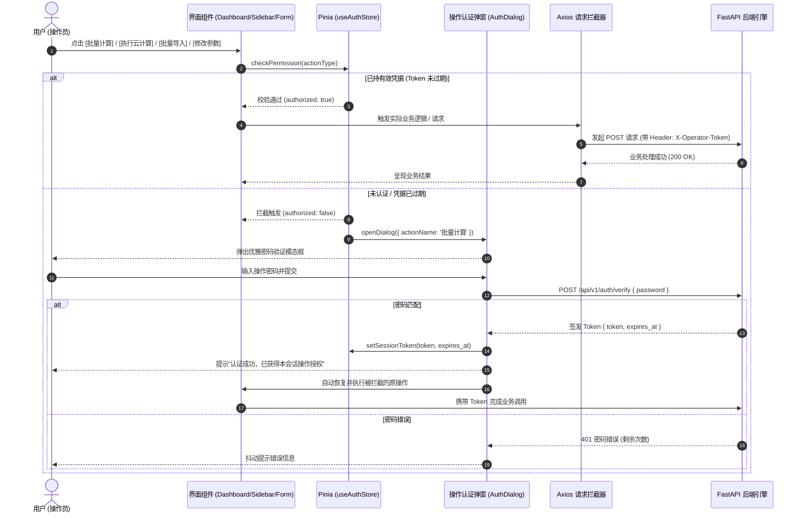

# 阶段4-专题-平台轻量一次性认证机制与敏感操作防护架构方案

## Goal Description

### 1. 核心业务痛点与目标分解 (Objectives)

隧道工程多维协同智能排水自适应平台目前集成了三维几何渲染（[Viewer3D.vue](file:///d:/offices/Github/隧道工程多维协同智能排水自适应平台/tunnel-drainage-platform/frontend/src/components/three/Viewer3D.vue)）、工况快照管理（[SnapshotSidebar.vue](file:///d:/offices/Github/隧道工程多维协同智能排水自适应平台/tunnel-drainage-platform/frontend/src/components/ui/SnapshotSidebar.vue)）、参数表单配置（[ParameterForm.vue](file:///d:/offices/Github/隧道工程多维协同智能排水自适应平台/tunnel-drainage-platform/frontend/src/components/ui/ParameterForm.vue)）与参数工程台账中心（[ParameterDatabase.vue](file:///d:/offices/Github/隧道工程多维协同智能排水自适应平台/tunnel-drainage-platform/frontend/src/views/ParameterDatabase.vue)）。

随着系统在**单机桌面端 (Tauri/PyInstaller)** 与 **服务器公网/局域网协作端 (Docker/FastAPI/Nginx)** 的双轨部署推进，现实工程应用场景中暴露出显著的**操作权限与安全性失衡**：

```
+---------------------------------------------------------------------------------------------------+
|                                     现实操作场景与安全痛点全景图                                    |
+---------------------------------------------------------------------------------------------------+
|  [场景 A: 领导汇报 / 专家会签 / 成果阅览]                                                           |
|       │                                                                                           |
|       ├─ 诉求: 打开系统即可免密直观漫游 3D 隧道模型、查看已有水动力计算成果、导出高保真计算书与施工图。  |
|       └─ 痛点: 绝不能出现前置强制登录页，否则严重阻断汇报演示，破坏“即开即用、数字孪生”的工程沉浸感。   |
|                                                                                                   |
|  [场景 B: 公网/内网共享服务器部署]                                                                  |
|       │                                                                                           |
|       ├─ 风险 1: 无权限控制的“批量计算”与“云计算”：任何外部网络请求均可调用有限元 CPU 密集计算引擎，      |
|       │         引发多核打满、拒绝服务 (DoS) 与服务器雪崩。                                       |
|       ├─ 风险 2: 随意篡改参数与误入库：任意人员修改表单参数、执行批量入库或删除工程组，破坏已有工程资产台账。 |
|       └─ 风险 3: 批量导入 Excel 投毒：上传异常伪造数据覆盖基准工况，造成严重数据污染。                     |
|                                                                                                   |
|  [场景 C: 单机桌面版日常设计]                                                                       |
|       │                                                                                           |
|       └─ 诉求: 既防止误触重算/覆盖已有资产，又不能让设计师每次改个数字都弹窗输密码（过度防御导致体验崩溃）。|
+---------------------------------------------------------------------------------------------------+
```

针对上述工程痛点，本方案提出**“渐进式即时认证 (Just-In-Time Challenge) + 会话级一次性免密凭证 (Session-level Once-off Auth)”** 的平台基础保险认证架构：

1. **“开箱即用”的平权阅览体系**：
   - 彻底摒弃传统沉重 SaaS 系统的前置全屏登录拦截（Login Gate）。
   - 用户打开工作台、漫游 3D 视口、查看计算结果指标、展开快照卡片、下钻工程台账、**从数字资产库载入已计算好的工程组/分段至工作台 (performRestore)**、下载 Typst 计算书 PDF/ZIP、下载施工设计图等**只读/下游消费操作 100% 免密开放**。
   - **关键界定 (Data Hydration vs. Mutation)**：从数字资产库向工作台载入历史数据（含带成果工况与纯参数工况）属于工作区只读回填与成果展现，表单默认维持“软锁报表只读状态”，**绝不触发认证弹窗**；仅当用户主动点击表单解锁/尝试编辑数值，或对未计算工况发起“执行云计算/批量计算”时，才在操作触发瞬时激活 JIT 认证。
2. **敏感变动与高耗算力操作的“即时保险栓认证”**：
   - 严格拦截 5 大敏感操作边界：
     - **批量导入 (Batch Import)**：Excel 解析与工况序列注入；
     - **修改参数 (Parameter Mutation)**：表单解锁后主动提交或修改几何/水力参数；
     - **批量计算 (Batch Calculation)**：侧边栏百段并发调度引擎触发；
     - **执行云计算 (Cloud Computation)**：主工具栏及表单单段核心计算引擎调用；
     - **工程入库与台账变更 (Database Archival & Mutate)**：单段入库、百段批量持久化、修改工程组信息、删除工程分段以及**工程组级联物理删除 (DELETE /projects/{id})**。
   - 首次触碰上述任一操作时，弹出轻量、现代的“操作安全认证”弹窗。
3. **“一次输入、会话漫游”的便捷性设计**：
   - 认证成功后，系统在当前会话（`sessionStorage` / Pinia Store）中注入经过密码学签名的短效会话凭证（Session Token），支持可配置的闲置超时（默认 120 分钟）或“在此设备上保持认证 24 小时”。
   - 在凭证有效期内，用户无论修改参数、多次执行云计算、连续批量入库，均直接放行，**杜绝重复打扰**。
   - 界面顶栏直观提供安全锁状态指示胶囊（🔒 / 🔓），支持随时一键主动回锁。
4. **单机版与服务器版的无缝双轨自适应**：
   - **单机版 (Desktop/Tauri)**：支持内置默认安全密码（统一为 `chongqing123456`），并提供“免密模式”环境开关，支持在单机纯净环境中自由关闭校验；
   - **服务器版 (Server/Web)**：服务端（FastAPI）基于依赖注入与轻量无状态 HMAC 签名算法实施强制后端守卫，彻底防范越过前端直接攻击底层 REST 接口的越权行为，并内置防暴力破解限流机制。

---

### 2. 约束条件与硬性边界 (Constraints & Hard Boundaries)

- **UI & Typography 绝对生理底线约束**：
  - 认证弹窗、状态锁胶囊、密码输入框及错误反馈文本，严格遵守 $\text{font-size} \ge 12\text{px}$（或 $\ge 0.75\text{rem}$），严禁硬编码 $< 12\text{px}$ 样式。
- **只读链路零侵入性 (Read-Path Zero Friction)**：
  - 核心展示路由（`GET /api/v1/database/projects`、`GET /api/v1/database/parameters`）、Typst 计算书导出（`/api/v1/calculation-books/*`）与静态资源托管（`/static/covers/*`）严禁添加任何强制认证依赖，确保成果输出与汇报不受任何阻碍。
- **无状态轻量化物理约束 (Stateless Physical Floor)**：
  - 服务端认证引擎必须零第三方外置依赖（严禁引入 Redis 等重型缓存组件），单机与服务器均采用轻量标准的 HMAC-SHA256 签名时间戳令牌，保障单文件绿色打包与跨平台极简分发。
- **时序攻击防御 (Timing Attack Defense)**：
  - 所有密码比对与 Token 签名校验严格使用常量时间比对算法（Python `hmac.compare_digest`），杜绝因字符串逐字符比对产生的侧信道时序泄漏。
- **防暴力破解与算力耗尽防御 (Rate-Limiting Hard Boundary)**：
  - 服务端对认证端点实施滑动窗口频次限制：同 IP 客户端连续输入错误 5 次，强制冻结 300 秒，杜绝自动化脚本撞库。

---

## Proposed Changes

### 1. 系统架构与模块分工 (Architecture & System Decomposition)

```
+-------------------------------------------------------------------------------------------------------------+
|                                  轻量一次性认证与权限防护多维分层架构                                          |
+-------------------------------------------------------------------------------------------------------------+
                                                     │
                                       [ 用户访问平台 (免密进入) ]
                                                     │
                 ┌───────────────────────────────────┴───────────────────────────────────┐
                 ▼                                                                       ▼
    【完全开放域 (Public Read-Only)】                                      【受保护敏感域 (Protected Mutating)】
    - 3D 全景视口与切片漫游                                                 - 批量导入 Excel (triggerUpload)
    - 快照卡片与受力云图浏览                                                 - 参数表单数值解锁编辑 (updateParam)
    - 工程台账查询与分段下钻                                                 - 执行云计算 (executeCalculation)
    - 载入已计算成果至工作台 (performRestore)                                - 百段并发批量计算 (startCalculation)
    - Typst 计算书导出 (PDF/ZIP)                                            - 单段/批量持久化入库 (batchArchive)
    - 施工设计图在线预览与导出 (Canvas/SVG)                                 - 工程组级联删除 (DELETE /projects/{id})
                 │                                                                       │
                 │ (直接放行)                                              [ 前端权限守卫: useAuthStore ]
                 │                                                                       │
                 │                                                   ┌───────────────────┴───────────────────┐
                 │                                                   ▼                                       ▼
                 │                                           [ 已持有有效 Token ]                   [ 未认证或已失效 ]
                 │                                                   │                                       │
                 │                                             (直接放行操作)                    [ 弹出 AuthDialog.vue ]
                 │                                                   │                                       │
                 │                                                   │                               [ 用户输入操作密码 ]
                 │                                                   │                                       │
                 │                                                   └───────────────────┬───────────────────┘
                 │                                                                       │
                 ▼                                                                       ▼
  【前端 Axios API 客户端】 ─── (GET / Calculation-Book Export) ───────► 【后端 FastAPI 开放端点 (No Auth)】
                 │
                 └────────────── (带有 Header: X-Operator-Token) ──────► 【后端受保护端点 (Depends: verify_auth)】
                                                                                         │
                                                                             ┌───────────┴───────────┐
                                                                             ▼                       ▼
                                                                     [ Token 校验通过 ]       [ 校验失败: 401 ]
                                                                             │                       │
                                                                     (执行有限元计算/写库)     (阻断并通知前端失效)
```

---

### 2. 边界契约矩阵与接口规范 (Boundary Contract Matrix)

#### 2.1 认证鉴权专用 API 端点

```
POST /api/v1/auth/verify
```
- **职责**：核验前端提交的认证口令，签发带时效的无状态会话令牌（Session Token）。
- **Request Body (JSON)**:
  ```json
  {
    "password": "string",
    "remember_me": false
  }
  ```
- **Response 200 (Success)**:
  ```json
  {
    "code": 200,
    "message": "认证成功",
    "data": {
      "token": "eyJhbGciOiJIUzI1NiIsInR5cCI6IkpXVCJ9...",
      "expires_at": 1792984800,
      "expires_in_seconds": 7200,
      "auth_mode": "server"
    }
  }
  ```
- **Response 401 (Unauthorized)**:
  ```json
  {
    "detail": "认证密码错误，还剩 3 次尝试机会"
  }
  ```
- **Response 429 (Too Many Requests)**:
  ```json
  {
    "detail": "密码错误次数过多，请在 285 秒后再试"
  }
  ```

```
GET /api/v1/auth/status
```
- **职责**：查询当前后端部署模式及认证策略（供前端初始化自适应感知）。
- **Response 200**:
  ```json
  {
    "auth_required": true,
    "auth_mode": "server", // "server" | "desktop" | "disabled"
    "session_timeout_minutes": 120,
    "has_custom_secret": true
  }
  ```

#### 2.2 敏感接口保护标记规则

在 FastAPI 路由中，通过依赖项 `Depends(require_operator_auth)` 显式保护以下关键节点：

| 接口地址 | HTTP 方法 | 功能描述 | 保护级别 |
|---|---|---|---|
| `/api/v1/calculate/drainage` | POST | 核心水动力与有限元计算 | **强保护 (401 拦截)** |
| `/api/v1/database/parameters/batch` | POST | 百段工况批量持久化入库 | **强保护 (401 拦截)** |
| `/api/v1/database/parameters` | POST | 单段参数保存入库 | **强保护 (401 拦截)** |
| `/api/v1/database/parameters/{id}` | DELETE | 删除单条分段记录 | **强保护 (401 拦截)** |
| `/api/v1/database/projects/{id}` | DELETE | 级联物理删除工程组及其全部分段 | **强保护 (401 拦截)** |
| `/api/v1/database/projects/{id}` | PUT | 更新工程组元数据 | **强保护 (401 拦截)** |
| `/api/v1/database/projects/{id}/cover*` | POST | 上传/覆盖工程封面 (文件与Base64) | **强保护 (401 拦截)** |
| `/api/v1/database/projects` | GET | 工程台账卡片列表 | 完全开放 (放行) |
| `/api/v1/database/projects/{id}/parameters`| GET | 下钻查看分段列表 (载入工作台数据源) | 完全开放 (放行) |
| `/api/v1/database/parameters` | GET | 扁平台账列表检索 | 完全开放 (放行) |
| `/api/v1/database/parameters/{id}` | GET | 分段详情检索 | 完全开放 (放行) |
| `/api/v1/calculation-books/*` | POST | Typst 计算书编译与导出 | 完全开放 (放行) |
| 施工设计图导出 (前端 Canvas/SVG) | 本地操作 | 纯前端施工剖面矢量导出 | 完全开放 (放行) |
| `/health`, `/` | GET | 服务健康探针 | 完全开放 (放行) |

> [!NOTE]
> **双轨协议头兼容声明**：FastAPI 依赖守卫 `require_operator_auth` 优先读取自定义 Header `X-Operator-Token`；若缺失则降级提取标准 `Authorization: Bearer <token>`，完全兼容反向代理（Nginx）与标准 REST 客户端。

---

### 3. 数据流与密码学机制 (Cryptographic & Token Model)

#### 3.1 零外部依赖的轻量无状态签名算法

系统不引入外部 Redis 依赖，直接采用符合 RFC 7519 规范的轻量签名结构（HMAC-SHA256）：

$$\text{Token} = \text{Base64Url}(\text{Header}) \,.\, \text{Base64Url}(\text{Payload}) \,.\, \text{Base64Url}(\text{Signature})$$

其中：
- **Payload 载荷**：
  $$\text{Payload} = \{ \text{"sub"}: \text{"operator"}, \text{"iat"}: t_0, \text{"exp"}: t_0 + \Delta t, \text{"mode"}: \text{auth\_mode} \}$$
  - $\Delta t$ 默认取 $7200\text{s}$（2小时）；若勾选“记住我”取 $86400\text{s}$（24小时）。
- **Signature 签名**：
  $$\text{Signature} = \text{HMAC-SHA256}(\text{Base64Url}(\text{Header}) \,\|\, \text{"."} \,\|\, \text{Base64Url}(\text{Payload}),\, K_{\text{system}})$$
  - $K_{\text{system}}$ 为服务端启动时由环境变量 `PLATFORM_SECRET_KEY` 或自动生成的 32 字节高熵密钥。
- **校验判定**：
  1. 解码 Payload，检查 $t_{\text{current}} \le \text{exp}$；
  2. 使用常量时间比较函数 $\text{compare\_digest}(\text{Signature}, \text{ExpectedSignature})$；
  3. 彻底避免时序侧信道攻击。

#### 3.2 前端拦截流转图 (Front-end Interception Flow)



#### 3.3 401 并发防雪崩与重验互斥网关 (Single-Flight Re-Authentication Gate)

在进行百段并发批量计算或密集写库时，若会话 Token 在中途过期，可能瞬间收到数十个并发的 `401 Unauthorized` 响应。为防止界面出现弹窗重叠、抖动风暴及重复验证冲突，前端 Axios 响应拦截器必须内置 **Single-Flight 互斥门禁与重试队列**：

1. **原子互斥锁 (`isAuthenticating`)**：
   - 当捕获到首个 401 状态码时，若 `isAuthenticating === false`，将其置为 `true`，并弹出 `AuthDialog.vue`；
2. **挂起重试队列 (`failedRequestsQueue`)**：
   - 随后的所有并发 401 请求将返回一个未决的 Promise，并将请求配置 `config` 与 `resolve/reject` 存入队列；
3. **认证成功统一重放**：
   - 用户输入密码认证成功签发新 Token 后，清空队列并依次使用最新 Token 自动重新发送所有挂起请求；
4. **认证取消/超限统一熔断**：
   - 若用户主动取消认证弹窗或连续重试失败，批量 Reject 挂起队列，彻底杜绝界面死锁。

---

### 4. 单机版与服务器版环境适配矩阵 (Standalone vs. Server Adaptation)

| 核心特性 | 单机桌面版 (Tauri / 伴生进程) | 服务器公网/局域网版 (Web / Docker) |
|---|---|---|
| **网络环境** | 本地回环 `127.0.0.1:18000`，单人专用 | `0.0.0.0:8000` 或 Nginx 反代，多用户并发 |
| **初始默认密码** | 系统内置出厂口令 `chongqing123456`（首次使用弹窗提示默认口令） | 必须通过 `.env` 或环境变量 `PLATFORM_AUTH_PASSWORD` 明确指定 |
| **免密开关支持** | **支持**：可在设置中勾选“单机免密模式”，彻底解除密码拦截 | **禁用**：生产环境变量强制启用，拒绝空密码启动 |
| **持久化存储** | 本地 `sessionStorage`，可选保存至桌面加密安全存储 | 纯浏览器 `sessionStorage`，可设 24h 免密 Cookie/Token |
| **伴生安全握手** | Tauri 启动子进程时自动通过 `--secret` 传递动态握手令牌 | Nginx 代理传递标准 `Authorization: Bearer` 或 `X-Operator-Token` |
| **密码配置与生命周期** | **发布期出厂固化，之后不可修改**：由打包发布规程固化初始默认口令（`chongqing123456`），单机运行时杜绝在线改密，防止误操作遗忘导致死锁；纯净环境可通过启动参数或开关切换免密模式 | **发布与运维期环境变量配置**：在部署机 `.env.production` 或 Compose 文件的 `PLATFORM_AUTH_PASSWORD` 中集中设定，修改后重启容器生效，消灭在线篡改攻击面 |

---

### 5. 前端用户体验与抗疲劳设计 (UX Anti-Fatigue & Ergonomics)

为了避免传统密码拦截导致的交互割裂，本方案在前端实施三层体验减负：

1. **顶栏常驻“权限状态微标”**：
   - 在 [Dashboard.vue](file:///d:/offices/Github/隧道工程多维协同智能排水自适应平台/tunnel-drainage-platform/frontend/src/views/Dashboard.vue) 顶栏工具区提供状态指示：
     - 未解锁态：`🔒 访客模式 (只读阅览)`，点击可主动输入密码提权；
     - 已解锁态：`🔓 操作员已授权 (有效剩余 115 分钟) [主动锁定]`。
2. **操作连续性自动恢复 (Pending Action Resume)**：
   - 当用户点击“批量计算”触发弹窗后，认证成功的回调函数自动无缝触发原任务，**无需用户关闭弹窗后再重新点一次按钮**。
3. **参数表单的温和解锁体验 (Form Soft-Lock) 与干净回填防抖**：
   - [ParameterForm.vue](file:///d:/offices/Github/隧道工程多维协同智能排水自适应平台/tunnel-drainage-platform/frontend/src/components/ui/ParameterForm.vue) 默认呈报表式只读状态（输入控件呈现 `:disabled` 或软锁遮罩），右上方提供醒目的 `[🔓 解锁参数修改]` 按钮；
   - **载入已算工况豁免**：当用户在数字资产库中点击“载入工作台”或侧边栏切换快照时，底层调用 `parameterStore.overrideAll()` 回填历史数据，被严格标记为干净载入（`isDirty = false`），表单仅做数据呈现，**绝不弹出认证模态框**；
   - **交互触发边界**：只有当用户主动点击 `[🔓 解锁参数修改]` 或尝试聚焦编辑数值框时，才触发即时认证，成功后全量 38/40 项参数同时激活编辑态，杜绝逐项拦截与载入误报。

---

## Work Breakdown Structure (WBS)

### 阶段 1：后端轻量认证与安全依赖层建设
- [ ] **1.1 全局安全配置扩展** ([config.py](file:///d:/offices/Github/隧道工程多维协同智能排水自适应平台/tunnel-drainage-platform/backend/app/core/config.py))：
  - 新增 `PLATFORM_AUTH_PASSWORD`（默认 `chongqing123456`）、`PLATFORM_SECRET_KEY`、`PLATFORM_AUTH_ENABLED`（布尔开关，单机支持关闭）、`AUTH_TOKEN_EXPIRE_MINUTES`（默认 120 分钟）。
- [ ] **1.2 认证核心服务实现** (`backend/app/services/auth_service.py`)：
  - 实现基于 `hmac` 与 `hashlib` 的轻量无状态签名签发与常量时间比对验签；
  - 实现内存级滑动窗口防爆破限流器（`InMemoryRateLimiter`）。
- [ ] **1.3 认证路由与依赖注入守卫** (`backend/app/api/v1/endpoints/auth.py` 与 `backend/app/core/deps.py`)：
  - 编写 `POST /api/v1/auth/verify` 与 `GET /api/v1/auth/status` 端点；
  - 编写 FastAPI 依赖注入函数 `require_operator_auth`，优先解析 `X-Operator-Token` 并兼容 `Authorization: Bearer <token>` 验签。
- [ ] **1.4 敏感业务路由挂载守卫**：
  - 在 [calculate.py](file:///d:/offices/Github/隧道工程多维协同智能排水自适应平台/tunnel-drainage-platform/backend/app/api/v1/endpoints/calculate.py) 的 `/drainage` 接口挂载 `require_operator_auth`；
  - 在 [database.py](file:///d:/offices/Github/隧道工程多维协同智能排水自适应平台/tunnel-drainage-platform/backend/app/api/v1/endpoints/database.py) 的 `/parameters/batch`、`/parameters (POST)`、`DELETE /parameters/{id}`、`DELETE /projects/{id}`、`/projects (PUT)`、`/projects/{id}/cover*` 接口挂载 `require_operator_auth`；
  - 确认查询接口（`/projects`、`/parameters`）、明细接口与 Typst 导出接口继续保持无认证放行。

### 阶段 2：前端认证状态机与全局拦截中枢
- [ ] **2.1 认证状态管理 Store** (`frontend/src/store/authStore.ts`)：
  - 封装 `isAuthenticated`、`token`、`expiresAt`、`authMode` 响应式状态；
  - 封装 `verifyPassword(pwd, remember)`、`logout()`、`initAuth()`、`wrapActionWithAuth(fn, title)` 通用守卫逻辑；
  - 支持 `sessionStorage` 与可选 `localStorage` 同步持久化与自动过期剔除。
- [ ] **2.2 Axios 请求拦截器与 401 统一重验** ([api/index.ts](file:///d:/offices/Github/隧道工程多维协同智能排水自适应平台/tunnel-drainage-platform/frontend/src/api/index.ts))：
  - 在请求拦截器中自动挂载 `headers['X-Operator-Token'] = token` 与 `Authorization: Bearer`；
  - 在响应拦截器中引入 Single-Flight 并发互斥锁与待重发请求队列，捕获 `401 Unauthorized` 时单例激活 `AuthDialog`，并在重验通过后批量重试，杜绝弹窗重叠。
- [ ] **2.3 现代化操作认证弹窗组件** (`frontend/src/components/ui/AuthDialog.vue`)：
  - 构建科技蓝/明亮白双主题沉浸式模态框；
  - 提供密码输入（支持回车快捷确认）、“24小时内记住此设备”复选框、防误触取消与清晰的状态提示。

### 阶段 3：各业务端点与工作台界面接入与防呆保护
- [ ] **3.1 顶栏状态与主操作守卫** ([Dashboard.vue](file:///d:/offices/Github/隧道工程多维协同智能排水自适应平台/tunnel-drainage-platform/frontend/src/views/Dashboard.vue))：
  - 顶栏增设操作员权限胶囊（支持查看授权倒计时与主动锁定）；
  - “批量导入”与“执行云计算”按钮事件接入 `authStore.wrapActionWithAuth` 包装。
- [ ] **3.2 参数表单锁定与受控编辑** ([ParameterForm.vue](file:///d:/offices/Github/隧道工程多维协同智能排水自适应平台/tunnel-drainage-platform/frontend/src/components/ui/ParameterForm.vue))：
  - 表单顶部增加锁状态指示与解锁按钮；
  - 未解锁状态下禁用输入框编辑或在聚焦修改时触发认证；
  - “单段另存为至数字资产库”按钮增加权限拦截。
- [ ] **3.3 快照侧边栏核心操作保护** ([SnapshotSidebar.vue](file:///d:/offices/Github/隧道工程多维协同智能排水自适应平台/tunnel-drainage-platform/frontend/src/components/ui/SnapshotSidebar.vue))：
  - “批量计算 / 继续计算”调度事件增加权限拦截；
  - “批量入库至参数工程库”提交事件增加权限拦截；
  - 保留“导出计算书”、“导出施工图”、“查看指标卡片”完全开放无需密码。

---

## Verification Plan

### 1. 验收标准 (Acceptance Criteria)

1. **只读全链路 100% 免密通行**：
   - 首次在未认证状态下打开网页，3D 隧道模型、管网、地下水浸润线及左右洞几何正常渲染；
   - 点击切换案例、展开快照卡片查看应力内力探针、在数字资产库查看已有工程组卡片与分段明细，全程零弹窗；
   - **数字资产库已算成果载入与查看**：在数字资产库中点击“整组载入工作台”或“单段载入工作台”，数据回填至快照与表单，3D 空间模型实时重构，全程零密码弹窗；
   - 勾选任意已计算分段，点击“导出计算书 PDF/ZIP”与“下载施工设计图”，成功下载，绝不阻断。
2. **写操作与计算密集型操作 100% 精准拦截**：
   - 未认证状态下，点击“执行云计算”、“批量计算”、“批量导入 Excel”、“批量入库”或工程组/分段“删除”，立即弹出 `AuthDialog`，原操作被挂起；
   - 输入错误密码时，界面抖动并准确提示剩余重试次数；
   - 输入正确密码（默认 `chongqing123456`）后，弹窗关闭，原被拦截的操作自动继续执行并成功回传结果；
   - 认证成功后再次触发其它受保护操作（如连续点入库、改参数、再重算），不再重复弹出密码框。
3. **后端网络接口安全验证 (Direct Curl/Postman Defense)**：
   - 在未携带 `X-Operator-Token` 请求头的情况下，直接向 `POST /api/v1/calculate/drainage`、`POST /api/v1/database/parameters/batch` 或 `DELETE /api/v1/database/projects/{id}` 发送 HTTP 请求，服务端严格返回 `401 Unauthorized`；
   - 携带有效 Token 时，请求返回 `200/201/204` 成功报文。
4. **单机/服务器双模兼容性**：
   - 服务器环境配置 `PLATFORM_AUTH_PASSWORD="custom_pass_2026"` 时，输入旧密码失败，输入新密码成功；
   - 单机环境若通过环境变量或启动参数设置 `PLATFORM_AUTH_ENABLED=false`，前端自动静默免密放行。

### 2. 测试用例与执行矩阵 (Manual & Automated Tests)

| 编号 | 测试场景 | 操作步骤 | 预期结果 |
|---|---|---|---|
| TC-01 | 访客全景观摩免密验证 | 打开 Dashboard，切换至“三维全景”，旋转缩放 3D 隧道 | 画面流利渲染，无任何认证弹窗打扰 |
| TC-02 | 成果下载免密验证 | 勾选 3 个既有完成计算的快照，点击“批量导出计算书” | 后端顺利编译 Typst PDF 并触发浏览器 ZIP 下载 |
| TC-03 | 敏感操作 JIT 弹窗拦截 | 首次点击顶部“执行云计算” | 立即弹出操作认证弹窗，计算请求未发出 |
| TC-04 | 密码错误与防爆破验证 | 故意连续输入 5 次错误密码 | 提示密码错误，第 5 次后提示“尝试过多，已锁定 300 秒” |
| TC-05 | 认证成功与操作自动恢复 | 输入正确密码并点击确定 | 弹窗关闭，计算请求自动发送，计算成功并生成新快照 |
| TC-06 | 会话免密有效期漫游 | 完成一次认证后，相继点击“批量入库”与修改表单参数 | 均直接顺利执行，不再弹出密码输入框 |
| TC-07 | 主动回锁功能测试 | 点击顶栏权限胶囊中的 `[主动锁定]` 按钮 | 状态变更为未授权，再次点击“批量导入”重新弹出认证框 |
| TC-08 | 后端 401 白盒穿透拦截 | 使用 Postman 裸请求 `/api/v1/database/parameters/batch` | 返回 `{"detail": "缺少操作授权凭证，操作被拒绝"}` (HTTP 401) |
| TC-09 | 数字资产库已算成果载入免密测试 | 在未认证状态下打开数字资产库，点击已算工程组的“载入工作台” | 工作台成功加载分段与 3D 云图，首段同步表单，全程无弹窗 |
| TC-10 | 工程组级联删除强拦截验证 | 裸请求 `DELETE /api/v1/database/projects/1` | 服务端直接拦截返回 401，工程组与分段资产未被破坏 |
