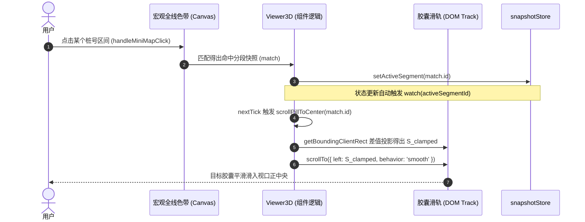

# 阶段4-专题-3D分段选区MiniMap联动居中与分段总览TXT导出架构方案

## 1. 目标与背景 (Objectives & Background)

### 1.1 业务背景与痛点诊断

在隧道工程多维协同智能排水自适应平台中，3D 视口顶部集成了“宏观全线安全热力色带 (Mini-map) + 微观分段水平胶囊流 (Pill Slider)”的双层选区控制器。当前在实际工程交互中暴露出两个核心缺陷：

1. **宏微联动失步（MiniMap 选中后胶囊未能居中滚动）**：
   - 用户在宏观 `minimap-wrapper`（Canvas 色带）上点击某一桩号分段时，3D 视口相机可飞行动画对齐、高亮线框亦能同步，但下方微观滑轨（`pill-slider-track`）内的对应工况胶囊（`.segment-pill`）并未同步平滑滚动至视口水平中心位置。
   - 当加载数十至上百个分段时，选中的胶囊往往隐匿在视口滚动条之外（Off-screen），导致宏观点击与微观视觉反馈割裂，降低了工况核查效率。
2. **分区总览缺乏轻量化文本导出手段（缺失 TXT 成果清单下载）**：
   - 顶部虽然展示了“📌 分区总览 (共 N 段 | 危险/预警/安全统计)”，但工程技术人员在日常踏勘、汇报会商或第三方验算比对时，急需一种无需依赖复杂 PDF/Word 渲染引擎、即点即得的轻量级 ASCII/UTF-8 纯文本（TXT）总览清单。
   - 导出的核心指标必须精准覆盖：**分区编号**、**里程桩号范围**、**分区安全系数 $F_s$** 以及 **分区临界注浆圈厚度 $t_g^{crit}$（若无则为 0）**。

```mermaid
flowchart TB
    subgraph UserAction [用户交互触发源]
        MClick[用户点击 Mini-map 全线色带]
        PClick[用户点击 Pill 胶囊]
        ExtSelect[外部侧边栏 / 3D点击选中]
        ExportClick[点击 📄 导出总览TXT 按钮]
    end

    subgraph SyncCore [选区联动与居中控制器 (Viewer3D.vue)]
        ActiveState[更新 activeSegmentId]
        CalcOffset[计算 targetScrollLeft 居中位移]
        SmoothScroll[调用 track.scrollTo 动画居中]
        CameraFly[相机平滑飞向该分段]
    end

    subgraph TxtEngine [分段总览 TXT 结构化导出引擎]
        ExtractLoop[遍历 renderedSegments 快照数组]
        ParamNormalize[提取: 桩号 / Fs / tg_crit(缺省降级为0)]
        FormatTable[Monospace 等宽字符排版 + UTF-8 BOM]
        BlobDownload[浏览器原生零开销 Blob 触发下载]
    end

    MClick --> ActiveState
    PClick --> ActiveState
    ExtSelect --> ActiveState
    ActiveState --> CalcOffset
    CalcOffset --> SmoothScroll
    ActiveState --> CameraFly

    ExportClick --> ExtractLoop
    ExtractLoop --> ParamNormalize
    ParamNormalize --> FormatTable
    FormatTable --> BlobDownload
```

---

## 2. 约束边界与设计准则 (Constraints & Engineering Floor)

1. **Scope Preservation (范围约束)**：
   - 仅对 `Viewer3D.vue` 的选区栏头部工具区与滚动胶囊轨道进行增量优化，不侵入改动 3D 核心渲染管线（`TunnelGenerator.ts`、`Reinforcement.ts`）与 Pinia 底层逻辑。
2. **UI & Typography Readability Floor (字阶生理底线硬约束)**：
   - 新增的“📄 导出总览TXT”按钮及所有文字排版严格遵守 $\text{font-size} \ge 12\text{px}$，避免视觉挤压，采用 Flex 弹性流与 Glassmorphism 设计变量。
3. **Deterministic Scroll Offset (绝对安全的无抖动居中算法)**：
   - 放弃可能触发整页垂直异常跳动的原生 `scrollIntoView()`，采用精准限定在容器内部的 `offsetLeft` 差值投影数学模型，执行严格边界约束 $[0, \text{scrollWidth} - \text{clientWidth}]$。
4. **Data Fallback & Zero-Overhead Export (数据安全与纯前端零开销导出)**：
   - 临界注浆圈厚度必须遵循工程契约：当不存在临界超限加固解或 $t_g^{crit} \le 0$ 时，输出严格归一化为 `0.00`。
   - TXT 导出全流程由前端 `Blob + URL.createObjectURL` 瞬时闭环完成，无需额外后端 API 往返与网络开销；添加 `\uFEFF` UTF-8 BOM 标记，杜绝 Windows 记事本与 Excel 打开中文乱码。

---

## 3. 架构设计与数学实现模型 (Architecture & Mathematical Models)

### 3.1 MiniMap 点击与微观胶囊精准水平居中数学模型

设微观胶囊滑轨容器 DOM 为 $T$ (`pillTrackRef.value`)，当前激活的分段胶囊 DOM 为 $E$（包含属性 `data-segment-id="snap.id"`）：

$$w_T = T.\text{clientWidth} \quad (\text{容器视口可见宽度})$$
$$W_{\text{total}} = T.\text{scrollWidth} \quad (\text{滑轨全量内容物理宽度})$$

为彻底消除由于祖先容器定位层级（`offsetParent`）导致的坐标偏移与中间元素抖动，通过视口绝对包围盒映射目标胶囊在滑轨内容中的实际绝对物理位移 $x_E$：

$$x_E = E.\text{getBoundingClientRect}().\text{left} - T.\text{getBoundingClientRect}().\text{left} + T.\text{scrollLeft}$$
$$w_E = E.\text{offsetWidth} \quad (\text{目标胶囊本身的物理渲染宽度})$$

为了使胶囊几何中心 $x_E + \frac{w_E}{2}$ 精确对齐到滑轨视口中心 $\frac{w_T}{2}$，理想的目标滚动偏移量 $S_{\text{target}}$ 为：

$$S_{\text{target}} = x_E - \frac{w_T - w_E}{2}$$

结合滚动物理边界，定义最终执行的防抖平滑滚动函数：

$$S_{\text{clamped}} = \max\left(0, \min\left(W_{\text{total}} - w_T, S_{\text{target}}\right)\right)$$



#### 边界防御处理：
- **不聚焦/全线概览态**：当取消选中进入全线概览时，目标对准 `.all-overview-pill`，直接滚动归零至最左端（$S = 0$）。
- **坐标系无关投影（BoundingRect）**：采用 `getBoundingClientRect` 计算差值并叠加当前 `scrollLeft`，彻底解耦 CSS `position` 与 `offsetParent`，免疫按钮、padding 或层级漂移。
- **搜索过滤冲突防护**：当 MiniMap 点击分段若当前处于关键字过滤隐藏状态时，优先重置 `selectorSearch = ''`，保证目标胶囊挂载并完成居中。
- **时序收敛与防抖**：居中滚动由响应式 `watch(activeSegmentId)` 与 `watch(isSelectorCollapsed)` 统一收敛调度，杜绝在各个业务函数中散落重复触发造成动画抢占。

---

### 3.2 计算分段成果总览 TXT 导出架构与排版规约

#### 3.2.1 数据提取映射矩阵

针对传入的 `renderedSegments.value` 快照集合，按如下契约统一提取与清洗：

| 输出字段 | 变量来源 | 降级容错机制 | 格式化表达范例 |
| :--- | :--- | :--- | :--- |
| **序号** | `index + 1` | 自然数升序 | `1`, `2`, `10` |
| **分区编号** | `#${index + 1}` + `snap.remark` | 若无备注则仅输出编号 | `#1 (洞口浅埋段)` |
| **里程起点** | `extractSnapshotValue(snap, 'start_chainage', 0)` | 缺省为 0 | `K0+000` (`formatChain`) |
| **里程终点** | `extractSnapshotValue(snap, 'end_chainage', 50)` | 缺省为 50 | `K0+050` (`formatChain`) |
| **分段长度** | $\| \text{end} - \text{start} \|$ | 浮点数四舍五入 | `50.00 m` |
| **分区安全系数** | `snap.results?.original_state?.safety_factor ?? snap.results?.critical_state?.final_safety_factor` | 若未解算则输出 `--` | `2.35` / `0.92 (超限)` |
| **临界注浆厚度** | `snap.results?.critical_state?.tg_crit ?? extractSnapshotValue(snap, 'tg_crit', 0)` | **若无或负值强制为 0** | `0.00 m` / `0.85 m` |
| **加固状态标签** | 由 $F_s$ 与 $t_g^{crit}$ 联合判定 | 自适应评级 | `安全无需加固` / `已临界加固` |

#### 3.2.2 导出文本模板规范 (Monospace Formatted ASCII Text)

导出的 `.txt` 文件遵循行业技术备忘录标准排版：

```text
================================================================================
           隧道工程多维协同智能排水自适应平台 - 计算分段成果总览清单
================================================================================
项目名称: 隧道工程全线防排水协同优化计算
导出时间: 2026-10-25 22:30:15
统计总览: 共 5 个计算分段 | 全线总长: 0.25 km | 状态分布: 🔴超限: 1 段, 🟡预警: 2 段, 🟢合规: 2 段
================================================================================
序号  分区编号   里程起点      里程终点      段长(m)  安全系数(Fs)  临界注浆厚度(m)  加固评价
--------------------------------------------------------------------------------
1     #1         K0+000        K0+050        50.00    0.85 (超限)   0.75             临界注浆加固
2     #2         K0+050        K0+100        50.00    1.42 (预警)   0.30             轻度注浆补强
3     #3         K0+100        K0+150        50.00    2.35 (安全)   0.00             安全合格无需加固
4     #4         K0+150        K0+200        50.00    3.10 (安全)   0.00             安全合格无需加固
5     #5         K0+200        K0+250        50.00    -- (未计算)   0.00             待计算
--------------------------------------------------------------------------------
说明:
1. 里程桩号遵循隧道工程标段标准格式 (K+m)；
2. 分区安全系数 Fs 依据极限受力承载力模型计算，基准安全限值通常为 2.0；
3. 分区临界注浆圈厚度 tg_crit 为将截面安全系数补强至设计目标所需之最小加固圈几何厚度；若原工况已满足安全要求或无超限状态，则标注为 0.00m。
================================================================================
```

---

## 4. 实施工作分解结构 (WBS & Code Modification Plan)

### 4.1 变更文件与范围

主要影响前端单文件：
- [`Viewer3D.vue`](file:///d:/offices/Github/隧道工程多维协同智能排水自适应平台/tunnel-drainage-platform/frontend/src/components/three/Viewer3D.vue)

### 4.2 任务清单与代码级改动计划

#### Task 1: 胶囊滑轨 DOM 属性绑定与居中滚动逻辑实现
- **修改位置**：`Viewer3D.vue` 模板与脚本逻辑
- **实现细节**：
  1. 给 `.all-overview-pill` 绑定 `:data-segment-id="'overview'"`。
  2. 给 `v-for="snap in filteredSelectorSegments"` 的 `.segment-pill` 绑定 `:data-segment-id="snap.id"`。
  3. 新增基于视口绝对包围盒映射的居中定位核心函数：
     ```ts
     const scrollPillToCenter = (snapId?: string | null) => {
       nextTick(() => {
         if (!pillTrackRef.value || isSelectorCollapsed.value) return;
         const track = pillTrackRef.value;
         const selector = snapId ? `[data-segment-id="${snapId}"]` : `[data-segment-id="overview"]`;
         const targetEl = track.querySelector<HTMLElement>(selector);

         if (targetEl) {
           const trackRect = track.getBoundingClientRect();
           const targetRect = targetEl.getBoundingClientRect();
           // 绝对消除 offsetParent 依赖，精准获取相对滚动物理位置
           const relLeft = targetRect.left - trackRect.left + track.scrollLeft;
           const targetScroll = relLeft - (track.clientWidth - targetEl.offsetWidth) / 2;
           const maxScroll = Math.max(0, track.scrollWidth - track.clientWidth);

           track.scrollTo({
             left: Math.max(0, Math.min(maxScroll, targetScroll)),
             behavior: 'smooth'
           });
         }
       });
     };
     ```
  4. 响应式事件统一收敛调度：
     ```ts
     // 集中式监听，避免在业务函数中重复散落调用
     watch(() => snapshotStore.activeSegmentId, (newId) => {
       scrollPillToCenter(newId);
     });

     // 监听选区栏折叠还原，展开时自动补齐居中
     watch(isSelectorCollapsed, (collapsed) => {
       if (!collapsed) {
         scrollPillToCenter(snapshotStore.activeSegmentId);
       }
     });
     ```
  5. 在 `handleMiniMapClick` 中增设搜索脱敏防御：若当前 `selectorSearch` 处于过滤状态，选中前自动清空 `selectorSearch = ''`，保证目标胶囊在 DOM 中正常挂载。

#### Task 2: 顶部选区控制器集成“📄 导出总览TXT”按钮
- **修改位置**：`Viewer3D.vue` 的 `<div class="header-right">` 区域
- **UI 呈现**：
  ```html
  <!-- 分段总览 TXT 导出按钮 -->
  <button 
    class="export-txt-btn" 
    @click.stop="exportSegmentOverviewTxt"
    title="导出当前全线各分段安全系数与临界注浆厚度总览清单 (TXT纯文本格式)"
  >
    📄 导出总览TXT
  </button>
  ```
- **CSS 样式规范（严格遵守 $\ge 12\text{px}$）**：
  ```css
  .export-txt-btn {
    display: inline-flex;
    align-items: center;
    gap: 4px;
    padding: 3px 10px;
    border-radius: 6px;
    border: 1px solid rgba(56, 189, 248, 0.4);
    background: rgba(56, 189, 248, 0.12);
    color: #38bdf8;
    font-size: 12px;
    font-weight: 500;
    cursor: pointer;
    transition: all 0.2s ease;
    white-space: nowrap;
    user-select: none;
  }
  .export-txt-btn:hover {
    background: rgba(56, 189, 248, 0.25);
    border-color: #38bdf8;
    color: #ffffff;
    box-shadow: 0 0 10px rgba(56, 189, 248, 0.3);
  }
  ```

#### Task 3: 纯前端分段总览 TXT 生成与下载闭环
- **逻辑实现**：
  ```ts
  // CJK 全角/半角字符视觉宽度自适应函数
  function getVisualWidth(str: string): number {
    let w = 0;
    for (let i = 0; i < str.length; i++) {
      w += str.charCodeAt(i) > 127 ? 2 : 1;
    }
    return w;
  }

  function padCol(str: string, targetWidth: number): string {
    const currentW = getVisualWidth(str);
    const padLen = Math.max(0, targetWidth - currentW);
    return str + ' '.repeat(padLen);
  }

  const exportSegmentOverviewTxt = () => {
    const list = renderedSegments.value;
    if (!list || list.length === 0) {
      ElMessage.warning('当前无可导出的分段数据');
      return;
    }

    const now = new Date();
    const timeStr = `${now.getFullYear()}-${String(now.getMonth()+1).padStart(2,'0')}-${String(now.getDate()).padStart(2,'0')} ${String(now.getHours()).padStart(2,'0')}:${String(now.getMinutes()).padStart(2,'0')}:${String(now.getSeconds()).padStart(2,'0')}`;
    
    // 统计各状态数量
    const totalCount = list.length;
    let dangerCount = 0;
    let warningCount = 0;
    let safeCount = 0;
    let uncalcCount = 0;
    let totalLenM = 0;

    list.forEach(s => {
      const fs = snapFs(s);
      if (fs != null) {
        if (fs < 1.0) dangerCount++;
        else if (fs < 2.0) warningCount++;
        else safeCount++;
      } else {
        uncalcCount++;
      }
      const start = extractSnapshotValue(s, 'start_chainage', 0);
      const end = extractSnapshotValue(s, 'end_chainage', 50);
      totalLenM += Math.abs(end - start);
    });

    const lines: string[] = [];
    lines.push('='.repeat(96));
    lines.push('           隧道工程多维协同智能排水自适应平台 - 计算分段成果总览清单');
    lines.push('='.repeat(96));
    lines.push(`导出时间: ${timeStr}`);
    lines.push(`统计总览: 共 ${totalCount} 个分段 | 贯通总长: ${(totalLenM/1000).toFixed(2)} km | 状态: 🔴超限: ${dangerCount} 段, 🟡预警: ${warningCount} 段, 🟢合规: ${safeCount} 段${uncalcCount > 0 ? `, ⚪待计算: ${uncalcCount} 段` : ''}`);
    lines.push('='.repeat(96));
    lines.push(padCol('序号', 6) + padCol('分区编号', 16) + padCol('里程起点', 14) + padCol('里程终点', 14) + padCol('段长(m)', 10) + padCol('安全系数(Fs)', 14) + padCol('临界注浆厚度(m)', 16) + '工况备注/加固评价');
    lines.push('-'.repeat(96));

    list.forEach((snap, idx) => {
      const segIdx = `#${idx + 1}`;
      const start = extractSnapshotValue(snap, 'start_chainage', 0);
      const end = extractSnapshotValue(snap, 'end_chainage', 50);
      const segLen = Math.abs(end - start).toFixed(2);
      const startStr = `K${formatChain(start)}`;
      const endStr = `K${formatChain(end)}`;
      
      const fs = snapFs(snap);
      let fsStr = '--';
      let evalTag = '未计算';
      if (fs != null) {
        fsStr = fs.toFixed(2);
        if (fs < 1.0) evalTag = '🔴 极度危险/超限';
        else if (fs < 2.0) evalTag = '🟡 临界预警';
        else evalTag = '🟢 安全合规';
      }

      // 临界注浆圈厚度：若无则为0
      const tgCrit = snap.results?.critical_state?.tg_crit ?? extractSnapshotValue(snap, 'tg_crit', 0);
      const tgCritNum = (typeof tgCrit === 'number' && !isNaN(tgCrit)) ? Math.max(0, tgCrit) : 0;
      const tgCritStr = tgCritNum > 0 ? tgCritNum.toFixed(2) : '0.00';

      const remark = snap.remark ? `[${snap.remark}] ${evalTag}` : evalTag;

      lines.push(
        padCol(String(idx + 1), 6) +
        padCol(segIdx, 16) +
        padCol(startStr, 14) +
        padCol(endStr, 14) +
        padCol(segLen, 10) +
        padCol(fsStr, 14) +
        padCol(tgCritStr, 16) +
        remark
      );
    });

    lines.push('='.repeat(96));
    lines.push('说明:');
    lines.push('1. 里程桩号遵循标准隧道标段格式 (K+m)；');
    lines.push('2. 分区安全系数 Fs 依据极限承载力方程计算得出；');
    lines.push('3. 分区临界注浆圈厚度为满足既定目标抗浮/承载所需之最小厚度，若原截面已合规则标注为 0.00m。');
    lines.push('='.repeat(96));

    const content = '\uFEFF' + lines.join('\r\n');
    const blob = new Blob([content], { type: 'text/plain;charset=utf-8' });
    const url = URL.createObjectURL(blob);
    const link = document.createElement('a');
    link.href = url;
    link.download = `隧道工程计算分段成果总览_${timeStr.replace(/[: ]/g, '_')}.txt`;
    document.body.appendChild(link);
    link.click();
    document.body.removeChild(link);
    URL.revokeObjectURL(url);
  };
  ```

---

## 5. 验证体系与验收门禁 (Verification Plan)

### 5.1 验收标准 (Acceptance Criteria)

| 门禁项 | 验证条件 | 预期判定 |
| :--- | :--- | :--- |
| **G1: MiniMap 点击居中** | 在 Mini-map Canvas 上点击第 1 段、中间段、最后一段 | 对应的 `.segment-pill` 立即以平滑动画横向滚动至视口正中间，高亮外框激活 |
| **G2: 全线概览复位** | 点击“全线概览 (不聚焦)”胶囊或取消选中 | 胶囊滑轨平滑滚动回第 1 位的 `all-overview-pill`，居左对齐 |
| **G3: 按钮样式与字阶合规** | 检查“📄 导出总览TXT”的 CSS 渲染与布局 | `font-size: 12px` 严格达标，符合赛博/影棚高对比度毛玻璃主题 |
| **G4: TXT 内容完整性** | 点击下载生成的 `.txt` 文件并在记事本/VS Code 打开 | 无乱码（UTF-8 BOM 正确），表头完整对齐，各行准确展示：分区编号、桩号、Fs、tg_crit（无临界解时显式输出 `0.00`） |
| **G5: 边界与异常防御** | 列表为空、或分段无结果数据（未运行计算时） | 导出不会抛出运行时错误，Fs 正确降级为 `--`，tg_crit 降级为 `0.00` |

### 5.2 实施步骤顺序
1. **阶段 1**：在 `Viewer3D.vue` 模板添加 `:data-segment-id` 标记，编写 `scrollPillToCenter` 并在所有选中触发点挂载。
2. **阶段 2**：在顶部选区栏操作区添加 `export-txt-btn` 及其样式。
3. **阶段 3**：实现等宽字符串排版 `padCol` 辅助函数与 `exportSegmentOverviewTxt` 导出函数。
4. **阶段 4**：本地 Vite 预览测试与跨视口宽度回归验证。
