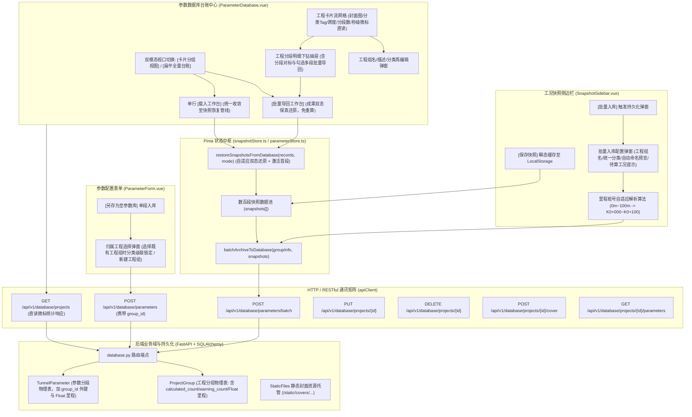

# 阶段4-专题-快照批量入库与参数工程分组卡片化架构方案

## Goal Description

### 1. 核心业务痛点与目标分解 (Objectives)

在隧道工程多维协同智能排水自适应平台中，计算分析贯穿了“单段敏感性试算”到“全线百段工程化贯通分析”。当面临真实隧道工程（如晏家隧道、中梁山隧道等，通常包含 100~500 个独立计算分段）的批量计算与成果归档时，现存的前端快照侧边栏（[SnapshotSidebar.vue](file:///d:/offices/Github/隧道工程多维协同智能排水自适应平台/tunnel-drainage-platform/frontend/src/components/ui/SnapshotSidebar.vue)）、参数表单（[ParameterForm.vue](file:///d:/offices/Github/隧道工程多维协同智能排水自适应平台/tunnel-drainage-platform/frontend/src/components/ui/ParameterForm.vue)）与参数数据库台账管理中心（[ParameterDatabase.vue](file:///d:/offices/Github/隧道工程多维协同智能排水自适应平台/tunnel-drainage-platform/frontend/src/views/ParameterDatabase.vue)）面临严重的工程断层与交互瓶颈：

```
+---------------------------------------------------------------------------------------------------+
|                                       现实工程痛点全景图                                            |
+---------------------------------------------------------------------------------------------------+
|  [数百段批量计算完成]                                                                               |
|       │                                                                                           |
|       ▼                                                                                           |
|  [痛点 1: 侧边栏与表单入库逻辑割裂且未聚合]                                                          |
|  侧边栏 [保存快照] 仅写前端 LocalStorage，未存入数据库；表单底部的 [另存为至参数库] 仅支持单条扁平存储，    |
|  缺乏统一工程项目聚合，且两者在“工程分类”上缺乏协同（侧边栏无分类，表单分类未关联分组）                    |
|       │                                                                                           |
|       ▼                                                                                           |
|  [痛点 2: 分段命名规则混乱无序]                                                                    |
|  缺乏里程自动序列化推导，数百个分段需要人工录入 "K0+000~K0+100"，极易错漏重叠                           |
|       │                                                                                           |
|       ▼                                                                                           |
|  [痛点 3: 参数数据库单表扁平淹没]                                                                  |
|  数据库仅有单一扁平 el-table，存入数百条分段后表格瞬间被淹没，无法按工程聚合，无法形成项目资产池           |
|       │                                                                                           |
|       ▼                                                                                           |
|  [痛点 4: 数据库历史快照回载成果丢失与状态割裂]                                                     |
|  当前载入工作台仅能单行覆写表单，不支持勾选多项批量导回；导回时不进快照池，或强行覆盖成果导致待算状态异常  |
|       │                                                                                           |
|       ▼                                                                                           |
|  [痛点 5: 缺失工程元数据与封面形象]                                                                |
|  无法编辑工程描述、无工程图片/实景渲染图，缺乏现代工程资产的卡片化美观呈现与快速归档管理能力             |
+---------------------------------------------------------------------------------------------------+
```

针对上述工程痛点，本专题方案规划实现以下四大核心系统目标：

1. **快照侧边栏支持“百段批量入库、统一工程分类与里程智能命名” (Batch Snapshot Archival & Auto-Naming)**：
   - 在 [SnapshotSidebar.vue](file:///d:/offices/Github/隧道工程多维协同智能排水自适应平台/tunnel-drainage-platform/frontend/src/components/ui/SnapshotSidebar.vue) 顶部操作栏与批量浮动栏中引入“批量入库”能力。
   - 用户只需定义统一工程名（如“晏家隧道”）并批量指定**工程分类**（公路/铁路/城市道路/城市轨道/水工/综合管廊/其他），系统自动依照各分段起讫里程（如 $0\text{m}\sim 100\text{m}$ 自动格式化为 `K0+000~K0+100`）执行批量规则命名，将数百个计算段与对应完整计算成果一次性打包提交至后端事务持久化。
   - 彻底梳理双层快照生命周期：明确 [SnapshotSidebar.vue](file:///d:/offices/Github/隧道工程多维协同智能排水自适应平台/tunnel-drainage-platform/frontend/src/components/ui/SnapshotSidebar.vue) 中 `[保存快照]`（工作区瞬态缓存）与 `[批量入库]`（数据库永久持久化）的职责边界；重构 [ParameterForm.vue](file:///d:/offices/Github/隧道工程多维协同智能排水自适应平台/tunnel-drainage-platform/frontend/src/components/ui/ParameterForm.vue) 单段存储弹窗，使其支持选择归属工程组，消除孤儿记录。
2. **参数数据库重构为“工程分组卡片化与分段下钻体系” (Project Grouped Card Grid & Drilldown)**：
   - 彻底打破 [ParameterDatabase.vue](file:///d:/offices/Github/隧道工程多维协同智能排水自适应平台/tunnel-drainage-platform/frontend/src/views/ParameterDatabase.vue) 现有的单一扁平表格架构，构建现代卡片式工程网格（Project Cards Grid）。
   - 每个卡片代表一个独立隧道工程资产，直观展示工程封面图、工程名、工程分类、分段总数、里程起讫跨度（如 `K0+000 ~ K15+600 [15.6km]`）、安全受力状态统计与更新时间。
3. **支持多段勾选自适应双态保真批量导回工作台 (Adaptive Dual-State Batch Restore)**：
   - 在工程卡片分段明细抽屉（Drilldown Drawer）与扁平全量台账中，**均支持勾选 $\ge 1$ 项分段直接点击“批量载入工作台”**，同时在卡片上支持“整组一键载入工作台”；并将原扁平表格中的单段 `[载入工作台]` 全面统一收敛至快照恢复管线。
   - **成果双态自适应与保真还原 (Dual-State Preservation)**：
     - **带计算成果分段**：完整保留 `results_json` 反序列化成果（包含涌水量 $Q$、临界孔径、盲管间距、安全系数 $F_s$ 等），直接标记状态为 **`status: 'done'`**，**绝不降级重置**；回载后 3D 视口立即呈现加固圈变径与受力应力着色，支持一键导出计算书与施工图。
     - **纯计算参数分段 (results_json 为空/None)**：无论是存量种子示范段还是用户未计算直接保存的纯参数记录，导回工作台时**完整在快照池中生成工况快照**，状态显式标记为 **`status: 'pending'` (待算)**，保留全部 38/40 项几何与水文地质参数，在侧边栏高亮常驻并点亮“批量计算”或“单段计算”；3D 视口以工程中性灰蓝自适应渲染物理几何轮廓。
     - **下游报告导出安全门禁**：对于 `status === 'pending'` 的待算分段，工作台与侧边栏**严格置灰并拦截“导出计算书”与“导出施工图”**，弹出友好引导提示“该分段尚未完成水力与结构计算，请先执行计算”，彻底杜绝因缺失涌水量 $Q$、临界管径等核心指标引发计算书引擎未捕获空指针崩溃。
     - **单段与批量载入行为统一**：点击单段 `[载入工作台]` 时，同样在快照池中注入该快照（纯参数为 `pending`，带成果为 `done`），并自动将其激活为当前表单活动工况（`paramStore.overrideAll`），消除以往单条只改表单、批量只改快照的交互割裂。
4. **工程组元数据动态编辑与多媒体封面管理 (Project Metadata & Cover Asset Management)**：
   - 支持对工程组进行全生命周期管理，提供“编辑工程信息”模态弹窗，可随时重命名“工程组名”、更新“工程分类”、录入多行“工程描述（可选，记录地质水文特点与工程概况）”。
   - 支持工程封面图片（Cover Image）的上传、预览与删除，支持本地图片文件上传至后端持久化托管，并支持将当前 3D 视口画布一键截屏作为工程封面，大幅提升工程资产数字化展示质感。

---

### 2. 约束条件与硬性边界 (Constraints & Hard Boundaries)

- **UI & Typography 绝对生理底线约束**：
  - 严格遵守全局工程规范：所有渲染文字 $\text{font-size} \ge 12\text{px}$（或 $\ge 0.75\text{rem}$），严禁在 CSS 或内联样式中使用任何 $< 12\text{px}$ 的硬编码（包括卡片标签、微标、辅助文本、单位标注等）。
  - 遇到卡片空间拥挤时，必须采用文本截断（`text-overflow: ellipsis` + `el-tooltip` 浮层提示）、徽标聚合或自适应网格折行等空间代偿手段，严禁使用 `transform: scale(<1.0)` 恶意缩小字体。
- **字段命名解耦与类型契约安全 (`tunnel_type` 消除二义性)**：
  - 计算引擎与表单中：`parameters_json.tunnel_type` 严格代表几何计算断面的**单双洞模型**（`'single' | 'double'`）；
  - 数据库工程层级中：`ProjectGroup.tunnel_type` 与 `TunnelParameter.tunnel_type` 严格代表**交通/行业工程分类**（`'公路' | '铁路' | '城市道路' | '城市轨道' | '水工' | '综合管廊' | '其他'`）；
  - 在前端 Pinia 状态树与后端 DTO 传输层中，统一采用 `engineering_category` 作为工程分类显式别名，严禁在批量入库时将几何断面的 `'single'` 错填入工程分类。
- **里程字段浮点精度契约 (Chainage Float Precision Floor)**：
  - 真实隧道工程里程常出现浮点数（如晏家隧道 $47.0\text{m}$、加固过渡段 $125.5\text{m}$ 或桩号 `K1+250.5`）。数据库物理列（`start_chainage`、`end_chainage`）与传输 DTO **必须统一声明为 `Float` 类型**，严禁使用 `Integer` 造成精度截断和 3D 相邻分段微小缝隙脱节。
- **成果双态自适应与导出安全守卫 (Dual-State Restoration & Export Safety Floor)**：
  - 数据库读写与快照状态流转必须完整平权兼容“纯计算参数工况”与“带计算成果工况”；
  - 纯参数分段回载为快照时严格赋 `status: 'pending'`，带成果分段赋 `status: 'done'`；
  - 未完成计算的分段严防向下游渗透：严禁在未计算状态下触发计算书和施工图导出，必须有前置校验门禁与阻断告警。
- **数据模型向下兼容与事务完整性 (Transaction & Backward Compatibility)**：
  - 数据库模型演进必须保持平滑：存量已有的 `tunnel_parameters` 记录通过外键迁移脚本无缝兼容（未指定组的归入系统内置“默认未分组工程”）。
  - 批量入库接口必须在单个数据库事务中执行。百段记录与结果的写入满足“要么全成功，要么全回滚”，防止产生断头分段脏数据。
  - 工程组写入支持覆盖/追加冲突策略控制（`mode: 'create_new' | 'append' | 'overwrite'`），防范同名 `group_name` 导致的物理主键冲突崩溃。
- **海量数据网络传输与二进制静态资源契约 (RFC & Platform Physical Contract)**：
  - 针对包含数百段计算结果（含大数组）的批量请求，后端必须支持轻量化分批写入，前端提交时对冗余的纯绘图点阵（如 echart 点阵）进行脱敏精简，单次批量提交报文体积控制在 5MB 以内。
  - 工程封面图片上传基于标准 RFC 7578（`multipart/form-data`），后端建立独立静态资源安全托管目录（`backend/data/uploads/covers/`），限制图片格式为 JPG/PNG/WebP，单张大小 $\le 5\text{MB}$，防范路径穿越（Path Traversal）安全漏洞。
- **Pinia 状态树与工作台联动闭环 (State Integrity & Instant 3D Reconstruction)**：
  - 批量保存操作不能破坏当前前端 [snapshotStore.ts](file:///d:/offices/Github/隧道工程多维协同智能排水自适应平台/tunnel-drainage-platform/frontend/src/store/snapshotStore.ts) 的本地运行态；
  - 从参数数据库“勾选批量载入”或“整组载入工作台”时，必须调用 `snapshotStore.restoreSnapshotsFromDatabase(records, { mode })`，自适应还原计算结果/待算状态，自动将首段设为当前活动工况同步回主表单，并自动触发 `trigger3DRefresh()`，实现 3D 全线隧道的即时重构。

---

## Proposed Changes

### 1. 架构与系统解构 (Architecture & System Decomposition)



---

### 2. 数据库与数据契约设计 (Database & API Contracts)

#### 2.1 物理数据库模型设计 ([backend/app/models/domain.py](file:///d:/offices/Github/隧道工程多维协同智能排水自适应平台/tunnel-drainage-platform/backend/app/models/domain.py))

为了保证工程分组与下属计算分段的严密关联，新建 `ProjectGroup` 实体，并在 `TunnelParameter` 中引入 `group_id` 外键关联与级联删除；增加卡片微标聚合统计缓存字段（`calculated_count`、`warning_count`），里程统一采用 `Float` 保证毫米级几何无损：

```python
# backend/app/models/domain.py
from datetime import datetime, timezone
from sqlalchemy import Column, Integer, Float, String, Text, DateTime, ForeignKey
from sqlalchemy.orm import declarative_base, relationship

Base = declarative_base()

class ProjectGroup(Base):
    """
    隧道工程分组物理表 (聚合真实隧道工程百级分段资产)
    """
    __tablename__ = "project_groups"

    id = Column(Integer, primary_key=True, autoincrement=True, comment="工程组主键 ID")
    group_name = Column(String(255), nullable=False, unique=True, index=True, comment="工程组名，如 '晏家隧道'")
    tunnel_type = Column(String(50), nullable=False, default="公路", comment="工程分类（公路/铁路/城市道路/城市轨道/水工/综合管廊/其他）")
    description = Column(Text, nullable=True, comment="工程详细描述/地质水文概况")
    cover_image_url = Column(String(500), nullable=True, comment="工程封面图相对路径或外部URL")
    
    # 里程统一声明为 Float，避免精度截断
    start_chainage = Column(Float, default=0.0, comment="全线起点里程(m)")
    end_chainage = Column(Float, default=0.0, comment="全线终点里程(m)")
    
    # 状态聚合统计缓存列 (支撑前端卡片秒级渲染，避免全量拉取反序列化造成雪崩)
    segment_count = Column(Integer, default=0, comment="包含的计算分段数量缓存")
    calculated_count = Column(Integer, default=0, comment="已完成计算的分段数量缓存 (status='done')")
    warning_count = Column(Integer, default=0, comment="处于预警/临界加固的分段数量缓存")
    
    created_at = Column(DateTime, default=lambda: datetime.now(timezone.utc), comment="创建时间戳")
    updated_at = Column(DateTime, default=lambda: datetime.now(timezone.utc), onupdate=lambda: datetime.now(timezone.utc), comment="最后更新时间")

    # 1:N 级联关系：删除工程组时自动级联删除其下的所有计算分段
    parameters = relationship("TunnelParameter", back_populates="group", cascade="all, delete-orphan", lazy="selectin")


class TunnelParameter(Base):
    """
    隧道输入参数与计算分段物理表 (平权支持纯参数工况与带成果工况)
    """
    __tablename__ = "tunnel_parameters"

    id = Column(Integer, primary_key=True, autoincrement=True, comment="主键 ID")
    group_id = Column(Integer, ForeignKey("project_groups.id", ondelete="CASCADE"), nullable=True, index=True, comment="所属工程组ID（为空表示默认未分组资产）")
    
    project_name = Column(String(255), nullable=False, index=True, comment="分段工程命名，如 '晏家隧道_K0+000~K0+100'")
    tunnel_type = Column(String(50), nullable=False, comment="工程分类（公路/铁路等，继承自所属工程组）")
    
    parameters_json = Column(Text, nullable=False, comment="参数字典序列化文本 (输入，内含单双洞 tunnel_type='single'|'double')")
    results_json = Column(Text, nullable=True, comment="计算结果序列化文本 (输出，纯参数工况为 None，包含 Q, 临界管径, 间距, 安全系数 Fs 等)")
    engine_version = Column(String(50), default="1.0.0", comment="计算核心引擎版本号")
    
    start_chainage = Column(Float, default=0.0, index=True, comment="该段起点里程(m)")
    end_chainage = Column(Float, default=0.0, index=True, comment="该段终点里程(m)")
    created_at = Column(DateTime, default=lambda: datetime.now(timezone.utc), comment="入库时间戳")

    group = relationship("ProjectGroup", back_populates="parameters")
```

#### 2.2 RESTful API 契约矩阵 ([backend/app/api/v1/endpoints/database.py](file:///d:/offices/Github/隧道工程多维协同智能排水自适应平台/tunnel-drainage-platform/backend/app/api/v1/endpoints/database.py))

```python
# backend/app/schemas/database.py
from pydantic import BaseModel, Field
from typing import List, Dict, Any, Literal
from datetime import datetime

class BatchSegmentItem(BaseModel):
    remark: str | None = Field(default=None, description="原始备注说明")
    start_chainage: float = Field(..., description="分段起点里程(m)")
    end_chainage: float = Field(..., description="分段终点里程(m)")
    parameters_json: Dict[str, Any] = Field(..., description="前端表单输入参数字典")
    results_json: Dict[str, Any] | None = Field(default=None, description="已完成的计算结果输出字典 (纯参数工况传入 None)")

class BatchArchiveRequest(BaseModel):
    group_name: str = Field(..., description="统一工程组名，如 '晏家隧道'")
    engineering_category: Literal["公路", "铁路", "城市道路", "城市轨道", "水工", "综合管廊", "其他"] = Field(
        default="公路", description="统一工程交通属性分类"
    )
    description: str | None = Field(default=None, description="工程概况与地质特征描述")
    naming_pattern: Literal["standard_station", "metric_range", "indexed_station"] = Field(
        default="standard_station", description="桩号自动命名规则模板"
    )
    conflict_mode: Literal["append", "overwrite", "create_new"] = Field(
        default="overwrite", description="若工程组重名时的处理策略"
    )
    segments: List[BatchSegmentItem] = Field(..., description="待入库的分段快照列表 (平权包含纯参数或带成果工况)")

class ParameterCreate(BaseModel):
    project_name: str = Field(..., description="分段工程命名")
    engineering_category: Literal["公路", "铁路", "城市道路", "城市轨道", "水工", "综合管廊", "其他"] = Field(default="公路")
    group_id: int | None = Field(default=None, description="关联既有工程组ID（可选）")
    parameters_json: Dict[str, Any]
    results_json: Dict[str, Any] | None = None

class ProjectGroupSummaryResponse(BaseModel):
    id: int
    group_name: str
    tunnel_type: str
    description: str | None = None
    cover_image_url: str | None = None
    start_chainage: float
    end_chainage: float
    segment_count: int
    calculated_count: int = Field(default=0, description="已完成计算分段数")
    warning_count: int = Field(default=0, description="预警分段数")
    created_at: datetime
    updated_at: datetime

    model_config = {"from_attributes": True}
```

| 端点方法与路径 | 请求体 / 参数 | 响应状态码 | 业务定义与原子操作 |
| :--- | :--- | :--- | :--- |
| `POST /database/parameters/batch` | `BatchArchiveRequest` | `201 Created` | **百段批量入库**：事务性创建/复用 `ProjectGroup`，为各分段批量填充统一 `engineering_category` 并按桩号命名，写入 `tunnel_parameters`，自动计算并更新 `start_chainage`、`end_chainage`、`segment_count`、`calculated_count`、`warning_count` |
| `POST /database/parameters` | `ParameterCreate` | `201 Created` | **单段入库兼容**：支持关联既有工程组或归入默认组，同步写入工程分类与参数，后端自动递增工程组的 `segment_count` 及 `calculated_count`（若含计算结果） |
| `GET /database/projects` | `searchQuery`, `tunnel_type`, `skip`, `limit` | `200 OK` | **获取工程组卡片列表**：返回所有工程组摘要信息（包含封面、分类Tag、分段总数、已算数 `calculated_count`、预警数 `warning_count`、里程跨度、最近更新时间，**无需逐条反序列化子段，实现极速响应**） |
| `GET /database/projects/{id}` | 路径参数 `id: int` | `200 OK` | **获取单工程组详情**：包含工程元数据及其名下全部分段完整参数与计算状态列表 |
| `PUT /database/projects/{id}` | `ProjectGroupUpdate` (组名、分类、描述) | `200 OK` | **再编辑工程信息**：支持修改组名、工程分类与描述信息，同步级联更新子分段命名前缀与分类 |
| `DELETE /database/projects/{id}` | 路径参数 `id: int` | `204 No Content` | **删除工程组**：级联彻底清理工程组实体与其名下数百条计算分段记录，物理删除本地孤立封面文件 |
| `POST /database/projects/{id}/cover` | `multipart/form-data; file: UploadFile` | `200 OK` | **上传工程封面图片**：验证图片 MIME 与尺寸，持久化至 `backend/data/uploads/covers/` 并更新路径 |
| `POST /database/projects/{id}/cover-base64` | `{"image_base64": "data:image/png;base64,..."}` | `200 OK` | **3D 视口画布截屏一键转封面**：将前端 `canvas.toDataURL()` 转化为 WebP/PNG 静态资产入库 |

---

### 3. 里程桩号自动解析与序列命名数学模型

当用户在快照侧边栏输入工程组名（例如：`晏家隧道`）并执行批量保存时，系统严禁要求用户手动逐个修改 300 个分段的名称。系统内置**工程标准里程桩号格式化推导器**：

#### 3.1 里程桩号推导公式

设定分段起点绝对里程为 $L_s \ (\text{单位: } \text{m})$，终点绝对里程为 $L_e \ (\text{单位: } \text{m})$：

$$
\text{Prefix} = \text{"K"}
$$
$$
\text{Kilometer}(L) = \lfloor L / 1000 \rfloor
$$
$$
\text{Meter}(L) = \text{round}(L \pmod{1000})
$$
$$
\text{FormatStation}(L) = \text{Prefix} + \text{Kilometer}(L) + \text{"+" } + \text{PadZero3}(\text{Meter}(L))
$$

例如：
- $L = 0 \implies \text{K0+000}$
- $L = 85 \implies \text{K0+085}$
- $L = 1250 \implies \text{K1+250}$
- $L = 20300 \implies \text{K20+300}$

#### 3.2 分段全自动命名模式表

提供 3 种规范化命名模板，默认推荐“模板 A”：

| 命名模板类型 | 格式化公式 | 晏家隧道 0m~100m 示例 | 适用场景 |
| :--- | :--- | :--- | :--- |
| **模板 A (标准工程桩号，推荐)** | `${GroupName}_${FormatStation(Ls)}~${FormatStation(Le)}` | `晏家隧道_K0+000~K0+100` | 国标公路/铁路勘察设计规范与交工文件 |
| **模板 B (米制区间紧凑型)** | `${GroupName} [${Ls}m~${Le}m]` | `晏家隧道 [0m~100m]` | 软件内部快速辨识与数字孪生 3D 标定 |
| **模板 C (带序号复合型)** | `${GroupName}_#${Index}_${FormatStation(Ls)}` | `晏家隧道_#01_K0+000` | 施工流水作业面与班组进度报表管理 |

---

### 4. 前端快照与表单生命周期重构

#### 4.1 快照双层生命周期规约 (L1 瞬态 vs L2 持久化)

| 生命周期层级 | 触发入口与组件 | 核心动作与技术行为 | 数据持久化介质 | 工程分类约束 |
| :--- | :--- | :--- | :--- | :--- |
| **L1 工作区瞬态快照** | [SnapshotSidebar.vue](file:///d:/offices/Github/隧道工程多维协同智能排水自适应平台/tunnel-drainage-platform/frontend/src/components/ui/SnapshotSidebar.vue) `[保存快照]` | 捕获当前表单参数与瞬态计算结果，仅推入 `snapshotStore.snapshots` 数组，用于试算比对与本地拼装。 | 内存 + 前端 `localStorage`（不请求后端） | 继承当前活动工程上下文，免填强制分类 |
| **L2 工程资产持久化** | 1. [SnapshotSidebar.vue](file:///d:/offices/Github/隧道工程多维协同智能排水自适应平台/tunnel-drainage-platform/frontend/src/components/ui/SnapshotSidebar.vue) `[批量入库]`<br>2. [ParameterForm.vue](file:///d:/offices/Github/隧道工程多维协同智能排水自适应平台/tunnel-drainage-platform/frontend/src/components/ui/ParameterForm.vue) `[另存为至参数库]` | 将已勾选或全量分段连同计算成果统一打包，事务性持久化至后端数据库物理表（平权支持纯参数或带成果工况）。 | 后端 SQLite/PostgreSQL (`project_groups`, `tunnel_parameters`) | **强制必选**：统一指定工程分类（公路/铁路/市政等） |

#### 4.2 快照侧边栏 ([SnapshotSidebar.vue](file:///d:/offices/Github/隧道工程多维协同智能排水自适应平台/tunnel-drainage-platform/frontend/src/components/ui/SnapshotSidebar.vue)) 升级细节

1. **顶部操作栏重构**：
   - 按钮组保持高识别度排布：`[刷新3D]`、`[批量计算]`、`[保存快照]` 以及新增的 **`[批量入库]`**（图标：`Upload` / `FolderAdd`，类型：`info` plain）。
   - 当侧边栏勾选了若干分段时，底部的批量浮动工具条（`.selected-floating-bar`）同步显现 `[已选 XX 项批量入库]`。
2. **“批量入库至工程数据库”交互弹窗 (Batch Archive Modal)**：
   - 弹窗采用居中沉浸式模态设计，包含：
     - **工程组名**（必填，`el-input`，支持下拉选择既有工程组实现覆盖/追加，或直接输入新工程组名）；
     - **工程分类**（必选，`el-select`：公路、铁路、城市道路、城市轨道、水工、综合管廊、其他，批量赋予所选全部快照）；
     - **工程描述**（选填，`el-input` type="textarea"，最多 500 字，支持填写地质围岩特征与设计工况备忘）；
     - **重名冲突策略**（单选：`覆盖更新已有分段 (Overwrite)` / `追加至该工程组 (Append)` / `重名新建独立副本 (Create New)`）；
     - **命名规则选择**（单选：`标准里程桩号 (K0+000~K0+100)` / `米制区间 [0m~100m]` / `带序号复合型`）；
     - **未计算工况入库自适应检测**：若勾选分段中包含 `status === 'pending'` 或计算失败的纯参数项，弹窗顶部友好展示提示条：`💡 提示：当前勾选包含 X 项未计算工况，将以纯参数记录入库，回载后可随时启动批量计算补齐结果`；
     - **自动命名实时映射预览列表**（展示前 5 项与最后 1 项的预览卡片，确保工程师所见即所得）；
     - **脱敏入库开关**（默认开启：自动剔除冗余的巨大图表点阵，仅保留物理水力学关键标量，确保百段极速入库）。

#### 4.3 参数表单 ([ParameterForm.vue](file:///d:/offices/Github/隧道工程多维协同智能排水自适应平台/tunnel-drainage-platform/frontend/src/components/ui/ParameterForm.vue)) 升级细节

- 重构 `[另存为至参数库]` 弹窗：在输入“分段工程命名”与选择“工程分类”的基础上，增加 **“归属工程项目组”**（可选下拉：选择既有工程组如“晏家隧道”，或选择“新建独立工程组”）。
- **工程分类级联锁定规则 (Category Cascade Lock)**：
  - 当用户在下拉框中选中既有工程组时，弹窗中的“工程分类”选择框**自动强制同步锁定为该工程组的分类且置为只读禁用（`disabled`）**，彻底避免单个分段与所属工程组出现分类二义性冲突；
  - 只有当用户选择“新建独立工程组”时，工程分类下拉框方可处于可交互选择状态。
- 提交时向 `POST /database/parameters` 传递 `group_id`，若当前表单尚未计算（`paramStore.currentResults == null`），`results_json` 正常传 `null`，确保单段纯参数入库也能在卡片化管理中心内正确归类，彻底消除孤儿断头数据。

---

### 5. 参数数据库 ([ParameterDatabase.vue](file:///d:/offices/Github/隧道工程多维协同智能排水自适应平台/tunnel-drainage-platform/frontend/src/views/ParameterDatabase.vue)) 核心重构与成果保真回载

#### 5.1 双模态视口架构 (Dual-Mode View Switcher)

在顶部工具栏引入分段控制器（`el-radio-group`）：
- **`[工程分组卡片视图]` (默认聚焦态)**：按工程项目聚合，展示美观卡片流，适合宏观工程资产管理、对标与一键整组载入。
- **`[扁平全量台账明细]`**：保留原有高密度表格（增强工程组名称列、工程分类Tag与勾选批量载入），适合跨工程自由筛选与多条件组合检索。

#### 5.2 现代卡片式工程网格设计 (Project Card Anatomy)

每个工程卡片采用 CSS Grid 弹性响应式排版（最小宽度 `320px`，支持 1920 高清大屏与 1366 紧凑屏自适应 2~4 列）：

```
+--------------------------------------------------------------------------+
|  +--------------------------------------------------------------------+  |
|  | [封面区] 工程封面图片 / 默认3D渲染矢量骨架图 (高度 140px, 锁定比例)      |  |
|  |  +--------------------+                    +--------------------+  |  |
|  |  | [分类: 公路] (Tag) |                    | [分段: 168段] (Pill)|  |  |
|  |  +--------------------+                    +--------------------+  |  |
|  +--------------------------------------------------------------------+  |
|  [工程组名] 晏家隧道工程全线优化方案                                        |
|  [里程跨度] 桩号: K0+000 ~ K16+800 | 跨度: 16.8 km                       |
|  [工程描述] 穿越溶洞强富水灰岩地层，全线采用环纵盲管自适应排泄间距控制...       |
|  ----------------------------------------------------------------------  |
|  [状态微标] 已算: 168段 (100%) | 待算: 0段 | 预警段: 3段                  |
|  [时间戳] 2026-10-24 23:30 (更新)                                        |
|  ----------------------------------------------------------------------  |
|  [操作栏]:                                                               |
|  [整组载入工作台] (Primary) | [管理分段] (Plain) | [编辑] (Icon) | [删除] (Red)  |
+--------------------------------------------------------------------------+
```

> **性能保障说明**：状态微标的统计数据（`已算: X段 / 待算: Y段 / 预警: Z段`）直接从后端 `ProjectGroupSummaryResponse` 的物理统计列（`calculated_count`、`warning_count`、`segment_count`）秒级渲染，待算段数直接计算为 `segment_count - calculated_count`，无需在列表查询时对数百段 `parameters_json` / `results_json` 逐一做 JSON 反序列化，彻底杜绝数据量增大时的网络和渲染雪崩。

#### 5.3 勾选多段批量导回工作台（成果自适应双态闭环）

针对“兼容纯参数记录与带成果记录、免除重复计算、待算工况自动归入快照池”的核心诉求，系统在 Pinia 与 UI 层建立**成果自适应双态载入与下游导出安全闭环机制**：

##### 5.3.1 Pinia 状态还原逻辑 (`snapshotStore.restoreSnapshotsFromDatabase`)

```typescript
// frontend/src/store/snapshotStore.ts
export const useSnapshotStore = defineStore('snapshot', {
  // ...
  actions: {
    /**
     * 从数据库记录批量反序列化并自适应还原快照池
     * 关键要求：
     * 1. 自动识别纯计算参数（results_json 为空）与带成果工况，分别赋予 'pending' 与 'done'；
     * 2. 还原后自动激活首个分段同步至表单，实现视口与配置即时响应；
     * 3. 触发 3D 重新组装渲染。
     */
    restoreSnapshotsFromDatabase(dbRecords: any[], options: { mode: 'replace' | 'append' } = { mode: 'replace' }) {
      if (!dbRecords || dbRecords.length === 0) return;

      const restoredSnapshots: Snapshot[] = dbRecords.map(rec => {
        const parsedParams = typeof rec.parameters_json === 'string' 
          ? JSON.parse(rec.parameters_json) 
          : rec.parameters_json;
        const parsedResults = rec.results_json 
          ? (typeof rec.results_json === 'string' ? JSON.parse(rec.results_json) : rec.results_json) 
          : null;
        
        // 核心判定：是否包含有效的水力学或临界加固计算成果
        const hasResults = Boolean(parsedResults && (parsedResults.original_state || parsedResults.critical_state));

        return {
          id: `snap_db_${rec.id}`,
          timestamp: new Date(rec.created_at).getTime(),
          remark: rec.project_name,
          start_chainage: rec.start_chainage ?? parsedParams.start_chainage ?? 0.0,
          end_chainage: rec.end_chainage ?? parsedParams.end_chainage ?? 0.0,
          params: parsedParams,
          results: parsedResults, // 🟢 保真注入计算成果字典（纯参数则为 null）
          status: hasResults ? 'done' : 'pending', // 🟢 有成果赋 'done'，纯参数赋 'pending'
          hasCriticalState: checkHasCriticalState({ results: parsedResults }),
          selectedFor3D: true // 默认选中参与 3D 全线组装
        };
      });

      if (options.mode === 'replace') {
        this.snapshots = restoredSnapshots;
      } else {
        // 追加合并模式（按 ID/桩号排重）
        const existingIds = new Set(this.snapshots.map(s => s.id));
        restoredSnapshots.forEach(s => {
          if (!existingIds.has(s.id)) this.snapshots.push(s);
        });
      }

      // 联动激活：将载入集合中的首个分段设为当前活动工况，并同步回主表单
      if (restoredSnapshots.length > 0) {
        const firstSnap = restoredSnapshots[0];
        this.setActiveSegment(firstSnap.id);
        const paramStore = useParameterStore();
        paramStore.overrideAll(firstSnap.params, firstSnap.params.tunnel_type, firstSnap.results);
      }

      this.saveToLocal();
      this.trigger3DRefresh(); // 立即触发 3D 空间隧道瞬时组装重构
    }
  }
});
```

##### 5.3.2 单段载入与批量载入的行为统一收敛

- **单段载入改造**：在 [ParameterDatabase.vue](file:///d:/offices/Github/隧道工程多维协同智能排水自适应平台/tunnel-drainage-platform/frontend/src/views/ParameterDatabase.vue) 中，单行的 `[载入工作台]` 按钮改造为调用统一函数：
  ```typescript
  const loadToWorkspace = (row: any) => {
    // 统一走快照恢复管线，以追加模式注入快照池并激活该分段
    snapshotStore.restoreSnapshotsFromDatabase([row], { mode: 'append' });
    const isCalculated = Boolean(row.results_json);
    ElMessage.success(
      `已将 [${row.project_name}] 载入工作台快照库（状态: ${isCalculated ? '已算' : '待算'}）`
    );
    emit('close'); // 关闭台账弹窗
  };
  ```
  这样无论单条还是多条操作，用户回到工作台后，左侧快照侧边栏均能清晰看见对应的工况卡片，纯参数工况呈现黄色“待算”徽标，可随时在侧边栏点击“批量计算”或“开始计算”完成闭环。

##### 5.3.3 3D 视口针对“待算 (pending)”工况的降级渲染与应力防护

- 当快照状态为 `pending` 且 `results` 为 `null` 时：
  - **几何体渲染**：基于 `params` 中的断面半径 $r_0$、埋深 $h_1$、单双洞类型与起讫里程，正常构建隧道内外衬砌实体与默认管网几何；
  - **色彩与材质**：材质采用统一的**工程中性灰蓝（Neutral Engineering Blueprint）**基础着色，不呈现红黄色的临界超限预警色；
  - **应力探针与水压云图防护**：`Viewer3D` 在拾取该分段时，自动判断 `snap.status === 'pending'`，探针浮窗显示“⚠️ 当前分段处于待算状态，无水力压强与安全系数数据，请先启动计算”，严禁执行未定义字段计算，彻底杜绝前端控制台抛出 `TypeError: Cannot read properties of undefined`。

##### 5.3.4 下游报告导出安全状态门禁 (Export Safety Guard)

- 在工作台与侧边栏的“导出 A4 计算书”与“导出 A3 施工图”动作前，注入确定性前置守卫：
  ```typescript
  function handleExportReport(snapshot: Snapshot) {
    if (snapshot.status === 'pending' || !snapshot.results) {
      ElMessageBox.alert(
        `工况 [${snapshot.remark}] 尚未执行水力与结构计算，缺乏涌水量 Q 与衬砌安全系数 Fs 等核心验算指标，无法生成合规工程计算书。请在侧边栏点击“开始计算”或“批量计算”后再行导出。`,
        '导出受限提示',
        { type: 'warning', confirmButtonText: '知道了' }
      );
      return;
    }
    // 状态为 done，正常流转至导出渲染引擎
    executeReportExport(snapshot);
  }
  ```

##### 5.3.5 双模态操作入口设计

1. **工程分段明细下钻抽屉（Drilldown Drawer）**：
   - 点击卡片上的 `[管理分段]` 展开右侧抽屉；
   - 抽屉表格内置多选复选框（`el-table-column type="selection"`）；
   - 抽屉底部工具栏提供高亮操作栏：
     - **`[批量载入工作台 (已选 X 项)]`**（类型：`primary`）；
     - 载入模式切换下拉：`[覆盖当前工作区]`（默认）/ `[追加合并至工作区]`；
     - 载入成功后弹出 Notification 提示：“已自适应载入 X 项分段（其中已算成果 X 项，待算 X 项），首个分段已同步至表单，3D 视口已拼装更新”。
2. **扁平全量台账明细视图（Flat Table View）**：
   - 顶部工具栏在“对标分析”旁新增：`[批量载入工作台]`（当勾选 `selectedRows.length >= 1` 时激活）；
   - 允许工程师跨不同工程组任意勾选分段，一键批量复原回侧边栏。
3. **卡片一键整组载入 (Load Entire Group)**：
   - 卡片底部 `[整组载入工作台]` 按钮一次性拉取该工程名下全部 100~500 段记录，执行 `restoreSnapshotsFromDatabase(allRecords, { mode: 'replace' })`，秒级重建整条长隧道孪生体。

---

### 6. 工作分解结构 (WBS, Work Breakdown Structure)

| 阶段编号 | 所属模块与文件 | 具体任务与交付物 (Tasks) | 依赖前置 |
| :--- | :--- | :--- | :--- |
| **Phase 1** | 后端数据模型与迁移<br>• [backend/app/models/domain.py](file:///d:/offices/Github/隧道工程多维协同智能排水自适应平台/tunnel-drainage-platform/backend/app/models/domain.py)<br>• [backend/app/db/init_db.py](file:///d:/offices/Github/隧道工程多维协同智能排水自适应平台/tunnel-drainage-platform/backend/app/db/init_db.py) | 1. 声明 `ProjectGroup` 物理实体（含 `calculated_count`、`warning_count` 与 `Float` 里程字段）与 1:N 级联关系。<br>2. 扩展 `TunnelParameter` 的 `group_id` 与 `Float` 里程字段，明确 `results_json` 支持纯参数工况为 `None`。<br>3. 编写平滑迁移脚本，历史未分组数据归纳至“默认未分组工程”，从 `parameters_json` 浮点反填起讫里程并自动统计初始已算/待算计数。 | 无 |
| **Phase 2** | 后端 API 与静态服务<br>• [backend/app/api/v1/endpoints/database.py](file:///d:/offices/Github/隧道工程多维协同智能排水自适应平台/tunnel-drainage-platform/backend/app/api/v1/endpoints/database.py)<br>• [backend/main.py](file:///d:/offices/Github/隧道工程多维协同智能排水自适应平台/tunnel-drainage-platform/backend/main.py) | 1. 实现 `POST /database/parameters/batch`（平权支持纯参数与成果分段入库，事务维护统计计数与浮点里程跨度）。<br>2. 升级 `POST /database/parameters`（支持 `group_id` 关联并同步更新工程组统计字段）。<br>3. 升级 `GET /database/projects` 输出 `ProjectGroupSummaryResponse`，实现秒级微标直读，无需全量反序列化子段。<br>4. 实现工程组 CRUD 端点与多媒体封面上传托管服务。 | Phase 1 |
| **Phase 3** | 前端状态层与侧边栏升级<br>• [snapshotStore.ts](file:///d:/offices/Github/隧道工程多维协同智能排水自适应平台/tunnel-drainage-platform/frontend/src/store/snapshotStore.ts)<br>• [SnapshotSidebar.vue](file:///d:/offices/Github/隧道工程多维协同智能排水自适应平台/tunnel-drainage-platform/frontend/src/components/ui/SnapshotSidebar.vue)<br>• [ParameterForm.vue](file:///d:/offices/Github/隧道工程多维协同智能排水自适应平台/tunnel-drainage-platform/frontend/src/components/ui/ParameterForm.vue) | 1. 扩展 `snapshotStore.restoreSnapshotsFromDatabase` 自适应双态还原与首段激活联动。<br>2. 侧边栏新增 `[批量入库]` 按钮及弹窗，包含未计算工况友好提示条与自动命名预览。<br>3. 规范表单 `[另存为至参数库]` 弹窗，实现“选择既有工程组时分类强制级联锁定并禁用”。<br>4. 注入报告导出安全状态门禁，对 `pending` 分段严格拦截导出并弹出友好引导。 | Phase 2 |
| **Phase 4** | 参数数据库重构与美化<br>• [ParameterDatabase.vue](file:///d:/offices/Github/隧道工程多维协同智能排水自适应平台/tunnel-drainage-platform/frontend/src/views/ParameterDatabase.vue) | 1. 构建双模态视口切换（卡片分组 vs 扁平台账）。<br>2. 实现自适应工程卡片流网格与状态徽标渲染（已算/待算/预警直读）。<br>3. 重构单段 `[载入工作台]` 与批量 `[批量载入工作台]`，统一收敛至快照恢复管线。<br>4. 实现工程信息编辑弹窗与封面图片上传组件。 | Phase 3 |
| **Phase 5** | 质量门禁与端到端质检<br>• 全链路联调与自动化测试 | 1. 纯计算参数工况与带成果工况混合批量入库与批量导回全流程测试。<br>2. 存量纯参数示范段单段载入工作台（生成 `pending` 快照且表单回显）测试。<br>3. 3D 视口待算分段中性渲染与应力探针防抛错测试。<br>4. 下游报告导出安全状态门禁拦截验证。<br>5. UI 字阶生理底线合规排查（$\ge 12\text{px}$ 验证）。 | Phase 4 |

---

## Verification Plan

### 1. 验收标准 (Acceptance Criteria)

- **批量快照保存与工程分类一致性**：
  - 侧边栏包含 200 个分段（无论是否已完成计算），点击“批量入库”，选择工程分类为“公路”并输入“晏家隧道”，系统在 $\le 3\text{s}$ 内完成事务入库；
  - 数据库生成对应的工程组及 200 条分段记录，所有记录的 `tunnel_type` 统一设置为“公路”，命名完全符合 `晏家隧道_K0+000~K0+100` 规范，工程组自动记录已算数与待算数。
- **纯参数工况与已算工况自适应双态还原**：
  - 在参数数据库中勾选存量纯参数记录（`results_json` 为空）或包含计算成果的记录，点击“批量载入工作台”；
  - 侧边栏快照池成功载入对应快照：带成果记录保持 **`已算 (done)`**，纯参数记录准确呈现 **`待算 (pending)`**；
  - 载入完成后，首个分段自动激活同步至当前工作台表单，3D 视口即时重构拼接；纯参数分段可随时在侧边栏点击“批量计算”完成闭环，全过程零报错。
- **下游报告导出安全状态门禁**：
  - 对处于 `pending` 状态的待算分段尝试点击“导出 A4 计算书”或“导出 A3 施工图”时，系统确定性弹出警告提示并安全拦截，绝不发生 `TypeError` 崩溃；仅在状态为 `done` 时允许生成工程报告。
- **单段载入与批量载入行为收敛一致**：
  - 在台账表格中点击单条“载入工作台”，左侧快照侧边栏同步产生对应工况快照（纯参数为 `pending`，已算为 `done`），当前表单完成参数覆写，彻底消除单条只改表单、批量只改快照的交互割裂。
- **工程分组卡片展示与元数据维护**：
  - 打开参数数据库，以现代卡片式清晰排列各工程组，微标秒级显示“已算: X段 | 待算: Y段 | 预警: Z段”，不出现任何低于 $12\text{px}$ 的文字挤压；
  - 支持成功上传并展示封面图片，支持在界面中直接修改工程组名称与描述信息，保存后立即刷新回显。
- **数据一致性与级联删除安全**：
  - 删除一个工程组时，二次确认机制生效；确认删除后，该组名下所有 200 个子分段及服务器物理封面图片被彻底清理，无孤立脏数据残留。

---

### 2. 自动化与手动测试计划 (Manual & Integration Tests)

| 测试用例编号 | 测试场景与操作步骤 | 预期输出与断言目标 | 验证手段 |
| :--- | :--- | :--- | :--- |
| **TC-ARCH-01** | 在侧边栏导入 150 段 Excel 工况并批量计算完成后，点击“批量入库”，选择“公路”分类与“标准工程桩号”模板。 | 弹出成功提示，返回批处理事务成功报文，所有分段按桩号规律递增命名且分类统一为“公路”，工程组 `calculated_count` 准确记录为 150。 | 审查网络请求载荷与数据库返回结果 |
| **TC-RESTORE-MIX-02** | 在工程分段明细抽屉中，混合勾选 20 个包含计算结果的分段与 10 个未计算纯参数分段，点击“批量载入工作台（覆盖模式）”。 | 返回工作台后，侧边栏精准载入 30 项分段，前 20 项显示绿色“已算”微标，后 10 项显示黄色“待算”微标，首个分段参数同步至表单，3D 隧道瞬时完成空间拼装，无控制台异常抛错。 | 审查 Pinia 状态树、网络监控面板与 3D 画布 |
| **TC-SINGLE-LOAD-03** | 在扁平全量台账表格中，点击存量初始示范段（`results_json` 为空）的“载入工作台”。 | 工作台表单参数完成回显，左侧快照侧边栏同步新增 1 条快照，状态显式为“待算 (pending)”，用户点击侧边栏“开始计算”可正常完成计算。 | 检查 Store 状态树与侧边栏渲染 |
| **TC-EXPORT-GUARD-04** | 针对处于“待算 (pending)”状态的快照，尝试点击“导出 A4 计算书”或“导出 A3 施工图”。 | 弹出“导出受限提示”，明确引导用户先执行计算，系统安全拦截导出动作，控制台无任何未捕获异常。 | 异常拦截断言与 UI 交互核验 |
| **TC-CASCADE-LOCK-05** | 在参数表单点击“另存为至参数库”，在弹窗中选择既有工程组“晏家隧道”（分类为“公路”）。 | 弹窗中“工程分类”下拉框自动强制同步变更为“公路”且处于禁用（`disabled`）状态；切换为“新建独立工程组”时恢复可选。 | 表单交互联动与字段只读状态核验 |
| **TC-CHAINAGE-FLOAT-06** | 录入浮点数里程分段（如 $L_s=0.0\text{m}, L_e=47.5\text{m}$），执行入库并在 3D 视口中载入。 | 数据库准确保存浮点里程数值无截断，桩号自动格式化为 `K0+000~K0+048`，3D 视口两分段接缝严格吻合，无几何网格错位。 | 检查数据库浮点值与 3D 顶点重合度 |
| **TC-CARD-07** | 打开参数数据库，检查多分辨率（1366×768、1920×1080）下的卡片网格响应式表现、微标统计与字阶。 | 微标准确显示各工程组的已算与待算段数，元素无溢出折行畸变，所有卡片标题、文本、标签均满足 $\ge 12\text{px}$。 | Chrome DevTools 元素审查与样式审计 |
| **TC-EDIT-COVER-08** | 编辑工程卡片名称与描述，并上传一张 3MB 的 PNG 实景隧道封面图；随后尝试上传 10MB 无效文件。 | 卡片元数据即时更新，3MB 封面成功渲染；10MB 超限文件被前端与后端拦截并弹出合规告警。 | 接口报文与边界值测试 |
| **TC-DEL-CASCADE-09** | 点击工程卡片“删除工程组”，在提示框输入二次确认并提交。 | 数据库 `project_groups` 与关联的所有子分段记录同步级联清空，孤立封面文件物理清理完毕。 | 数据库查询确认无孤立关联记录 |
