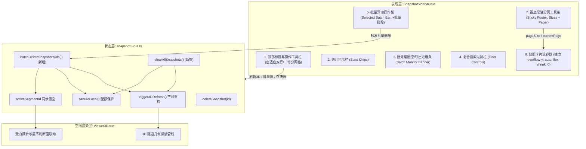
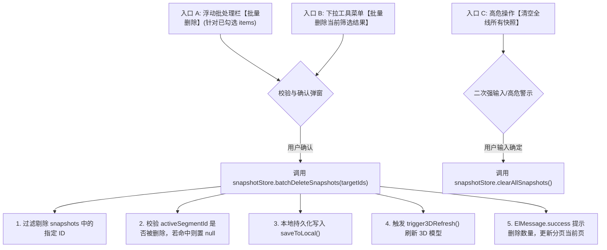
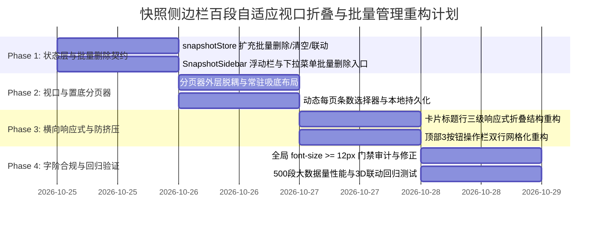

# 阶段4-专题-快照侧边栏百段自适应视口折叠与批量管理工程方案

## Goal Description

### 1. 核心业务痛点与目标分解 (Objectives)

在隧道工程多维协同智能排水自适应平台中，右侧工况快照侧边栏（[SnapshotSidebar.vue](file:///d:/offices/Github/隧道工程多维协同智能排水自适应平台/tunnel-drainage-platform/frontend/src/components/ui/SnapshotSidebar.vue)）作为多计算段管理、百段工况批处理、参数回溯与 3D 空间模型装配的核心枢纽。随着现场工程从“单段试算”演进至“百级分段全线贯通分析”（通常包含 100~500 个独立计算段），原有侧边栏在实际多分辨率及不同窗口尺寸下暴露了四项核心工程缺陷：

1. **缺失批量删除机制 (Batch Deletion Deficiency)**：
   - 当前快照删除仅支持卡片头部的单条二次确认删除（`handleDeleteSnapshot(id)`）。
   - 当工程师通过 Excel 批量导入 200~300 个工况或快速生成数百条计算分段后，如需清理无效段、淘汰旧版设计或重置筛选集，只能逐条手工确认删除数百次，效率极低，严重阻碍生产交互。
   - 目标：建立多级安全防线的“批量删除体系”，联动现有已选浮动栏、筛选结果集与 Pinia 状态树。

2. **纵向视口高度受限与硬编码分页导致的挤压 (Vertical Viewport & Pagination Bottleneck)**：
   - 既有实现中，分页大小固定硬编码为 `pageSize = ref(15)`，且分页控制器 `<div class="pagination-container">` 被置于滚动容器 `<div class="snapshot-list">` 的底部尾端。
   - 在 1366×768、1440×900 笔记本屏幕或 1080p 左右分屏场景下，浏览器有效可视高度仅约 450~550px。固定 15 条卡片会导致单页总高度达 700~900px，卡片未显式锁定 `flex-shrink: 0` 时会产生严重纵向挤压；且分页条被埋在滚动流底部，用户不滚到底部根本无法感知分页，无法按需调节单页容量。
   - 目标：将分页器解耦置底常驻（Sticky/Fixed Footer），引入动态每页条数选择器（`[5, 10, 15, 20, 50, 100]`），卡片锁定最小物理高度防挤压，赋予容器平滑滚动弹性。

3. **横向窗口宽度不足时工况标题行挤压与信息破损 (Card Header Horizontal Adaptive Collapse)**：
   - 侧边栏支持 300px~600px 自由拖拽调节（默认 420px）。当收缩至 300px~350px 窄宽时，卡片紧凑顶栏（`.card-compact-header`）内同时承载复选框、里程胶囊、备注文本、安全系数 Fs 药丸、计算状态标签、以及 4 个操作按钮（施工图、计算书、展开箭头、删除），横向物理总宽需求超 440px。
   - 空间不足时，导致备注完全被遮蔽、右侧操作按钮与状态标签重叠交错、部分图标被溢出裁剪。
   - 目标：建立三级横向响应式折叠状态机（宽态直列、紧凑态收敛、窄态双行弹性自适应），低频操作收纳至统一下拉菜单，保证关键力学指标（Fs、里程）在任何宽度下 100% 清晰呈现。

4. **顶部操作按钮栏挤压换行破损 ([刷新3D] [批量计算] [保存快照] Toolbar Squeeze)**：
   - 顶部标题行（`.header-title-bar`）将“工况快照与序列库”（含计数微标，约 140px）与 3 个实体按钮（[刷新3D] 80px + [批量计算] 85px + [保存快照] 85px，总计约 260px）硬性并排在一行（总宽需求 > 410px）。
   - 在 300px~380px 宽度区间内，按钮文字折行截断、边框挤压变形甚至顶破父级容器边界。
   - 目标：重构顶部操作区为自适应双行/响应式弹性网格布局，大宽屏时保持横向对齐，紧凑与窄宽时平滑转换为独立操作工具栏（三等分自适应分布或图标+Tooltip 极简模式）。

### 2. 约束条件与硬性边界 (Constraints & Hard Boundaries)

- **UI 字阶生理底线合规 (Typography Readability Floor)**：
  - 必须严格遵循全局硬性规范：所有渲染文字 $\text{font-size} \ge 12\text{px}$（或 $\ge 0.75\text{rem}$）。
  - 全面排查并根除既有 CSS 中残留的 `font-size: 10px`、`10.5px`、`11px`、`11.5px` 硬编码，重构为 CSS 变量（如 `var(--sys-font-xs, 12px)`）。
- **Pinia 存储与状态向下兼容 (State Contract Integrity)**：
  - 严格保持 `snapshotStore.snapshots` 核心接口契约向下兼容。
  - 新增批量删除方法 `batchDeleteSnapshots(ids: string[])` 必须同步清理持久化 `localStorage`（含已有的 `QuotaExceededError` 轻量化脱敏降级机制），并触发 3D 重绘钩子（`trigger3DRefresh()`）。
  - 若被删除的工况中包含当前 3D 激活聚焦段（`activeSegmentId`），必须安全置空并通知 3D 视口解除最不利受力探针高亮。
- **3D 渲染与大数据量内存安全 (WebGL & DOM Performance)**：
  - 无论视图层每页展示 5 条还是 50 条，已勾选用于 3D 渲染的工况集（`selectedFor3D=true`）跨页保持独立，3D 组合拼装模型不可发生跨页丢失。
  - DOM 节点上限保护：单页限制最大渲染 50~100 张卡片，杜绝数百条快照全量渲染导致的浏览器重排重绘卡顿。

---

## Proposed Changes

### 1. 架构与系统解构 (Architecture & System Decomposition)



### 2. 模块细化设计与技术契约

#### 2.1 模块一：多级批量删除安全体系 (Batch Deletion Architecture)

批量删除涉及生产数据与工程快照的不可逆销毁，采用“三级触发入口 + 二次强确认防误触 + 级联状态清理”模型：



- **交互入口呈现与防挤压多级自适应设计**：
  1. **已勾选工况快捷批处理栏 (`.selected-batch-bar`)**：当卡片勾选数 `selectedCount > 0` 时常驻呈现。针对侧边栏拖拽在 300px~600px 宽度变化下的挤压痛点，采用**两级弹性解耦 + Container Query 三阶字阶自适应机制**：
     - **大屏区间 ($\ge 450\text{px}$)**：单行横向对齐，左侧显示勾选统计与清空按钮，右侧横向排列【施工图(A3)】、【计算书(ZIP)】与【批量删除】3 个快捷按钮。
     - **标准/紧凑区间 ($380\text{px} \sim 449\text{px}$)**：自动换行为双行结构，第 1 行两端对齐展示选中数与清空，第 2 行以 3 等分 CSS Grid (`grid-template-columns: repeat(3, 1fr)`) 撑满底栏。
     - **窄宽区间 ($330\text{px} \sim 380\text{px}$)**：操作按钮文字自适应切换为短标签（`施工图`、`计算书`、`删除`），杜绝文字折行或溢出变形。
     - **极窄区间 ($< 330\text{px}$)**：隐藏文字标签，仅保留居中图标与 Tooltip 提示，保持微卡纯净且功能无损。
     ```html
     <!-- frontend/src/components/ui/SnapshotSidebar.vue -->
     <div class="selected-batch-bar" v-if="selectedCount > 0">
       <div class="batch-bar-left">
         <span class="batch-count-tag">
           <el-icon><CircleCheckFilled /></el-icon>
           已选中 <b>{{ selectedCount }}</b> 个工况
         </span>
         <el-button link type="info" size="small" class="batch-clear-btn" @click="clearSelectedCards">清空</el-button>
       </div>
       <div class="batch-bar-actions">
         <el-button type="warning" size="small" class="batch-quick-btn" :loading="isBatchExporting" @click="batchDownloadBlueprints('pdf')" title="一键批量下载选中工况的标准 A3 施工设计图 (PDF)">
           <el-icon><PictureFilled /></el-icon>
           <span class="batch-btn-text"><span class="text-full">施工图(A3)</span><span class="text-compact">施工图</span></span>
         </el-button>
         <el-button type="primary" size="small" class="batch-quick-btn" :loading="isBatchExporting" @click="batchExportCalcBooks()" title="一键批量并发编译导出选中工况的 A4 标准计算书 (Typst ZIP)">
           <el-icon v-if="!isBatchExporting"><DocumentCopy /></el-icon>
           <span class="batch-btn-text"><span class="text-full">计算书(ZIP)</span><span class="text-compact">计算书</span></span>
         </el-button>
         <el-button type="danger" size="small" class="batch-quick-btn batch-delete-btn" @click="handleBatchDeleteSelected" title="一键批量删除当前已勾选的工况快照">
           <el-icon><Delete /></el-icon>
           <span class="batch-btn-text"><span class="text-full">批量删除</span><span class="text-compact">删除</span></span>
         </el-button>
       </div>
     </div>
     ```
  2. **筛选结果批量删除**：在 3D 勾选控制或过滤操作下拉菜单中，新增“🗑️ 批量删除当前筛选工况 ({{ filteredSnapshots.length }})”。
  3. **确认对话框交互**：调用 `ElMessageBox.confirm`，使用 `type: 'warning'` 明确提示：“确定要删除选中的 X 个工况快照吗？删除后对应桩号分段与计算结果将不可恢复。”

- **Pinia 数据层实现契约 (`snapshotStore.ts`)**：
  ```typescript
  // frontend/src/store/snapshotStore.ts
  batchDeleteSnapshots(ids: string[]) {
    if (!ids || ids.length === 0) return;
    const idSet = new Set(ids);
    this.snapshots = this.snapshots.filter(s => !idSet.has(s.id));
    
    // 若当前 3D 聚焦段在删除列表中，安全释放
    if (this.activeSegmentId && idSet.has(this.activeSegmentId)) {
      this.activeSegmentId = null;
    }
    
    this.saveToLocal();
    this.trigger3DRefresh();
  },

  clearAllSnapshots() {
    this.snapshots = [];
    this.sequences = [];
    this.activeSegmentId = null;
    this.saveToLocal();
    this.trigger3DRefresh();
  }
  ```

---

#### 2.2 模块二：视口高度解耦与常驻分页器优化 (Viewport Decoupling & Sticky Pagination)

针对小高度屏幕（768p/900p）全挤到一起的根本原因：原 DOM 树中分页器置于滚动流尾部，外层缺少固定底栏，卡片未显式锁定 `flex-shrink: 0`。

```
+-------------------------------------------------------------+
| [Header] 标题与全局操作工具栏 (flex-shrink: 0)               |
+-------------------------------------------------------------+
| [Stats & Filter] 统计胶囊与检索栏 (flex-shrink: 0)          |
+-------------------------------------------------------------+
| [Selected Floating Bar] 已选批处理浮动栏 (如有, flex-shrink: 0)|
+-------------------------------------------------------------+
|                                                             |
| [Snapshot Card List] 独立滚动视口 (flex: 1; overflow-y: auto)|
|  - Card 1 (min-height: 42px; flex-shrink: 0)                |
|  - Card 2 (min-height: 42px; flex-shrink: 0)                |
|  ... 平滑垂直滚动，高度不足时原生滚动条承载 ...             |
|                                                             |
+-------------------------------------------------------------+
| [Sticky Footer Pagination] 常驻底部分页器 (flex-shrink: 0)    |
| [ 共 240 条 ] [ 15条/页 ▾ ]   [<] 1 2 3 4 5 [>]   [跳至__页]  |
+-------------------------------------------------------------+
```

- **核心重构技术契约**：
  1. **分页条 DOM 层级提升**：将 `<div class="pagination-container">` 从 `<div class="snapshot-list">` 内部移出，置为 `.snapshot-sidebar` 的直接子节点，赋予 `flex-shrink: 0; border-top: 1px solid var(--sys-border);`，实现常驻吸底。
  2. **完整分页能力集成**：
     ```html
     <!-- frontend/src/components/ui/SnapshotSidebar.vue -->
     <div class="pagination-footer" v-if="filteredSnapshots.length > 0">
       <el-pagination
         v-model:current-page="currentPage"
         v-model:page-size="pageSize"
         :page-sizes="[5, 10, 15, 20, 50, 100]"
         :total="filteredSnapshots.length"
         layout="total, sizes, prev, pager, next"
         small
         background
         class="compact-pagination"
         @size-change="handlePageSizeChange"
       />
     </div>
     ```
  3. **个性化每页条数持久化**：
     - `pageSize` 初始化优先读取 `localStorage.getItem('snapshot_page_size') || 10`。
     - 在笔记本或分屏视口高度 $< 800\text{px}$ 时，推荐默认呈现 10 条或 5 条，避免首屏超出滚动过长。
  4. **防挤压 CSS 物理约束**：
     ```css
     /* frontend/src/components/ui/SnapshotSidebar.vue */
     .snapshot-list {
       flex: 1;
       min-height: 0; /* 关键：突破 flex 子元素溢出滚动边界 */
       overflow-y: auto;
       overflow-x: hidden;
       display: flex;
       flex-direction: column;
       gap: 8px;
     }

     .snapshot-card {
       flex-shrink: 0; /* 核心防挤压契约：严禁卡片纵向压缩 */
       min-height: 42px;
       box-sizing: border-box;
     }
     ```

---

#### 2.3 模块三：卡片标题行横向自适应折叠机制 (Card Header Adaptive Layout)

针对侧边栏拖拽收缩到 300px~350px 时的内容挤压重叠，采用基于 CSS 媒体查询 / Container Query 的“三级信息密度自适应模型”：

| 侧边栏宽度区间 | 布局策略 (Layout Strategy) | 元素展现形式 |
| :--- | :--- | :--- |
| **宽屏区间 ($\ge 420\text{px}$)** | **全量直列 (Full Inline)** | 单行排列：[复选框] + [K0+000~K0+050] + [备注文本(截断)] + [Fs 药丸(带文字)] + [状态标签] + [4个直列操作按钮] |
| **紧凑区间 ($340\text{px} \sim 419\text{px}$)** | **操作收敛 (Compact Inline)** | 单行紧凑：备注最大宽度收缩至 80px；[施工图] 与 [计算书] 按钮收敛至单一【更多操作 ▾】小下拉菜单；仅直接保留 [展开] 与 [删除] 按钮；Fs 药丸仅保留数值，隐藏 "Fs" 前缀 |
| **极窄区间 ($< 340\text{px}$)** | **双行弹性微卡 (Two-row Micro)** | 标题行自动换行为双行结构：<br>• 第 1 行：[复选框] [里程胶囊] [Fs 微标] [展开箭头]<br>• 第 2 行：[工况备注] [状态 Tag] [更多操作 Dropdown] [删除] |

- **DOM 结构精细化重构**：
  ```html
  <!-- frontend/src/components/ui/SnapshotSidebar.vue -->
  <div class="card-compact-header" @click="handleCardHeaderClick(snap.id)">
    <div class="card-status-stripe" :class="getCardStripeClass(snap)"></div>

    <!-- 主展示区 (支持 flex-wrap 自适应) -->
    <div class="compact-main-wrapper">
      <div class="compact-row-primary">
        <el-checkbox 
          v-model="snap.selectedFor3D" 
          @click.stop="handleCheckboxChange" 
          class="snap-checkbox"
          title="勾选用于批量导出或 3D 空间装配"
        />
        <div class="chainage-capsule">
          <span class="chainage-icon">📏</span>
          <span class="chainage-text">K{{ getChainage(snap, 'start') }}~K{{ getChainage(snap, 'end') }}</span>
        </div>
        
        <!-- 安全系数微标 -->
        <div 
          class="fs-pill" 
          :class="getFsClass(getSnapshotFs(snap))" 
          v-if="getSnapshotFs(snap) != null"
          :title="`安全系数 Fs = ${getSnapshotFs(snap)?.toFixed(2)}`"
        >
          <span class="fs-dot"></span>
          <span class="fs-num">Fs {{ getSnapshotFs(snap)?.toFixed(2) }}</span>
        </div>

        <!-- 状态标签 -->
        <span class="status-chip" :class="getStatusChipClass(snap)">
          <el-icon v-if="snap.status === 'calculating'" class="is-loading"><Loading /></el-icon>
          {{ snap.status === 'calculating' ? '计算中' : snap.status === 'paused' ? '暂停' : snap.status === 'done' || snap.results ? '已算' : snap.status === 'error' ? '失败' : '待算' }}
        </span>

        <!-- 极右侧快捷展开箭头 -->
        <button 
          type="button"
          class="icon-action-btn expand-btn" 
          :class="{ 'expanded': isCardExpanded(snap.id) }"
          @click.stop="toggleCardExpand(snap.id)" 
          title="展开/收起详情"
        >
          <el-icon><ArrowDown /></el-icon>
        </button>
      </div>

      <!-- 次级信息与操作行 (窄屏时自动下沉，宽屏时平铺在右侧) -->
      <div class="compact-row-secondary">
        <span class="snap-remark-text" :title="getSnapRemark(snap)">
          {{ getSnapRemark(snap) }}
        </span>

        <!-- 操作按钮组 (大屏展开，小屏收敛为下拉) -->
        <div class="compact-quick-actions" @click.stop>
          <!-- 宽屏直列模式 (CSS 控制受限时隐藏) -->
          <div class="wide-action-group">
            <button class="icon-action-btn blueprint-btn" @click.stop="handleQuickExportBlueprint(snap)" title="导出 A3 施工图">
              <el-icon><PictureFilled /></el-icon>
            </button>
            <button class="icon-action-btn book-btn" @click.stop="handleQuickExportBook(snap)" title="预览/导出计算书">
              <el-icon><Notebook /></el-icon>
            </button>
          </div>

          <!-- 窄屏收纳下拉菜单 -->
          <el-dropdown trigger="click" class="narrow-more-dropdown" @command="(cmd: any) => handleCardMoreCommand(snap, cmd)">
            <button class="icon-action-btn more-btn" title="更多操作">
              <el-icon><MoreFilled /></el-icon>
            </button>
            <template #dropdown>
              <el-dropdown-menu>
                <el-dropdown-item command="blueprint_pdf">📑 导出 A3 施工图 (PDF)</el-dropdown-item>
                <el-dropdown-item command="calcbook_preview">📚 查看 A4 计算书</el-dropdown-item>
                <el-dropdown-item command="recalc" divided>⚡ 重新计算当前段</el-dropdown-item>
                <el-dropdown-item command="delete" class="text-danger">🗑️ 删除此快照</el-dropdown-item>
              </el-dropdown-menu>
            </template>
          </el-dropdown>

          <!-- 独立删除按钮 (高频操作常驻) -->
          <button 
            type="button"
            class="icon-action-btn delete-btn" 
            @click.stop="handleDeleteSnapshot(snap.id)"
            title="删除快照"
          >
            <el-icon><Delete /></el-icon>
          </button>
        </div>
      </div>
    </div>
  </div>
  ```

---

#### 2.4 模块四：顶部操作区防挤压网格化重构 ([刷新3D] [批量计算] [保存快照])

原代码问题在于：标题栏与 3 个长按钮在同一 flex 行内，无法承受侧边栏 $< 400\text{px}$ 时的空间压缩。

```
【宽屏模式 >= 420px】
+-------------------------------------------------------------+
| 工况快照与序列库 [24]       [🔄 刷新3D] [⚡ 批量计算] [➕ 保存快照] |
+-------------------------------------------------------------+

【紧凑与窄屏模式 < 420px (自适应双行网格)】
+-------------------------------------------------------------+
| 工况快照与序列库 [24]                           [⚙️ 更多配置 ▾] |
+-------------------------------------------------------------+
|  [🔄 刷新3D]      |      [⚡ 批量计算]     |     [➕ 保存快照]  |
|  (flex: 1 等宽)   |      (flex: 1 等宽)   |     (flex: 1 等宽) |
+-------------------------------------------------------------+

【极窄模式 < 320px】
+-------------------------------------------------------------+
| 快照库 [24]                                                 |
+-------------------------------------------------------------+
|     [ 🔄 ]        |          [ ⚡ ]        |        [ ➕ ]     |
| (图标居中 Tooltip) |   (图标居中 Tooltip)   |  (图标居中 Tooltip) |
+-------------------------------------------------------------+
```

- **重构 CSS 与布局体系**：
  ```css
  /* frontend/src/components/ui/SnapshotSidebar.vue */
  .header {
    display: flex;
    flex-direction: column;
    gap: 8px;
    flex-shrink: 0;
  }

  /* 标题与动作按钮容器解耦为独立行或弹性包装 */
  .header-title-bar {
    display: flex;
    flex-wrap: wrap; /* 关键：允许自动换行至下一行 */
    align-items: center;
    justify-content: space-between;
    gap: 8px;
  }

  .title-with-badge {
    display: flex;
    align-items: center;
    gap: 6px;
    flex-shrink: 0;
  }

  .header-actions-row {
    display: grid;
    grid-template-columns: repeat(3, 1fr); /* 三等分响应式网格 */
    gap: 6px;
    width: 100%; /* 换行后撑满宽度 */
  }

  /* 宽屏单行融合媒体查询 */
  @container (min-width: 420px) or (min-width: 420px) {
    .header-title-bar {
      flex-wrap: nowrap;
    }
    .header-actions-row {
      width: auto;
      display: flex;
      gap: 5px;
    }
  }

  .header-btn {
    width: 100%;
    justify-content: center;
    padding: 6px 4px;
    font-size: var(--sys-font-xs, 12px); /* 坚守 >= 12px 底线 */
    border-radius: 6px;
    white-space: nowrap;
  }

  /* 极窄模式下隐藏按钮文本，仅保留图标 + Tooltip */
  @media (max-width: 320px) {
    .header-btn .btn-label {
      display: none;
    }
    .header-btn {
      padding: 6px 0;
    }
  }
  ```

---

### 3. 工作分解结构 (Work Breakdown Structure, WBS)



#### 实施任务细分清单

1. **Task 1.1：`snapshotStore.ts` 批量删除能力落地**
   - 编写 `batchDeleteSnapshots(ids: string[])` 与 `clearAllSnapshots()`。
   - 补齐 `activeSegmentId` 级联置空安全逻辑。
   - 验证 `saveToLocal()` 在批量删除后的持久化落盘与 `trigger3DRefresh()` 广播。

2. **Task 1.2：`SnapshotSidebar.vue` 批量删除 UI 与防误触确认交互**
   - 在 `.selected-batch-bar` 中集成红色【批量删除已选 (N)】按钮。
   - 在顶部过滤工具栏的更多菜单中集成【批量删除筛选结果 (N)】入口。
   - 编写 `handleBatchDeleteSelected` 与二次确认弹窗逻辑，并在删除后动态平滑修正 `currentPage`（防止当前页被删空导致显示空白）。

3. **Task 2.1：分页器层级外提与常驻底部 (Sticky Footer)**
   - 将分页器从 `.snapshot-list` 内部抽离至外层，作为独立容器 `.pagination-footer`。
   - 增加 `layout="total, sizes, prev, pager, next"`，支持 `page-sizes="[5, 10, 15, 20, 50, 100]"`。
   - 补齐 `localStorage` 缓存机制，记忆用户习惯的分页容量。

4. **Task 2.2：卡片列表独立滚动容器与物理尺寸保护**
   - 给 `.snapshot-list` 增加 `flex: 1; min-height: 0; overflow-y: auto;`。
   - 给 `.snapshot-card` 统一注入 `flex-shrink: 0; min-height: 42px;`，杜绝纵向挤压。

5. **Task 3.1：工况卡片标题行横向自适应折叠**
   - 重构 `.card-compact-header` 结构为弹性双行/自适应流式网格。
   - 新增更多操作收纳下拉菜单 `.narrow-more-dropdown`，集中收敛施工图导出、计算书预览与重算动作。
   - 优化里程胶囊与 Fs 微标的文本溢出与最小物理尺寸。

6. **Task 3.2：顶部操作按钮栏自适应网格重构**
   - 重写 `.header-title-bar`，支持窄屏下自动换行至第二行。
   - 将 [刷新3D]、[批量计算]、[保存快照] 封装入 `.header-actions-row`，应用 CSS Grid 三等分自适应布局。
   - 为按钮增加 `.btn-label` 包装，在极窄视口下优雅降级为纯图标模式。

7. **Task 4.1：UI 字阶合规审计与主题变量重构**
   - 全面排查 `SnapshotSidebar.vue` 中所有 `font-size < 12px` 的样式规则。
   - 将 `font-size: 10px`、`11px`、`11.5px` 全部无死角升级为 `font-size: 12px` 或 `var(--sys-font-xs)`，保持严谨的字阶生理底线。

---

## Verification Plan

### 1. 验收标准与质量门禁 (Acceptance Criteria)

| 验证维度 | 验证项 | 预期结果与合格判定标准 |
| :--- | :--- | :--- |
| **批量删除功能** | 选中项批量删除 | 勾选 5 个工况卡片，点击【批量删除】，弹出二次确认框；点击确认后，5 个工况瞬间从列表与 Store 移除，`totalCount` 减 5，本地 LocalStorage 及时更新；若当前选中的是 3D 活动段，3D 画布相应高亮探针解除，无报错。 |
| **批量删除功能** | 筛选结果批量删除 | 通过桩号或状态过滤出 10 条待计算工况，点击【批量删除当前筛选结果】，确认后仅删除该 10 条，其余工况完好无损。 |
| **分页与纵向适配** | 置底常驻与容量调节 | 在 1366×768 及 1920×1080 分屏下，底部分页条始终清晰吸附在侧边栏最底部，无需滚动到卡片尽头即可翻页；切换每页为 5、10、20 条时，列表渲染条数瞬时联动并自动重置至第 1 页。 |
| **纵向防挤压** | 列表滚动无压缩 | 当单页展示 15 条卡片且窗口高度严重不足（如 400px）时，每张卡片保持 $\ge 42\text{px}$ 规范高度，卡片文字完全无压扁扭曲，`.snapshot-list` 出现顺滑纵向滚动条。 |
| **横向自适应折叠** | 卡片标题行 300px 适配 | 将右侧侧边栏宽度从 600px 拖拽收缩至 300px 极限极窄状态：<br>1. 卡片标题行平滑折叠，里程、Fs 值及展开箭头清晰可见；<br>2. 施工图与计算书按钮优雅收纳至 `...` 下拉菜单，无任何文字图标重叠或横向破损溢出。 |
| **顶部按钮防挤压** | 顶部 3 按钮自适应 | 在 300px~360px 宽度下，[刷新3D] [批量计算] [保存快照] 自动以等宽三等分网格整齐排列在标题下方，按钮文字不折断、边框不挤瘪；极窄状态（<320px）平滑转为图标按钮并保留 Tooltip。 |
| **字阶生理底线** | 全面符合 $\ge 12\text{px}$ 规范 | 经代码审查与 DevTools 元素计算样式（Computed Styles）抽检，侧边栏内部所有文字（徽章、微标、状态标签、按钮）的 `font-size` 严格 $\ge 12\text{px}$。 |
| **3D 与并发兼容性** | 跨页 3D 装配连续性 | 勾选跨越第 1 页与第 2 页的若干工况，Viewer3D 画布中空间隧道装配完整连贯；批量并发计算与动态估时断点续算机制运行稳定，无时序冲突。 |

### 2. 自动化与人工回归测试方案

1. **数据边界回归用例**：
   - 用例 1（空数据）：清空所有快照，验证空状态提示居中正常，分页器自动隐藏，顶部按钮点击无 Null Pointer。
   - 用例 2（百级工况）：导入包含 150 个分段的 Excel 文件，设置每页 10 条，验证翻页性能 `< 16ms`，DOM 节点维持在低负载。
   - 用例 3（末页全删）：跳转至第 10 页（仅余 2 条数据），全选该 2 条并执行批量删除，验证当前页能自适应回退到第 9 页，无空白页现象。
2. **响应式尺寸遍历用例**：
   - 分别在侧边栏拖拽宽度 300px、340px、380px、420px、550px 下进行全功能点击遍历与截图比对。
