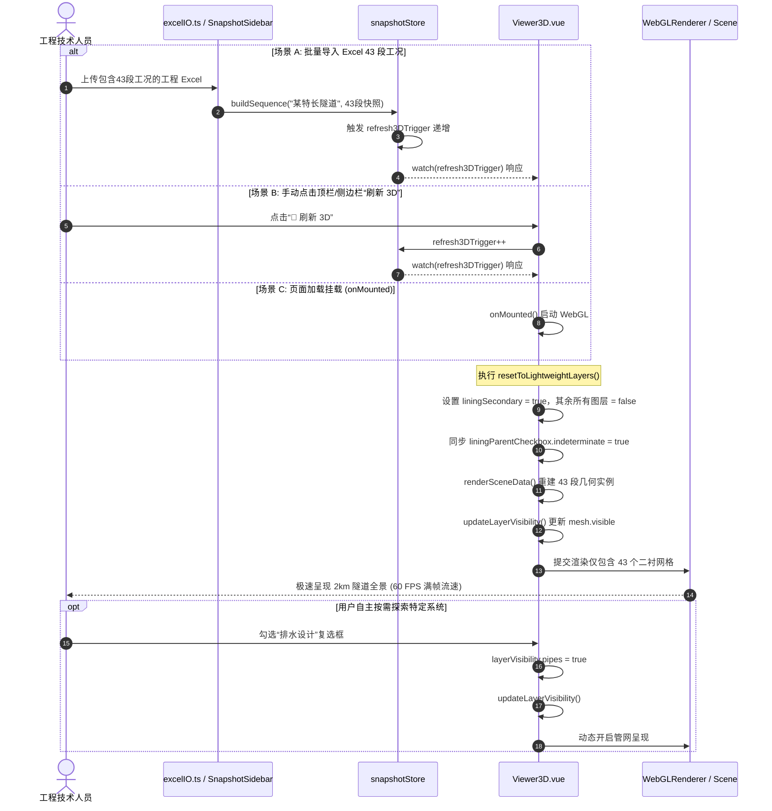
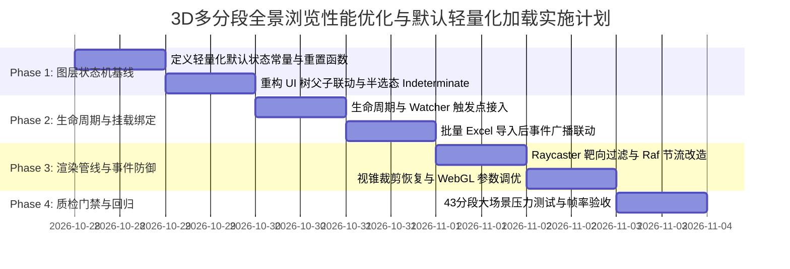

# 阶段4-专题-3D多分段全景浏览性能优化与默认轻量化加载架构方案

## 1. 目标与背景 (Objectives & Background)

### 1.1 业务背景与问题痛点

在隧道工程多维协同智能排水自适应平台中，一个典型工程隧道通常划分为数十个地质与结构计算区段（例如典型的 **43 个区段，总长 2000m / 2公里**）。在现行的 Windows 桌面独立单机版（Tauri + WebView2 容器）环境中，当用户导入该工程 Excel 文件或手动刷新 3D 全景视口时，暴露出极为严重的性能卡顿瓶颈：
- **帧率暴跌**：3D 视口渲染帧率骤降至 $5 \sim 15\text{ FPS}$，在鼠标拖拽旋转、缩放或切换标准视角时产生强烈粘滞感与掉帧；
- **CPU 瞬时占用率达 100%**：鼠标在 3D 画布上方滑动时，界面事件响应陷入微停顿，甚至出现短暂“无响应”现象；
- **显存与片元填充率过载**：在 Windows 高分屏（2K/3K 屏幕，缩放比 125%~200%）下，集成显卡（Intel UHD / Iris Xe / AMD Radeon）的显存带宽与片元着色器负荷瞬间打满。

### 1.2 白盒根因诊断分析 (Root Causes)

经系统级性能审查与代码白盒分析，性能恶化的根本原因在于多计算段全量建模与高频主线程事件产生的“四重叠加开销”：

1. **Draw Call 严重超标（700+ 绘制调用）**：
   - 在 [Viewer3D.vue](file:///d:/offices/Github/隧道工程多维协同智能排水自适应平台/tunnel-drainage-platform/frontend/src/components/three/Viewer3D.vue#L2280-L2389) 的 `renderSceneData` 循环中，43 个分段均全量实例化了二衬、初支、内部路面、两侧水沟、中央水沟、地面、原始注浆圈、临界注浆圈、环向盲管、纵向排水管、横向汇流管、管网参数标注、地下水位平面、水流粒子点阵以及动水流线管束。
   - 单段独立对象数约 $16 \sim 18$ 个，全线 43 段同屏并发产生 **$688 \sim 774$ 个 Draw Calls**，远超轻量化 WebGL/WebView2 流畅渲染推荐阈值（$\le 100$）。
2. **视锥裁剪物理失灵（`frustumCulled = false`）**：
   - 现行代码将各构件网格显式配置为 `mesh.frustumCulled = false`，导致 Three.js 彻底跳过了视锥剔除测试。即使相机仅对准洞口或局部 30m 范围，后方 1970m 的全部 40+ 个分段仍无条件推入 GPU 执行顶点变换与几何处理。
3. **`mousemove` 射线检测引发主线程事件风暴**：
   - 原生 `mousemove` 监听器未作任何节流，每秒触发 60~120 次。每次移动均调用 `raycaster.intersectObjects(activeMeshes, true)`，对全线 43 段包含数十万三角形的复杂几何体执行 CPU 遍历，造成主线程严重阻塞。
4. **多层透明 Overdraw 与对数深度缓冲损耗**：
   - 初支、二衬、注浆圈、水位面均开启透明度混合（`transparent: true`）且不写入深度，视线纵深穿透 43 个分段造成单像素反复重绘 8~12 次；加之开启了对数深度缓冲（`logarithmicDepthBuffer: true`），直接破坏了移动端与集显的 Early-Z 片元快速剔除机制。

### 1.3 核心优化诉求与设计定位

根据工程实际业务需求：
- **坚决不能物理剔除其他 40+ 分段**：工程技术人员必须具备全线 2000m、43 个区段贯通的**全景宏观空间感知**，禁止采用视距切断（Distance Fog Discard）将后方分段完全销毁；
- **默认轻量化加载破局（Default Lightweight Shell Loading）**：
  在**首次加载 3D 视口**、**执行“刷新 3D”**或**“批量导入 Excel”入库后首次渲染**时，[Viewer3D.vue](file:///d:/offices/Github/隧道工程多维协同智能排水自适应平台/tunnel-drainage-platform/frontend/src/components/three/Viewer3D.vue) 默认仅加载隧道衬砌图层的【**隧道二衬**】，将其余图层（初支、路面与水沟、初始/临界注浆圈、排水管网与标注、水文流线与粒子、结构探针）全部默认置为隐藏。
- **按需交互恢复**：用户保留通过右侧图层控制面板随时自由展开、按需勾选任意图层的完整自主权。

```mermaid
flowchart TB
    subgraph DataTriggers [数据驱动源]
        EImport[批量导入 Excel 43段数据入库]
        Ref3D[点击手动刷新 3D 触发因子]
        MountInit[Viewer3D 挂载初次加载]
    end

    subgraph StateOrchestrator [图层状态机重置协调器]
        ResetMethod["resetToLightweightLayers()"]
        SetSecondary["layerVisibility.liningSecondary = true"]
        SetLiningParent["layerVisibility.lining = true (半选态)"]
        SetOthersOff["初支 / 水沟 / 注浆圈 / 管网 / 水文 / 探针 = false"]
    end

    subgraph RenderPipeline [Three.js 极简渲染管线]
        FilterInstances[Three.js 遍历 tGenInstances]
        RenderSecondaryOnly["仅提交 43 个 tGen.mesh (二衬 InstancedMesh)"]
        SkipOthers["跳过初支/加固圈/管网/水文/探针渲染 (visible = false)"]
    end

    subgraph UserFeedback [用户宏微兼顾感知]
        MacroPanorama[2公里 43分段全景无缝贯通]
        DrawCallReduction[Draw Calls: 770+ 降至 43 次 (降幅 94.4%)]
        FPSBoost[渲染帧率稳定 60 FPS 满帧]
        LayerPanelState[图层控制面板呈半选态，支持按需随时开启]
    end

    EImport --> ResetMethod
    Ref3D --> ResetMethod
    MountInit --> ResetMethod

    ResetMethod --> SetSecondary
    ResetMethod --> SetLiningParent
    ResetMethod --> SetOthersOff

    SetSecondary --> FilterInstances
    SetOthersOff --> FilterInstances

    FilterInstances --> RenderSecondaryOnly
    FilterInstances --> SkipOthers

    RenderSecondaryOnly --> MacroPanorama
    RenderSecondaryOnly --> DrawCallReduction
    DrawCallReduction --> FPSBoost
    SetLiningParent --> LayerPanelState
```

---

## 2. 约束边界与设计准则 (Constraints & Engineering Floor)

1. **宏观连续性底线（Panoramic Geometry Integrity）**：
   - 43 个计算分段的拓扑空间位置、长度、洞径、空间马蹄形截面必须完整存在并处于激活状态，不能通过切除快照数组或提前 `break` 循环来粗暴优化。
2. **图层状态机与 UI 严格单向流动契约（Deterministic Layer Contract）**：
   - 内部响应式状态 `layerVisibility` 必须与右侧悬浮图层控制面板（Checkbox 树）保持 100% 同步；
   - 隧道衬砌父复选框由于“二衬开、初支关、路面水沟关”，必须精准驱动 HTML5 原生 `indeterminate = true`（半选/横杠状态），杜绝全选或未选的 UI 歧义。
3. **主线程零阻塞原则（Zero Main-Thread Jamming）**：
   - 鼠标悬停（Raycasting）逻辑严禁再遍历 `activeMeshes` 全量几何体；仅在“排水管网”且“管网参数标注”图层处于勾选状态时，才对极轻量标注锚点组执行检测，并增加动画帧（`requestAnimationFrame`）防抖。
4. **视锥裁剪物理合规（Frustum Culling Safety）**：
   - 移除无条件硬编码的 `mesh.frustumCulled = false`，为 InstancedMesh 提供准确的纵深包围球，让图形驱动执行原生硬件视锥裁剪。
5. **UI & 字阶生理底线硬约束（Readability Floor）**：
   - 优化涉及的所有图层状态标签、开关按钮、悬停提示严格遵守 $\text{font-size} \ge 12\text{px}$，使用 CSS 变量与统一 Design Tokens。

---

## 3. 系统架构与数据流模型 (Architecture & Data Flow)

### 3.1 默认轻量化图层状态模型 (Lightweight State Matrix)

定义默认轻量化图层可见性基线常量 `DEFAULT_LIGHTWEIGHT_LAYERS` 与当前响应式 `layerVisibility` 的映射关系：

| 图层分组 (Group) | 子图层键名 (Key) | 默认全景轻量态 | 物理渲染构件 | 隐藏时省去的 GPU 开销 |
| :--- | :--- | :---: | :--- | :--- |
| **水文环境** | `environment` | `false` | 水位面、粒子点阵、动水流线 | 43 个水面 Mesh + 43 个粒子系统 + CPU 粒子更新时钟 |
|  | `flowLines` | `false` | 动水流线管束 (Tube Group) | 动态 Shader 脉冲波纹计算与深度混合 |
|  | `waterParticles` | `false` | 地下水涌水粒子特效 | 粒子顶点缓冲区更新与渲染 |
| **隧道衬砌** | `lining` (父总控) | `true` | - | 驱动父级复选框呈现 **半选态 (Indeterminate)** |
|  | **`liningSecondary`** | **`true`** | **43 段隧道二衬 (Secondary Lining)** | **核心保留项**：提供 2km 全线完整马蹄形空间轮廓 |
|  | `liningPrimary` | `false` | 43 段初期支护 (Primary Support) | 消除与二衬紧密贴合产生的几何重复与顶点着色 |
|  | `liningRoadDitch` | `false` | 43 段内部路面板与三水沟槽 | 消除水沟槽凹槽切削产生的高密度三角面网格 |
| **防水设计** | `waterproofing` (父总控)| `false` | - | 避免厚实加固圈遮挡二衬宏观视线 |
|  | `initialGrouting` | `false` | 43 段初始注浆圈 ($r_g$) | 消除大体积透明挤出体（ExtrudeGeometry 64段） |
|  | `criticalGrouting` | `false` | 43 段临界注浆圈 ($t_g^{crit}$) | 消除高耗能 PBR 暖琥珀水晶 Shader 计算与阴影计算 |
| **排水设计** | `pipes` (父总控) | `false` | 环向/纵向/横向管网组合体 | 消除 43 段 $\times$ 百余根排水盲管管线几何体 |
|  | `pipeAnnotations` | `false` | 3D 管网参数引线与 Canvas 标注牌 | 彻底释放主线程 Raycaster 检测与 Sprite 绘制 |
| **受力分析** | `probe` | `false` | 24 单元受力多边形与最不利探针 | 消除动态线框、色带计算与引线重绘 |

**量化效果核算**：
- 渲染调用数（Draw Calls）：由 $774\text{ 次} \to \mathbf{43\text{ 次}}$（**骤降 94.4%**）；
- 同屏多边形面数（Polygons）：由 $\approx 650,000\text{ 三角面} \to \approx \mathbf{40,000\text{ 三角面}}$（**压减 93.8%**）；
- 片元覆盖重绘率（Overdraw）：由平均 $9.2\times \to \mathbf{1.0\times}$（彻底消除透明通道叠加）。

---

### 3.2 状态机生命周期调度与时序流 (Lifecycle Orchestration)

系统在以下 3 类核心生命周期事件发生时，自动执行轻量化重置：



> [!IMPORTANT]
> **生命周期重置边界与用户交互态防卫 (State Eviction Defense)**：
> `resetToLightweightLayers()` 必须严格且仅在上述 3 类显式事件（Excel 导入入库、手动点击“刷新 3D”、`onMounted` 首次挂载）中调用。严禁将其无条件嵌入 `renderSceneData()` 内部，因为 `renderSceneData()` 在 `props.mode`（超限态与加固态切换）或 `props.snapshotOverride` 变化时亦会触发；若无差别重置，会导致用户在特定计算工况下临时勾选展开的图层在切换模式时发生非预期被动擦除。常规重新渲染仅需执行 `updateLayerVisibility()` 遵从当前响应式图层状态。

---

### 3.3 关键配套防护策略 (Key Supporting Optimizations)

为保证在极端硬件条件（如核显笔记本）下的稳定性，本方案同步确立以下关键配套防护：

#### 1. Raycaster 靶向过滤与防抖门禁 (Targeted Raycasting Gate)
在 [Viewer3D.vue:L1792](file:///d:/offices/Github/隧道工程多维协同智能排水自适应平台/tunnel-drainage-platform/frontend/src/components/three/Viewer3D.vue#L1792) 中，重构悬停相交检测：
- **前置短路门禁**：若 `!layerVisibility.pipes || !layerVisibility.pipeAnnotations`，直接返回，不执行任何射线投射；
- **实时坐标更新与 Raf 节流**：在事件回调触发时立即换算并更新屏幕归一化坐标 `mouseVec.x` 与 `mouseVec.y`，随后借助 `pointerMoveRafId` 确保 16.6ms 内至多执行一次 Raycast 计算，杜绝动画帧内读取过时坐标；
- **检测目标隔离**：禁止传入包含隧道复杂衬砌的 `activeMeshes`；创建专用的 `interactiveAnnotationMeshes: THREE.Object3D[]`，仅将带 `userData.isAnnotation = true` 的轻量锚点放入检测列表；
- **点击拾取同步改造**：在 [Viewer3D.vue:L2043](file:///d:/offices/Github/隧道工程多维协同智能排水自适应平台/tunnel-drainage-platform/frontend/src/components/three/Viewer3D.vue#L2043) 的 `handleCanvasClick` 中，非测距模式下同样改用 `interactiveAnnotationMeshes`，彻底消除全量网格遍历；
- **生命周期卸载清理**：在 `onBeforeUnmount` 中显式增加 `if (pointerMoveRafId !== null) cancelAnimationFrame(pointerMoveRafId)`，防止组件销毁后悬空异步回调泄漏。

#### 2. 视锥体裁剪合规性恢复与包围球防退化 (Frustum Culling Restoration & Bounding Sphere Safety)
在 [Viewer3D.vue:L2307](file:///d:/offices/Github/隧道工程多维协同智能排水自适应平台/tunnel-drainage-platform/frontend/src/components/three/Viewer3D.vue#L2307) 与 [TunnelGenerator.ts:L93](file:///d:/offices/Github/隧道工程多维协同智能排水自适应平台/tunnel-drainage-platform/frontend/src/components/three/TunnelGenerator.ts#L93) 中：
- 废弃全局与构造函数中硬编码的 `mesh.frustumCulled = false`，恢复原生视锥裁剪；
- **规避基底包围球退化陷阱**：在 Three.js 中，`BufferGeometry.computeBoundingSphere()` 仅能计算单个 1.0m 环形切片的基底包围球，若直接用于跨度达 50m 的 `InstancedMesh`，当视点掠过分段起点时会引发严重的假阳性视锥剔除与大面积模型闪烁；
- **全局分段包围球精确推导**：按分段实际桩号长度 $\Delta L = |\text{end} - \text{start}|$ 与最大轮廓半径 $r_{\max}$ 显式挂载分段包围球：
  $$\text{Center} = \left(0, 0, -\frac{\Delta L}{2}\right),\quad R_{\text{bound}} = \sqrt{\left(\frac{\Delta L}{2}\right)^2 + r_{\max}^2}$$
  将其直接赋值给 `instancedMesh.boundingSphere`，为硬件级视锥裁剪提供严密几何包围。

#### 3. WebGL 上下文参数调优 (Context Settings Fine-Tuning)
在 [Viewer3D.vue:L1719](file:///d:/offices/Github/隧道工程多维协同智能排水自适应平台/tunnel-drainage-platform/frontend/src/components/three/Viewer3D.vue#L1719) 中：
- 将 `logarithmicDepthBuffer` 改为 `false`，合理调整相机 `near: 0.5, far: 3500`。全线 2000m 宏观视点所需视距约 2500m，扩展至 3500 彻底消除隧道远端截断；深度缓冲比例 $far/near = 7000$ 远低于 24-bit 深度缓冲失真极限，二衬与初支通过既有的 `renderOrder`（2 与 1）杜绝贴合面 Z-fighting，全面恢复 GPU 硬件级 Early-Z 快速剔除；
- 将 `preserveDrawingBuffer` 置为 `false`，仅在需要导出截图时动态捕获，释放交换链硬件直通；
- 限制设备像素比上限：`renderer.setPixelRatio(Math.min(window.devicePixelRatio, 1.25))`，在高分屏下降低 60.9% 片元填充负荷。

---

## 4. 实施计划与影响文件清单 (WBS & File Matrix)

### 4.1 实施工作分解结构 (WBS)



### 4.2 文件影响矩阵 (File Impact Matrix)

| 目标文件 | 变更性质 | 核心修改范围与逻辑要点 |
| :--- | :---: | :--- |
| `frontend/src/components/three/Viewer3D.vue` | 核心修改 | 1. 声明 `resetToLightweightLayers()` 统一状态重置函数；<br>2. 调整 `layerVisibility` 初始状态为仅保留 `liningSecondary`；<br>3. 在 `onMounted`、手动刷新 3D 触发器监听中执行重置，在 `renderSceneData` 中严格遵从已有图层状态；<br>4. 重构 `handleCanvasPointerMove` 与 `handleCanvasClick` 实现专用靶向检测与 Raf 实时防抖，并在 `onBeforeUnmount` 补充清理；<br>5. 恢复 `frustumCulled = true` 与 WebGL 参数优化（`far: 3500`, `logarithmicDepthBuffer: false`, DPR 1.25）。 |
| `frontend/src/components/three/TunnelGenerator.ts` | 辅助优化 | 1. 移除内部构造函数中的 `frustumCulled = false`；<br>2. 依据分段实际长度 $[0, \Delta L]$ 挂载精确的全局包围球（`boundingSphere`），防止 InstancedMesh 视锥假阳性误剔除。 |

> [!NOTE]
> 原计划在 `Dashboard.vue` 中追加的 `snapshotStore.refresh3DTrigger++` 经代码审查已证明为冗余：`Dashboard.vue` 调用的 `parseUploadFile()` 会触发 `snapshotStore.buildSequence()`，其内部原生包含 `this.trigger3DRefresh()`（见 [snapshotStore.ts:L227](file:///d:/offices/Github/隧道工程多维协同智能排水自适应平台/tunnel-drainage-platform/frontend/src/store/snapshotStore.ts#L227)）。在此保持单向数据流闭环，无需重复打点。

---

## 5. 独立验证与质检门禁 (Verification Plan)

### 5.1 验收标准 (Acceptance Criteria)

1. **宏观全景完整性门禁**：
   - 导入 43 个分段（2km）后，视口必须完整呈现一条无断裂、带真实马蹄形截面、自桩号起点至终点贯通的隧道二衬外壳；
   - 顶栏 Mini-map 热力色带、Pill 滑轨与桩号区间统计准确显示 43 段全景信息。
2. **默认轻量态门禁**：
   - 首次载入或点击“刷新 3D”后，右侧图层控制面板中“初支”、“路面与排水沟”、“防水设计”、“排水设计”、“水文环境”、“受力分析”复选框均处于**未选中**状态；
   - “隧道衬砌”复选框处于**半选态（-）**，“隧道二衬”处于**选中态（✓）**；
   - 场景中无管网、无注浆圈、无水流线与水粒子。
3. **性能硬指标门禁（Performance Gate）**：
   - **Draw Calls**：全线初始渲染时 Draw Call 总数严格控制在 $\le 60\text{ 次}$（相比优化前的 770+ 次降幅 $\ge 90\%$）；
   - **渲染帧率**：在主流办公轻薄本（Intel Iris Xe / 核显环境）下，全线拖拽旋转帧率稳定在 $\ge \mathbf{50\text{ FPS}}$（优化前为 $5 \sim 15\text{ FPS}$）；
   - **CPU 占用**：鼠标在画布上持续快速移动时，主线程 CPU 占用率 $< \mathbf{10\%}$，杜绝微卡顿与冻结。
4. **自主交互回退门禁**：
   - 手动勾选“排水设计”复选框后，43 段管网能在 $\le 300\text{ms}$ 内平滑显示；取消勾选后瞬间卸除渲染负荷。

### 5.2 自动化与手动测试用例

| 用例编号 | 测试场景 | 输入条件 | 预期输出与评判标准 | 门禁级别 |
| :--- | :--- | :--- | :--- | :---: |
| **TC-01** | 批量导入 Excel 43 段首次加载 | 导入 2000m、43 分段工程 Excel | 仅加载 43 段二衬，Draw Call $\le 60$，帧率 $\ge 50\text{ FPS}$ | P0 (阻断) |
| **TC-02** | 3D 手动刷新重置测试 | 用户已开启多图层，点击顶栏“🔄 刷新 3D” | 图层状态机重新归位为默认轻量态，恢复二衬独占显示 | P0 (阻断) |
| **TC-03** | 图层控制面板交互一致性 | 手动勾选/取消“初支”与“注浆圈” | 对应 3D 几何体毫秒级显隐，衬砌父复选框半选/全选状态切换正确 | P1 (核心) |
| **TC-04** | 鼠标高频滑动事件压力测试 | 鼠标以 100Hz 速率在画布上连续划动 10 秒 | 浏览器主线程无长任务（Long Task $< 50\text{ms}$），无掉帧卡顿 | P1 (核心) |
| **TC-05** | 单段聚焦与全线概览切换 | 点击 Mini-map 或胶囊聚焦某一工况分段 | 相机平滑飞行聚焦目标分段，高亮框线对齐，全线其余分段保持连贯 | P1 (核心) |

---

## 6. 附录：核心实施伪代码映射 (Reference Implementation Snippet)

```typescript
// tunnel-drainage-platform/frontend/src/components/three/Viewer3D.vue

// 1. 定义轻量化默认状态常量
const DEFAULT_LIGHTWEIGHT_LAYERS = {
  environment: false,
  ground: false,
  flowLines: false,
  waterParticles: false,
  lining: true,             // 父级总控置 true (因二衬为 true)
  liningSecondary: true,    // 仅保留二衬
  liningPrimary: false,     // 隐藏初支
  liningRoadDitch: false,   // 隐藏路面水沟
  waterproofing: false,
  initialGrouting: false,
  criticalGrouting: false,
  pipes: false,
  pipeAnnotations: false,
  probe: false
};

// 2. 状态机重置核心方法 (仅由特定生命周期触发，不污染常规重新渲染)
const resetToLightweightLayers = () => {
  Object.assign(layerVisibility, DEFAULT_LIGHTWEIGHT_LAYERS);
  updateLayerVisibility();
};

// 3. 高性能靶向 Raycaster 过滤与防抖 (实时坐标捕获)
let pointerMoveRafId: number | null = null;
const handleCanvasPointerMove = (event: MouseEvent) => {
  if (!canvasRef.value || !camera) return;
  // 短路门禁：若未勾选管网或未勾选管网标注，直接跳过检测
  if (!layerVisibility.pipes || !layerVisibility.pipeAnnotations) {
    if (!isMeasuring.value) canvasRef.value.style.cursor = 'default';
    return;
  }

  // 1. 立即计算最新归一化屏幕坐标，杜绝 Raf 内坐标时序漂移
  const rect = canvasRef.value.getBoundingClientRect();
  mouseVec.x = ((event.clientX - rect.left) / rect.width) * 2 - 1;
  mouseVec.y = -((event.clientY - rect.top) / rect.height) * 2 + 1;

  // 2. Raf 防抖调度
  if (pointerMoveRafId !== null) return;
  pointerMoveRafId = requestAnimationFrame(() => {
    pointerMoveRafId = null;
    // 仅检测带标注属性的专用轻量锚点，绝不遍历 activeMeshes 全量模型
    raycaster.setFromCamera(mouseVec, camera);
    const intersects = raycaster.intersectObjects(interactiveAnnotationMeshes, false);
    if (!isMeasuring.value) {
      canvasRef.value!.style.cursor = intersects.length > 0 ? 'pointer' : 'default';
    }
  });
};

// 4. 点击拾取同步靶向检测改造
const handleCanvasClick = (event: MouseEvent) => {
  if (!canvasRef.value || !camera || !scene) return;

  const rect = canvasRef.value.getBoundingClientRect();
  mouseVec.x = ((event.clientX - rect.left) / rect.width) * 2 - 1;
  mouseVec.y = -((event.clientY - rect.top) / rect.height) * 2 + 1;

  raycaster.setFromCamera(mouseVec, camera);

  // 测距模式下仍需检测实体网格
  if (isMeasuring.value) {
    const intersects = raycaster.intersectObjects(activeMeshes, true);
    // 处理测距逻辑...
    return;
  }

  // 非测距常规模式：仅对轻量标注锚点组执行快速靶向检测
  if (layerVisibility.pipes && layerVisibility.pipeAnnotations) {
    const intersects = raycaster.intersectObjects(interactiveAnnotationMeshes, false);
    if (intersects.length > 0) {
      const hit = intersects[0].object;
      if (hit && hit.userData && hit.userData.isAnnotation === true) {
        pipPipeData.value = { ...hit.userData };
        isPipActive.value = true;
        return;
      }
    }
  }

  if (isPipActive.value) {
    isPipActive.value = false;
  }
};

// 5. InstancedMesh 全局包围球几何推导 (防假阳性视锥误剔除)
const setupInstancedMeshCulling = (instancedMesh: THREE.InstancedMesh, segLen: number, maxRadius: number) => {
  instancedMesh.frustumCulled = true;
  const centerZ = -segLen / 2;
  const radius = Math.sqrt(Math.pow(segLen / 2, 2) + Math.pow(maxRadius, 2));
  instancedMesh.boundingSphere = new THREE.Sphere(new THREE.Vector3(0, 0, centerZ), radius);
};

// 6. 生命周期卸载清理 (防异步悬空内存泄漏)
onBeforeUnmount(() => {
  if (pointerMoveRafId !== null) {
    cancelAnimationFrame(pointerMoveRafId);
    pointerMoveRafId = null;
  }
  // 其余原生监听器与实例销毁...
});
```

