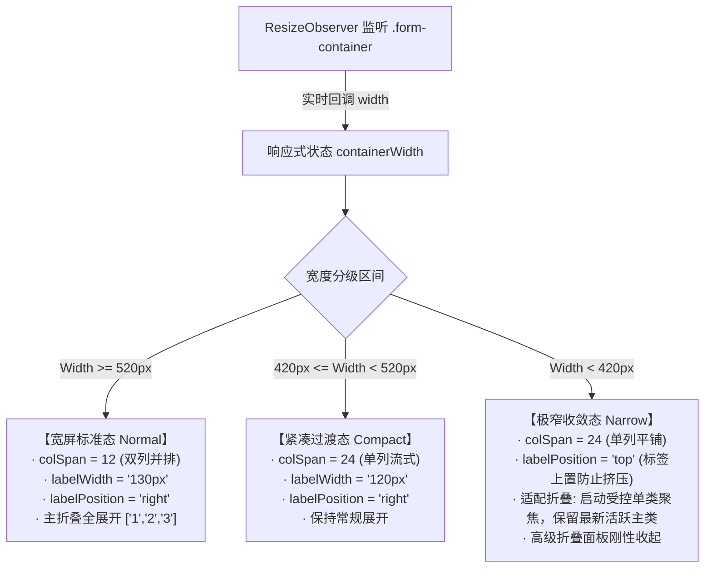

# 阶段4-专题-参数表单三大类重构与自适应折叠架构方案

## Goal Description

### 1. 核心业务痛点与重构诉求 (Objectives)

在隧道工程多维协同智能排水自适应平台中，左侧参数输入面板（[ParameterForm.vue](file:///d:/offices/Github/隧道工程多维协同智能排水自适应平台/tunnel-drainage-platform/frontend/src/components/ui/ParameterForm.vue)）是工程师录入隧道地质勘察指标、空间几何断面、支护材料渗透性以及防排水管网水力参数的核心工作台。

在既有实现中（`ParameterForm.vue:L33-L300`），参数组织与空间布局存在以下关键工程缺陷：
1. **分类边界不符合工程专业逻辑**：既有表单划分为 4 个主折叠项（`1. 基础定位与地质水文参数`、`2. 结构尺寸参数`、`3. 材料属性参数`、`4. 高级默认参数设置`）。该划分割裂了专业体系——例如将同属排水管网系统的纵向排水管坡降（$I_{\text{long}}$）孤立放置于“材料属性”中，而将环向管/横向管水力参数塞入独立的大类“高级默认参数”中；
2. **高级参数孤立堆砌**：原“高级默认参数设置”汇集了 13 项参数（水的重度 $\gamma$、安全系数 $[K]$、保护层厚度 $a_s$、盲管间距限值 $S$、三管管径 $d$、坡降 $I$、曼宁粗糙度 $n$），缺乏专业归属感，工程师在调整特定专业参数时难以建立上下文联想；
3. **窄视口排版挤压与缺乏折叠自适应**：
   - 平台主界面（[Dashboard.vue](file:///d:/offices/Github/隧道工程多维协同智能排水自适应平台/tunnel-drainage-platform/frontend/src/views/Dashboard.vue)）支持左侧面板动态拖拽拉伸（`leftWidth` 允许在 $300\text{px} \sim 800\text{px}$ 之间自由调整，默认 $550\text{px}$）；
   - 当前表单静态采用双列网格（`<el-col :span="12">`）与固定标签宽度（`label-width="140px"`）。当工程师向左拖拽至 $300\text{px} \sim 420\text{px}$ 紧凑态时，标签与输入框发生严重重叠溢出，输入框缩窄为极小缝隙；
   - 缺乏宽度收缩时的折叠自适应状态，导致表单纵向高度无限膨胀，严重损害 3D 协同视口的操作体验。

为此，制定本方案，实施**参数体系三大类解构**、**高级参数就地二次折叠**与**容器宽度响应式折叠自适应**重构。

```
┌─────────────────────────────────────────────────────────────────┐
│ ParameterForm.vue 整体重构架构                                    │
├─────────────────────────────────────────────────────────────────┤
│ 顶部状态与安全软锁指示条 (Header & Soft-Lock Capsule)            │
│ [📐 几何与水文参数]  [单洞35项/双洞36项]  [🔒 解锁修改 / 🔓 激活编辑态] │
├─────────────────────────────────────────────────────────────────┤
│ 三大主类折叠面板 (Main Collapses)                                │
│ ├── 1. 🌊 水文地质参数 (Hydrogeological Parameters)               │
│ │   ├── 核心层: 围岩渗透 kr、地下水头 H、降雨量 p、围岩级别等    │
│ │   └── 嵌入折叠区: ⚙️ 高级水文常数 (水的重度 γ)                 │
│ │                                                               │
│ ├── 2. 🏛️ 隧道结构与支护材料参数 (Structural & Support Material) │
│ │   ├── 核心层: 洞型、里程桩号、中心埋深、几何内外径、配筋/材料等 │
│ │   └── 嵌入折叠区: ⚙️ 高级结构设计参数 (容许安全系数 [K]、保护层 as)│
│ │                                                               │
│ └── 3. 💧 隧道排水参数 (Tunnel Drainage Parameters)              │
│     ├── 核心层: 中间排水沟布设 (3D/三沟/双沟)、纵向管坡降 I_long │
│     └── 嵌入折叠区: ⚙️ 高级排水管网参数 (三管内径/坡降/粗糙度/间距)│
├─────────────────────────────────────────────────────────────────┤
│ 宽度感知与自适应折叠层 (ResizeObserver-driven Adaptor)          │
│ · 宽屏态 (≥ 520px): 双列网格 (:span="12")，标准标签宽度 (130px)  │
│ · 紧凑态 (< 520px): 单列网格 (:span="24")，自适应紧凑标签       │
│ · 极窄态 (< 420px): 自动单类聚焦/收敛高级折叠，无横向挤压溢出   │
└─────────────────────────────────────────────────────────────────┘
```

### 2. 约束条件与硬性边界 (Constraints & Hard Boundaries)

1. **UI 字阶生理底线合规 (Typography Readability Floor)**：
   - 严格遵循全局规则：所有表单文字（包含 Form Label、Placeholder、Input Number 内部数值、Tag 标签、Collapse 标题）必须满足 $\text{font-size} \ge 12\text{px}$（或 $\ge 0.75\text{rem}$）。
   - 严禁在 CSS 中出现 `font-size: 9px`、`10px`、`11px`，严禁使用 `transform: scale(<1.0)` 伪缩小方案。
   - 当侧边栏收窄至 $300\text{px}$ 时，必须通过“单列化 + 标签上置/自适应”空间代偿，禁止靠缩小字号妥协排版。
2. **数据契约与响应式状态机完整性 (Data Contract Preservation)**：
   - 严禁改动底层 Pinia 状态树（`parameterStore.ts`）的字段名与数据结构；
   - 维持单洞（35项动态输入+1项材料基准）/ 双洞（36项动态输入+1项材料基准）参数全覆盖，无遗漏、无死键；（注：历史文档“38/40项”系未剔除废弃键 `double_side`、`P_crit` 等时的口径，现已归一化校准）；
   - 维持表单软锁权限联动（`authStore.isFormUnlocked`）与脏数据感知切断机制（`paramStore.$subscribe`）。
3. **校验规则链一致性 (Validation Rule Matrix)**：
   - 保留里程校验：`end_chainage > start_chainage`；
   - 保留同心圆几何级联校验：$r_0 < r_s < r_p \le r_g$；
   - 保留水头与埋深物理解算校验：$H \le h_1$。

---

## Proposed Changes

### 1. 参数全生命周期分类映射矩阵 (Parameter Classification Matrix)

将平台全部 35（单洞）/ 36（双洞）项动态输入参数及 1 项静态材料基准完全重组解构，归入三大专业类别及其内部高级折叠区：

| 专业大类 | 参数分组 | 字段键名 (Key) | 参数显示名称与工程单位 | 默认值 (单/双) | 步长/控制类型 | 物理与工程含义 |
| :--- | :--- | :--- | :--- | :--- | :--- | :--- |
| **1. 🌊 水文地质参数** | 基础核心 | `k_r` | 围岩渗透系数 $k_r$ (m/d) | 0.15 | step=0.1 | 围岩基质导水能力 |
| | 基础核心 | `H` | 初始地下水头 $H$ (m) | 120.0 | step=1.0 | 隧道顶水柱压力高度 |
| | 基础核心 | `p_mm` | 年降雨量 $p$ (mm) | 1000.0 | step=100 | 地表地质降水入渗补给 |
| | 基础核心 | `grades` | 围岩级别 (1-6) | 4 | min=1, max=6 | 围岩完整性与自稳能力 |
| | 基础核心 | `cn_condition` | 灌溉条件 | '灌溉良好' | 下拉单选 | 地下水径流与土壤湿度 |
| | 基础核心 | `land_use` | 地表用地类型 | '居住地' | 下拉单选 | 降水入渗折减条件 |
| | **高级折叠** | `gamma` | 水的重度 $\gamma$ (kN/m³) | 10.0 | step=0.1 | 重力场地下水重度基准 |
| **2. 🏛️ 隧道结构与支护材料参数** | 基础核心 | `tunnel_type` | 隧道形式 | 'single' / 'double' | 单选切页 | 单洞 / 双洞结构模式 |
| | 基础核心 | `start_chainage` | 分区起点里程 (m) | 0 | 自由输入 | 空间拼装起点桩号 |
| | 基础核心 | `end_chainage` | 分区终点里程 (m) | 47 | 自由输入 | 空间拼装终点桩号 |
| | 基础核心 | `h_1` | 隧道中心埋深 $h_1$ (m) | 130.0 | step=1.0 | 地表至隧道轴心垂直深度 |
| | 基础核心 | `r_0` | 二衬内半径 $r_0$ (m) | 7.95 | step=0.5 | 隧道净空净空开挖界限 |
| | 基础核心 | `r_s` | 二衬外半径 $r_s$ (m) | 8.35 | step=0.5 | 二衬结构外缘边界 |
| | 基础核心 | `r_p` | 初支外半径 $r_p$ (m) | 8.57 | step=0.5 | 初期支护喷锚外边界 |
| | 基础核心 | `r_g` | 注浆圈外半径 $r_g$ (m) | 8.57 | step=0.5 | 围岩注浆加固止水圈边界 |
| | 基础核心 | `aspect_ratio` | 断面高宽比 | 0.7 | step=0.1 | 3D 马蹄形截面拉伸系数 |
| | 基础核心 | `D_spacing` | 双洞中心间距 $D$ (m) | 40.0 | step=1.0 | 双洞净间距（双洞专属） |
| | 基础核心 | `concrete_grade` | 二衬混凝土等级 | 'C35' | 下拉 C15~C50 | 结构抗压强度承载力基准 |
| | 基础核心 | *(静态展示)* | 主筋材料级别 | HRB400 | Tag 展示 | 计算引擎硬编码钢筋等级 |
| | 基础核心 | `Ag` | 配筋截面面积 $A_g$ (mm²) | 1000.0 | step=100 | 二衬单位米配筋截面积 |
| | 基础核心 | `k_g` | 注浆圈渗透系数 $k_g$ (m/d) | 0.00864 | step=0.01 | 加固圈堵水抗渗能力 |
| | 基础核心 | `k_p` | 初支渗透系数 $k_p$ (m/d) | 0.00864 | step=0.001 | 初期支护喷层渗透系数 |
| | 基础核心 | `k_s` | 二衬渗透系数 $k_s$ (m/d) | 0.000864 | step=0.001 | 防水二衬混凝土渗透系数 |
| | **高级折叠** | `tol_safety_factor` | 容许安全系数 $[K]$ | 2.0 | step=0.1 | 规范安全评价最低红线 |
| | **高级折叠** | `as_mm` | 钢筋保护层厚度 $a_s$ (mm) | 50.0 | step=1.0 | 截面有效计算高度折减 |
| **3. 💧 隧道排水参数** | 基础核心 | `has_central_ditch` | 中间排水沟设置 | true | 单选 (三沟/双侧) | 3D视口与底板排水系统构造 |
| | 基础核心 | `I_long` | 纵向排水管水力坡降 | 0.02 | step=0.01 | 隧道纵坡排水动力梯度 |
| | **高级折叠** | `S_code_max` | 规范最大盲管间距 $S_{\max}$ (m) | 10.0 | step=1.0 | 规范要求盲管间距上限 |
| | **高级折叠** | `S_min` | 工程实际最小间距 $S_{\min}$ (m) | 3.0 | step=0.5 | 施工打孔密排下限 |
| | **高级折叠** | `d_ring_default` | 环向管默认内径 (m) | 0.050 | step=0.01 | 初始环向盲管通水管径 |
| | **高级折叠** | `d_long_default` | 纵向管默认内径 (m) | 0.100 | step=0.01 | 初始纵向集水管管径 |
| | **高级折叠** | `d_lat_default` | 横向管默认内径 (m) | 0.080 | step=0.01 | 初始横向引水管管径 |
| | **高级折叠** | `I_ring` | 环向排水管水力坡降 | 0.73 | step=0.01 | 环向汇水重力梯度 |
| | **高级折叠** | `I_lat` | 横向排水管水力坡降 | 0.01 | step=0.01 | 横向出流重力梯度 |
| | **高级折叠** | `n_long` | 纵向管曼宁粗糙度 | 0.012 | step=0.001 | 纵向波纹管壁面糙率 |
| | **高级折叠** | `n_ring` | 环向管曼宁粗糙度 | 0.012 | step=0.001 | 环向盲管壁面糙率 |
| | **高级折叠** | `n_lat` | 横向管曼宁粗糙度 | 0.012 | step=0.001 | 横向硬质管壁面糙率 |

---

### 2. 高级参数分类内嵌折叠架构 (Embedded Sub-collapse Architecture)

在既有设计中，高级参数作为一个独立的大项（`name="4"`）置于最底端，与上方的水文、结构参数完全脱节。
本方案将原本的 `name="4"` 彻底拆除，在三大主折叠面板（`el-collapse-item`）内部末端，分别内嵌二级折叠卡片（Nested Sub-collapse）：

```html
<!-- 水文地质参数面板内部末尾 -->
<div class="nested-sub-collapse">
  <el-collapse v-model="hydroSubActive">
    <el-collapse-item title="⚙️ 高级水文常数设置" name="hydro-adv">
      <el-row :gutter="gridGutter">
        <el-col :span="colSpan">
          <el-form-item label="水的重度(kN/m³)">
            <el-input-number :model-value="formData.gamma" @change="(val) => paramStore.updateParam('gamma', val)" :step="0.1" />
          </el-form-item>
        </el-col>
      </el-row>
    </el-collapse-item>
  </el-collapse>
</div>
```

```html
<!-- 隧道结构与支护材料参数面板内部末尾 -->
<div class="nested-sub-collapse">
  <el-collapse v-model="structSubActive">
    <el-collapse-item title="⚙️ 高级结构设计参数" name="struct-adv">
      <el-row :gutter="gridGutter">
        <el-col :span="colSpan">
          <el-form-item label="容许安全系数 [K]">
            <el-input-number :model-value="formData.tol_safety_factor" @change="(val) => paramStore.updateParam('tol_safety_factor', val)" :step="0.1" />
          </el-form-item>
        </el-col>
        <el-col :span="colSpan">
          <el-form-item label="钢筋保护层厚度(mm)">
            <el-input-number :model-value="formData.as_mm" @change="(val) => paramStore.updateParam('as_mm', val)" :step="1" />
          </el-form-item>
        </el-col>
      </el-row>
    </el-collapse-item>
  </el-collapse>
</div>
```

```html
<!-- 隧道排水参数面板内部末尾 -->
<div class="nested-sub-collapse">
  <el-collapse v-model="drainSubActive">
    <el-collapse-item title="⚙️ 高级排水管网参数" name="drain-adv">
      <el-row :gutter="gridGutter">
        <el-col :span="colSpan">
          <el-form-item label="规范最大盲管间距(m)">
            <el-input-number :model-value="formData.S_code_max" @change="(val) => paramStore.updateParam('S_code_max', val)" :step="1" />
          </el-form-item>
        </el-col>
        <el-col :span="colSpan">
          <el-form-item label="工程最小盲管间距(m)">
            <el-input-number :model-value="formData.S_min" @change="(val) => paramStore.updateParam('S_min', val)" :step="0.5" />
          </el-form-item>
        </el-col>
        <!-- 环/纵/横管内径、坡降、曼宁系数依次成对排布，均挂接 @change="(val) => paramStore.updateParam(key, val)" -->
      </el-row>
    </el-collapse-item>
  </el-collapse>
</div>
```

**设计特性**：
1. **默认闭合 (Collapsed by Default)**：三个二级高级面板默认均为空数组 `[]`（折叠状态），保证核心工作流视野聚焦；
2. **轻量化视觉区分**：二级折叠面板采用弱化背景色（`background: rgba(0, 0, 0, 0.02)` / 暗色模式下 `rgba(255, 255, 255, 0.03)`）与圆角边框包裹，避免多层嵌套造成的视觉喧宾夺主。

---

### 3. 宽度较小自适应折叠与响应式排版引擎 (Adaptive Collapse & Responsive Engine)

#### 3.1 宽度响应状态机模型

由于左侧面板宽度由父级 `Dashboard.vue` 的鼠标拖拽手柄驱动（`leftWidth` 从 $300\text{px}$ 到 $800\text{px}$），传统的 `@media` 媒体查询是基于全屏视口（`window.innerWidth`）而非侧边栏容器自身宽度。
因此，必须在 `ParameterForm.vue` 中引入基于 **`ResizeObserver` 的容器自适应引擎 (Container-Width Responsive Engine)**。



#### 3.2 自适应折叠交互行为契约 (Adaptive Collapse Interaction Contract)

针对用户明确提出的 **“对于宽度较小时，可以适配折叠”**，制定以下三重自适应折叠策略：

1. **自动收敛高级参数面板 (Auto-collapse Advanced Panels)**：
   - 当 `containerWidth < 420px`（进入极窄态）时，系统自动清空二级高级折叠面板的展开态（`hydroSubActive.value = []; structSubActive.value = []; drainSubActive.value = [];`），避免次要参数占用宝贵的垂直纵深。
2. **受控单类聚焦与防类型冲突 (Controlled Single Category Focus)**：
   - 在宽屏态（$\ge 520\text{px}$）下，主面板 `activeNames = ref(['1', '2', '3'])` 全部展开，方便对照浏览；
   - 在极窄态（$< 420\text{px}$）下，为避免 Element Plus 动态切换 `:accordion` 属性导致的 `string` 与 `string[]` 类型错位与控制台警告，统一保持 `activeNames` 为 `string[]` 类型；通过折叠监听函数受控限制：当工程师在极窄态展开某一类时，其他两类自动收缩（`activeNames.value = [val[val.length - 1]]`），视口始终聚焦于当前编辑的主类，杜绝在 $300\text{px}$ 宽度下出现数十屏翻滚的严重体验缺陷。
3. **顶栏便捷全折叠/全展开切换器 (Quick Collapse/Expand Toggle)**：
   - 在表单顶栏（`form-header-bar`）右侧安全锁旁，增设微型折叠控制胶囊：`[一键折叠]` / `[一键展开]`；
   - 在窄屏下自动变为紧凑图表按钮，赋予工程师极高自由度。

#### 3.3 窄屏标签上置防溢出策略 (Label-Position Dynamic Switching)

Element Plus 的 `<el-form>` 在窄屏下最致命的问题是行内标签（`label-position="right"`）硬性占据固定宽度（如 130px），导致剩余的输入框被压缩至无法辨识甚至触发横向滚动条。
本方案设计计算属性：
```typescript
const formLabelPosition = computed<'right' | 'top'>(() => {
  return containerWidth.value < 420 ? 'top' : 'right';
});

const formLabelWidth = computed(() => {
  if (containerWidth.value < 420) return 'auto';
  if (containerWidth.value < 520) return '115px';
  return '130px';
});

const colSpan = computed(() => {
  return containerWidth.value < 520 ? 24 : 12;
});
```
- 当宽度 $< 420\text{px}$ 时，标签自动平滑切换至输入框上方（`label-position="top"`），输入框享受完整的横向宽度（$100\%$），操作手感达到极致；
- 字体严格维持 $\ge 12\text{px}$，输入框按钮步进器完整可用。

---

## Work Breakdown Structure (WBS)

### 阶段 1：表单模板结构重组与字段重构 (Template Restructuring)
- **目标**：重构 `ParameterForm.vue` 的 `<template>` 结构，将原 4 项折叠彻底重组为 3 大主类。
- **具体任务**：
  1. 重命名并定义三大主折叠面板：
     - `name="1"`: `🌊 水文地质参数`
     - `name="2"`: `🏛️ 隧道结构与支护材料参数`
     - `name="3"`: `💧 隧道排水参数`
  2. 搬移参数字段：
     - 将原第 3 类中的 $I_{\text{long}}$ 移动至第 3 类（隧道排水参数）；
     - 将原第 1 类的隧道类型、桩号里程移动至第 2 类（隧道结构与支护材料参数）前端作为定位首部；
     - 将原第 4 类的 13 项高级参数拆分为 3 组，通过内嵌 `<el-collapse>` 分别注入三大主类末尾。
  3. 保留表单头部软锁指示、另存为至数字资产库弹窗及原有数据绑定事件。

### 阶段 2：ResizeObserver 容器宽度感知与自适应引擎构建 (Responsive Engine)
- **目标**：在 `<script setup>` 中集成尺寸观测器，构建动态计算属性与自适应折叠状态机。
- **具体任务**：
  1. 创建 `const formContainerRef = ref<HTMLElement | null>(null);` 并挂载至根节点；
  2. 初始化 `ResizeObserver`，防抖监听容器实际渲染宽度 `containerWidth`；
  3. 构建计算属性：`colSpan`、`formLabelPosition`、`formLabelWidth`、`gridGutter`；
  4. 编写宽度断点联动逻辑：当宽度跌破 $420\text{px}$ 时，自动触发折叠优化（收起高级面板，收敛非活跃主面板）。

### 阶段 3：CSS 样式微调与字阶合规质检 (Styling & A11y Polish)
- **目标**：适配 Element Plus 内置样式，确保嵌套折叠层次分明，字体严格 $\ge 12\text{px}$。
- **具体任务**：
  1. 为 `.nested-sub-collapse` 添加轻量微背景、浅边框与适当外边距，形成视觉梯次；
  2. 优化 `.el-form-item` 在 `label-position="top"` 时的紧凑内边距（`margin-bottom: 8px`）；
  3. 检查所有 CSS 规则，确保无 `scale` 变形、无 $<12\text{px}$ 违规，高亮/徽标清晰可辨。

---

## Verification Plan

### 1. 验收准则与门禁指标 (Acceptance Criteria)

1. **功能完整性与数据闭环 (Functional Completeness)**：
   - 切换单洞（35项动态输入+1项材料基准）/ 双洞（36项动态输入+1项材料基准）时，所有参数完整呈现，与 Pinia 状态机双向绑定实时同步；
   - 点击“执行云计算”，全量参数成功打包发送至后端计算引擎并正确生成计算结果与 3D 呈现；
   - 点击“另存为至数字资产库”，弹窗正确获取工程组并成功固化参数入库；
   - 表单权限软锁与锁定防误触机制正常工作。
2. **分类逻辑与高级折叠验证 (Classification & Sub-collapse)**：
   - 表单呈现 3 大主分类，高级参数被正确收敛在对应分类下的独立折叠框内；
   - 默认状态下 3 个高级折叠框全部闭合，展开任一高级折叠框可正常编辑内部字段。
3. **响应式拉伸自适应验证 (Responsive Drag Verification)**：
   - 在 Dashboard 中鼠标拖拽左侧拉伸调整手柄（`resizer-left`）：
     - 当宽度从 $800\text{px}$ 逐渐缩小至 $550\text{px}$：保持双列舒适排布；
     - 当缩小至 $500\text{px}$：自动切换为单列排布，布局规整；
     - 当缩小至 $380\text{px} \sim 300\text{px}$：标签平滑上置（`label-position="top"`），主折叠自动收敛非活跃类，高级折叠全部闭合，页面垂直高度紧凑，无任何横向溢出。
4. **字阶底线质检 (Typography Compliance)**：
   - 经 Chrome DevTools 审查，表单内所有元素文本（包含输入框、步进按钮、Tag、折叠标题、Label）计算后字体大小（Computed Font Size）严格满足 $\ge 12\text{px}$。
