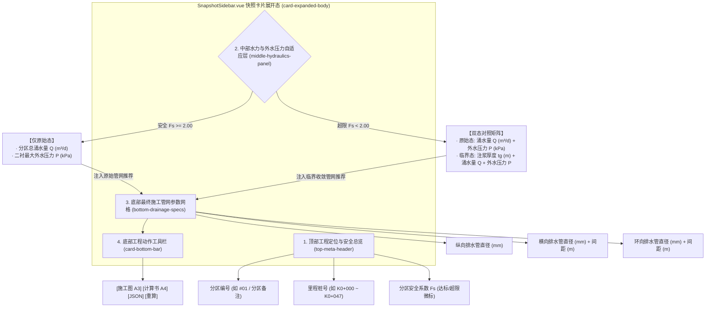

# 阶段4-专题-快照卡片展开态指标三段式重构方案

## Goal Description

### 1. 核心业务痛点与目标分解 (Objectives)

在隧道工程多维协同智能排水自适应平台中，工况快照侧边栏（[SnapshotSidebar.vue](file:///d:/offices/Github/隧道工程多维协同智能排水自适应平台/tunnel-drainage-platform/frontend/src/components/ui/SnapshotSidebar.vue)）是工程师进行全线百段工况水力学复核、二衬结构安全评定、注浆堵水优化与管网参数决策的核心交互窗口。

在既有实现中（`SnapshotSidebar.vue:L477-L620`），深度展开态（`.card-expanded-body`）采用了初期的简易布局：
1. **顶部信息冗余与关键标识缺失**：顶栏仅简单罗列“原始设计水头”与“分区安全系数”，缺失了最重要的工程索引要素——**分区编号**与**里程桩号**，工程师在展开多张卡片滚动对照时难以快速定位物理区段；
2. **中部指标展示逻辑混乱**：
   - 既有实现无论工况安全与否，均在 4 宫格中混杂展示“环向管间距、环向管径、横向管径、分区总涌水量”，既未突出二衬外水压力这一核心结构破坏源，又将管网参数提前挤压在中部；
   - 当工况超限触发临界注浆加固时，在下方以嵌套卡片（`.critical-reinforce-panel`）重复堆砌“加固水头、临界环向间距、临界环向孔径、临界排涌量”，缺乏清晰的“原始超限 vs 临界加固达标”指标对比基线；
   - 缺失关键的**注浆圈加固厚度（$t_g$）**与**二衬最大外水压力（$P_{\max}$）**直观呈现。
3. **底部参数不聚焦且决策重叠**：工程施工落地只需要**一套确定的最终排水管网参数**。若结构安全，施工直接采纳原始状态参数；若结构超限，则采纳临界加固状态对应的管网参数。既有界面上下出现两套管网参数，极易造成施工交底与图纸核对混淆。

为此，需对 `SnapshotSidebar.vue` 展开态进行**三段式（顶部工程定位与安全总览、中部水力外水压力自适应对比、底部最终收敛排水管网参数）工程重构**。

```
┌─────────────────────────────────────────────────────────────────┐
│ 顶部 (Top Header):                                              │
│ [分区编号 #01]   [里程桩号 K0+000 ~ K0+047]   [安全系数 Fs = 1.78]│
├─────────────────────────────────────────────────────────────────┤
│ 中部 (Middle Metrics):                                          │
│   · 满足安全规范 (Fs ≥ 2.00):                                   │
│     仅展示: 原始涌水量 Q (m³/d) | 原始二衬最大外水压力 P (kPa) │
│   · 不满足安全规范 (Fs < 2.00):                                 │
│     原始状态: 涌水量 Q (m³/d)   | 二衬最大外水压力 P (kPa)       │
│     临界加固: 注浆厚度 tg (m)   | 涌水量 Q (m³/d) | 外水压力 P   │
├─────────────────────────────────────────────────────────────────┤
│ 底部 (Bottom Decision): [最终采纳管网施工参数]                  │
│ [纵向管径] [横向管径 / 间距] [环向管径 / 间距] (全中文+工程单位)│
├─────────────────────────────────────────────────────────────────┤
│ 动作栏 (Action Bar): [施工图] [计算书] [JSON] [重算]            │
└─────────────────────────────────────────────────────────────────┘
```

### 2. 约束条件与硬性边界 (Constraints & Hard Boundaries)

1. **UI 字阶生理底线合规 (Typography Readability Floor)**：
   - 严格遵循全局工程规范：所有展开态卡片文字（包含标签、数值、单位、副标题、徽标）必须满足 $\text{font-size} \ge 12\text{px}$（或 $\ge 0.75\text{rem}$）。
   - 严禁在 CSS 中出现 `font-size: 9px`、`10px`、`11px` 等微型字号，严禁使用 `transform: scale(<1.0)` 恶意缩水。
   - 空间溢出治理严禁依靠缩字号，统一采用弹性换行、Flex Wrap、CSS Grid 自适应列宽与 Tooltip 气泡提示。
2. **规范安全门禁硬性约束 (Code Safety Threshold)**：
   - 严格依据《公路隧道设计规范 第一册 土建工程》（JTG 3370.1-2018）与《铁路隧道设计规范》（TB 10003-2016），隧道二次衬砌受压极限状态的容许安全系数刚性门禁为：
     $$[K] = 2.00$$
   - 无论工况是否达标，顶部均必须清晰呈现该分区的安全系数 $F_s$。
   - 分支判断基准为：$F_s \ge 2.00$（达标安全态）与 $F_s < 2.00$（超限预警态）。
3. **数据链降级与容错防御 (Defensive Fallback Contract)**：
   - 最大外水压力 $P_{\max}$ 在低水头工况（`single_low` / `double_low`）下取仰拱外水压力 $P_{\text{invert}}$（水力学最不利受力点），高水头工况（`single_high` / `double_high`）下取均布外水压力 $P$，降级取拱顶外水压力 $P_{\text{crown}}$；
   - 注浆圈厚度优先提取 `tg_crit`，降级推导 $t_g = \max(0, r_{g,\text{crit}} - r_p)$；
   - 待计算状态（`status === 'pending'` 或 `!snap.results`）平滑回退至提示面板，杜绝前端空指针异常。

---

## Proposed Changes

### 1. 架构与系统解构 (Architecture & System Decomposition)



### 2. 字段映射契约与数据流解析 (Data Contract & Flow Modeling)

#### 2.1 顶部数据抽取契约 (Top Metadata Contract)
- **分区编号 (Zone Number)**：
  - 首选：计算序列中的物理序号 `#01`、`#02`（可通过 `snapshots.findIndex(s => s.id === snap.id) + 1` 或父组件传入索引）；
  - 辅显：工程备注说明 `getSnapRemark(snap)`（如“富水破碎带加固段”）；
- **里程桩号 (Chainage Range)**：
  - 格式化标准工程桩号：`formatStation(getChainage(snap, 'start')) ~ formatStation(getChainage(snap, 'end'))`，如 `K0+000 ~ K0+047`；
- **分区安全系数 (Safety Factor $F_s$)**：
  - 数据源：`snap.results.original_state?.safety_factor`（若不存在则提取 `snap.results.critical_state?.final_safety_factor`）；
  - 判定：$F_s \ge 2.00$ 渲染为达标徽标（绿色系），$F_s < 2.00$ 渲染为超限警示徽标（红色系脉冲）。

#### 2.2 中部水力学与二衬受力映射契约 (Middle Hydraulics Contract)
- **原始状态涌水量 $Q_{\text{orig}}$ ($m^3/d$)**：
  - 数据路径：`snap.results.original_state?.Q ?? snap.results.original_state?.q_drain ?? 0`
- **原始状态二衬最大外水压力 $P_{\text{orig},\max}$ ($kPa$)**：
  - 数据路径：`snap.results.original_state?.P_invert ?? snap.results.original_state?.P ?? snap.results.original_state?.P_crown ?? 0`
- **临界注浆圈厚度 $t_g$ ($m$)**：
  - 数据路径：`snap.results.critical_state?.tg_crit ?? Math.max(0, (snap.results.critical_state?.rg_crit - (snap.results.input_parameter?.r_p ?? 8.57)))`
- **临界状态涌水量 $Q_{\text{crit}}$ ($m^3/d$)**：
  - 数据路径：`snap.results.critical_state?.Q ?? snap.results.critical_state?.final_Q ?? 0`
- **临界状态二衬最大外水压力 $P_{\text{crit},\max}$ ($kPa$)**：
  - 数据路径：`snap.results.critical_state?.P_invert ?? snap.results.critical_state?.P ?? snap.results.critical_state?.P_crown ?? snap.results.critical_state?.P_crit_input ?? 0`

#### 2.3 底部最终施工管网收敛契约 (Bottom Drainage Pipeline Contract)
按“结构安全采纳原始参数，结构超限采纳临界参数”原则统一收敛为单个状态对象 `finalPipeState`：

```typescript
// 伪代码契约推导
const isRisk = getSnapshotFs(snap) != null && getSnapshotFs(snap)! < 2.0;
const targetState = isRisk ? snap.results.critical_state : snap.results.original_state;

// 1. 纵向排水管
const d_long_mm = (targetState?.long_diam_recommend ?? targetState?.d_long ?? 0.1) * 1000;

// 2. 横向排水管
const d_lat_mm = (targetState?.lateral_diam_recommend ?? targetState?.d_lat ?? 0.08) * 1000;
const s_lat_m = targetState?.lateral_spacing_recommend ?? targetState?.S_lat ?? snap.results?.input_parameter?.S_lat ?? 20;

// 3. 环向排水管
const d_ring_mm = (targetState?.ring_diam_recommend ?? targetState?.d_ring ?? 0.05) * 1000;
const s_ring_m = targetState?.ring_spacing_recommend ?? targetState?.S_ring ?? 10.0;
```

---

### 3. 三段式自适应布局渲染规格 (Three-tier Structural Rendering Specs)

#### 3.1 顶部工程定位栏 (Top Meta Header)
采用紧凑型 3 列弹性横栏布局：
- **左侧**：分区编号胶囊（如 `分区 #01`），深色/主题色高亮；
- **中间**：里程桩号胶囊（如 `📏 K0+000 ~ K0+047`），附带区间长度提示；
- **右侧**：安全系数徽标（如 `🛡️ Fs 1.78 (超限)` 或 `🛡️ Fs 2.45 (达标)`）。

#### 3.2 中部水力安全指标网格 (Middle Hydraulics Panel)
- **分支 A（满足安全规范 $F_s \ge 2.00$）**：
  渲染两列大数值指标卡片：
  - `卡片 1`：💧 分区总涌水量 $Q$（单位 $m^3/d$）
  - `卡片 2`：🌊 二衬最大外水压力 $P_{\max}$（单位 $kPa$，附标仰拱/均布）
- **分支 B（不满足安全规范 $F_s < 2.00$）**：
  采用两栏并列/上下对比卡片组：
  - `左栏/上栏：原始超限工况 (警示背景)`
    - 涌水量 $Q$ ($m^3/d$)
    - 二衬最大外水压力 $P_{\max}$ ($kPa$)
  - `右栏/下栏：临界加固达标方案 (加固绿/科技蓝背景)`
    - 注浆圈加固厚度 $t_g$ ($m$)（重点高亮加粗）
    - 加固后涌水量 $Q_{\text{crit}}$ ($m^3/d$)
    - 加固后外水压力 $P_{\text{crit},\max}$ ($kPa$)

#### 3.3 底部最终管网施工参数 (Bottom Drainage Specs)
展示标题：“🛠️ 最终施工排水管网参数（临界控压加固方案 / 原始标准防排方案）”
采用清晰的网格或三行结构化参数牌呈现：
1. **纵向排水管**：直径 $\Phi\ 100\text{ mm}$（通长贯通布设于隧道两侧墙脚）
2. **横向排水管**：直径 $\Phi\ 80\text{ mm}$ · 间距 $20.0\text{ m}$（引水入中心水沟）
3. **环向排水管**：直径 $\Phi\ 50\text{ mm}$ · 间距 $10.0\text{ m}$（初支与二衬间密贴布设）

#### 3.4 底部动作栏 (Actions)
保持既有高质量胶囊按钮组：
- 施工图（A3 PDF / PNG）
- 计算书（A4 Typst 预览 / PDF 下载）
- JSON（原始数据下载）
- 重算（单段重新计算）

---

### 4. 样式系统与视觉排版规范 (Styling & CSS Architecture)

严格落实字阶生理底线，杜绝任何小于 12px 的字体：

```css
/* 字阶与间距规范 */
.top-meta-header {
  display: flex;
  align-items: center;
  justify-content: space-between;
  gap: 8px;
  padding: 8px 10px;
  background: var(--sys-bg-subtle, #f8fafc);
  border-radius: 6px;
  border: 1px solid var(--sys-border-light, #e2e8f0);
  font-size: 12px; /* 严格 >= 12px */
}

.zone-badge {
  font-weight: 700;
  font-size: 12px;
  padding: 2px 8px;
  border-radius: 4px;
  background: var(--el-color-primary-light-9, #ecf5ff);
  color: var(--el-color-primary, #409eff);
}

.chainage-badge {
  font-weight: 600;
  font-size: 12px;
  color: var(--sys-text-primary, #1e293b);
  display: flex;
  align-items: center;
  gap: 4px;
}

.fs-indicator-badge {
  font-size: 12px;
  font-weight: 700;
  padding: 2px 8px;
  border-radius: 12px;
}
.fs-indicator-badge.is-safe {
  background: #f0fdf4;
  color: #16a34a;
  border: 1px solid #bbf7d0;
}
.fs-indicator-badge.is-danger {
  background: #fef2f2;
  color: #dc2626;
  border: 1px solid #fecaca;
}

/* 中部指标卡片网格 */
.hydraulics-grid {
  display: grid;
  grid-template-columns: repeat(2, 1fr);
  gap: 8px;
  margin-top: 8px;
}

.metric-box {
  padding: 8px 10px;
  background: #ffffff;
  border: 1px solid var(--sys-border-light, #e2e8f0);
  border-radius: 6px;
  display: flex;
  flex-direction: column;
  gap: 4px;
}
.metric-box .metric-title {
  font-size: 12px;
  color: var(--sys-text-secondary, #64748b);
}
.metric-box .metric-number {
  font-size: 14px;
  font-weight: 700;
  color: var(--sys-text-primary, #0f172a);
}
.metric-box .metric-unit {
  font-size: 12px;
  font-weight: 400;
  color: var(--sys-text-muted, #94a3b8);
  margin-left: 2px;
}

/* 临界超限对比双列卡片 */
.dual-state-panel {
  display: flex;
  flex-direction: column;
  gap: 8px;
  margin-top: 8px;
}
.state-subcard {
  padding: 8px 10px;
  border-radius: 6px;
  border: 1px solid transparent;
}
.state-subcard.orig-danger {
  background: #fff5f5;
  border-color: #fed7d7;
}
.state-subcard.crit-solution {
  background: #f0fdf9;
  border-color: #ccfbf1;
}

/* 底部最终管网施工参数 */
.final-pipes-panel {
  margin-top: 8px;
  padding: 8px 10px;
  background: #f8fafc;
  border: 1px solid var(--sys-border-light, #e2e8f0);
  border-radius: 6px;
}
.pipes-grid {
  display: grid;
  grid-template-columns: repeat(3, 1fr);
  gap: 6px;
  margin-top: 6px;
}
.pipe-item {
  display: flex;
  flex-direction: column;
  gap: 2px;
}
.pipe-name {
  font-size: 12px;
  color: #64748b;
}
.pipe-val {
  font-size: 12px;
  font-weight: 600;
  color: #1e293b;
}
```

---

### 5. 任务分解结构 (Work Breakdown Structure, WBS)

| 阶段 | 编号 | 任务名称 | 具体实施内容 | 影响文件 |
| :--- | :--- | :--- | :--- | :--- |
| **阶段 1** | T1.1 | 辅助函数与字段抽取器扩展 | 在 `<script setup>` 中编写桩号格式化、最大二衬外水压力提取（$P_{\text{invert}} \to P \to P_{\text{crown}}$）、注浆圈厚度抽取器及最终管网参数派生计算函数 | [SnapshotSidebar.vue](file:///d:/offices/Github/隧道工程多维协同智能排水自适应平台/tunnel-drainage-platform/frontend/src/components/ui/SnapshotSidebar.vue) |
| **阶段 2** | T2.1 | 顶部工程定位栏重构 | 重构展开态首行：渲染分区编号、规范化里程桩号范围、安全系数状态微标（达标/超限），移除孤立的旧版水头与安全系数双卡 | [SnapshotSidebar.vue](file:///d:/offices/Github/隧道工程多维协同智能排水自适应平台/tunnel-drainage-platform/frontend/src/components/ui/SnapshotSidebar.vue) |
| **阶段 3** | T3.1 | 中部水力学二分支渲染逻辑 | 根据 `getSnapshotFs(snap) >= 2.0` 实现二分支：达标仅展示原始涌水量与外水压力；超限并列展示原始超限与临界加固（含注浆圈厚度 $t_g$） | [SnapshotSidebar.vue](file:///d:/offices/Github/隧道工程多维协同智能排水自适应平台/tunnel-drainage-platform/frontend/src/components/ui/SnapshotSidebar.vue) |
| **阶段 4** | T4.1 | 底部收敛管网参数网格 | 实现底部纵向、横向、环向三大管道的直径（mm）与间距（m）单一最终结果展示，安全态映射原始、超限态映射临界 | [SnapshotSidebar.vue](file:///d:/offices/Github/隧道工程多维协同智能排水自适应平台/tunnel-drainage-platform/frontend/src/components/ui/SnapshotSidebar.vue) |
| **阶段 5** | T5.1 | 样式重构与字阶质检门禁 | 补充新三段式 CSS 样式，验证所有字号 $\ge 12\text{px}$，适配 300px~600px 宽度容器自适应 | [SnapshotSidebar.vue](file:///d:/offices/Github/隧道工程多维协同智能排水自适应平台/tunnel-drainage-platform/frontend/src/components/ui/SnapshotSidebar.vue) |

---

## Verification Plan

### 1. 验收标准 (Acceptance Criteria)

1. **三段式结构完整性**：
   - 展开态必须且仅能分为：顶部（分区编号、桩号、安全系数）、中部（水力涌水量与外水压力对比）、底部（最终收敛排水管网参数）；
   - 动作栏（施工图、计算书、JSON、重算）及 pending 友好提示功能完整无破损。
2. **分支逻辑精确性**：
   - 当快照 $F_s \ge 2.00$ 时：中部仅出现“原始状态下的分区总涌水量”与“原始状态下的二衬最大外水压力”，不出现注浆加固相关字段；底部展示原始状态排水管参数；
   - 当快照 $F_s < 2.00$ 时：中部必须完整对比展示“原始状态（涌水量、最大外水压力）”与“临界状态（注浆厚度 $t_g$、加固后涌水量、加固后最大外水压力）”；底部仅展示临界加固收敛后的排水管参数。
3. **管网参数完整性**：
   - 纵向管：直径（mm）；
   - 横向管：直径（mm）、间距（m）；
   - 环向管：直径（mm）、间距（m）；
   - 严禁出现未转换的米制孔径（如 `0.05m`，必须为 `50mm`）。
4. **字阶底线无违规**：
   - 全组件所有渲染文本及样式配置严格满足 $\text{font-size} \ge 12\text{px}$。

### 2. 自动化与人工验证用例 (Automated/Manual Verification Cases)

| 用例 ID | 验证场景 | 前置输入数据 | 预期展示行为 | 验证方式 |
| :--- | :--- | :--- | :--- | :--- |
| **TC-01** | 安全达标工况展开 | $F_s = 2.45 \ge 2.00$, $Q = 180\text{ m}^3/\text{d}$, $P_{\text{invert}} = 450\text{ kPa}$ | 顶部标绿 `Fs 2.45 (达标)`；中部仅展示原始 $Q$ 与 $P_{\max}$；底部展示原始 DN100 纵向、DN80 横向、DN50 环向管 | 浏览器点击展开卡片视觉查验 |
| **TC-02** | 预警超限工况展开 | $F_s = 1.78 < 2.00$, 临界 $t_g = 0.89\text{ m}$, 临界 $Q = 313.16\text{ m}^3/\text{d}$ | 顶部标红 `Fs 1.78 (超限)`；中部并列呈现原始与临界状态，明确呈现注浆厚度 $0.89\text{ m}$；底部展示临界管网参数 | 浏览器点击展开预警卡片查验 |
| **TC-03** | 未计算工况展开 | `status = 'pending'`, 无 `results` | 优雅展示“该工况尚未执行计算引擎，请点击右下角重算或批量计算”，不报错崩毁 | 切换待算工况卡片查验 |
| **TC-04** | 响应式容器极小宽度 | 侧边栏拖拽至 $320\text{px}$ 宽度 | 三段式内容自适应流式折行，不产生横向滚动溢出，字阶保持 $\ge 12\text{px}$ | 浏览器 DevTools 缩放侧边栏 |
