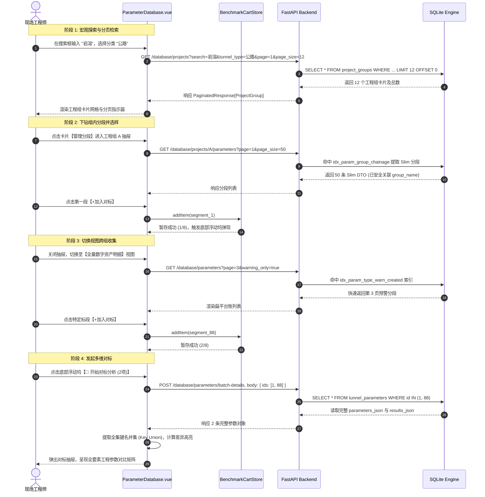
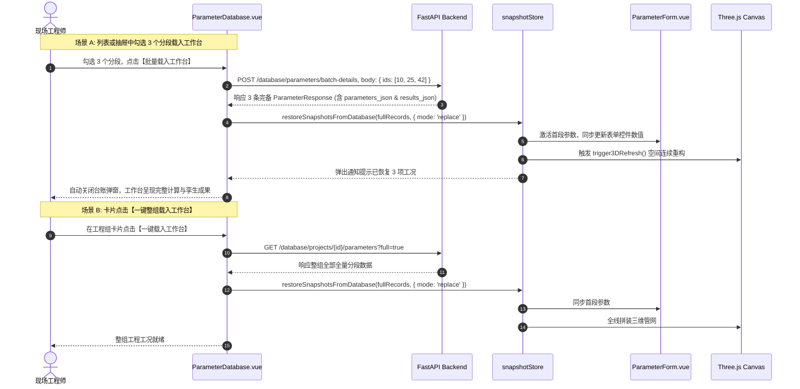

<!-- docs/stages/stage6-delivery/阶段6-海量工程参数台账分页分散与跨组多维对标分析方案.md -->

# 【阶段6-系统方案】：海量工程参数台账分页分散与跨组多维对标分析架构方案

> **系统分析与工程架构声明 (System Analyst & Engineering Architecture Mandate)**：  
> 本方案严格遵循系统分析与微观数据流水线验证规范，针对“隧道工程多维协同智能排水自适应平台”阶段六在海量数字资产管理场景下的可扩展性瓶颈展开深度工程重构。针对“数百工程组、数万分区段”的未来容量演进诉求，彻底解构无分页状态下的内存溃败与 DOM 灾难，建立**“三级分流分散架构”**、**“按需水合加载管线 (Hydration Bridge)”**与**“跨页跨组对标暂存篮 (Global Benchmark Cart)”**机制，输出确定性的架构拓扑、边界契约矩阵、数据流拓扑、WBS 分工及工业级验收指标。

---

## 一、 Objectives (目标体系与现状解构)

### 1.1 现状代码级事实解构 (Fact, Judgment and Speculation)

- **事实 (Fact)**：
  1. **前端请求全量无分页**：`ParameterDatabase.vue` 在 `onMounted` 和 `fetchData` 中通过 `Promise.all` 并发请求 `/database/projects` 与 `/database/parameters`，一次性拉取全量工程组与全量分段记录至浏览器内存。
  2. **后端硬编码静默截断**：`database.py` 中 `/database/parameters` 接口强制限制 `limit = 500`。当数据库中分区段数量超过 500 条时，超出部分**在前端完全静默不可见、不可检索、不可分析**。
  3. **数据载荷过度冗余 (Fat DTO)**：`ParameterResponse` 包含完整的 `parameters_json`（大字段输入字典）和 `results_json`（大字段计算成果字典）。即使在扁平台账列表仅展示“工程名/桩号/安全系数”等元数据时，后端依然将完整 JSON 字符串全量序列化并下发。
  4. **视图选中绑定易失 (Volatile Selection)**：当前对标分析多选机制直接依赖 Element Plus `<el-table>` 的 `@selection-change`。表格当前渲染行一旦因检索词输入、分类过滤或重载而发生变动，已选中的对标项即刻丢失；且卡片下钻抽屉（单个工程组明细）与全局扁平表之间选择状态完全割裂，无法实现跨工程组多段对标。
  5. **工作台快照还原依赖大字段 JSON**：`snapshotStore.restoreSnapshotsFromDatabase()` 强依赖记录中的 `parameters_json` 与 `results_json` 进行反序列化，以此恢复表单参数、水力计算状态及 3D 数字孪生多段拼接。

- **判断 (Judgment)**：
  1. 当前前端纯内存计算与过滤机制属于原型期（<500 项）实现，面对“数百工程组、数万分区段”存在**物理不可行性**。
  2. 列表展示必须与工作台恢复解耦：台账浏览采用**轻量元数据模型 (Slim DTO)**；当触发“对标分析”或“载入工作台”时，通过**按需水合管线 (Hydration Bridge)** 靶向获取全量 JSON，彻底杜绝数据传输与内存雪崩。
  3. 后端接口改造必须保证**向后兼容性**，避免破坏 `ParameterForm.vue` 与 `SnapshotSidebar.vue` 现有的工程组下拉选择逻辑。

- **推测 (Speculation)**：
  1. 现场一线工程师进行对标分析时，通常跨越 2~5 个不同标段（上限 $\le 8$ 项）；载入工作台通常为单段调试或整组 3D 拼装（通常 $\le 100$ 段）。按需水合的网络吞吐压力远小于无分页全量预载。

### 1.2 物理级算力与吞吐瓶颈分析

设系统演进目标规模为：工程组数量 $N_{\text{group}} = 500$，总计算分段数量 $N_{\text{segment}} = 50,000$。单条参数记录中，`parameters_json` 平均尺寸约为 $1.2\,\text{KB}$，`results_json` 平均尺寸约为 $2.8\,\text{KB}$，基础标量列约为 $0.3\,\text{KB}$。

```
【当前全量无分页模式的灾难推导】
┌────────────────────────────────────────────────────────────────────────┐
│ 1. 传输载荷 (Payload Size):                                            │
│    50,000 条 × (1.2KB + 2.8KB + 0.3KB 基础列) ≈ 215 MB 压缩前 JSON 文本   │
│    -> 即使 Gzip 压缩后仍有 20~30 MB，导致现场弱网下载直接超时中断         │
├────────────────────────────────────────────────────────────────────────┤
│ 2. 内存堆占用 (V8 Heap Footprint):                                     │
│    V8 对 215 MB JSON 执行反序列化，生成 50,000 个深层 JavaScript 对象    │
│    Vue 3 对其建立深层响应式 Proxy 劫持 -> 堆内存暴增至 800 MB ~ 1.2 GB   │
│    -> 频繁触发 Major GC (Stop-the-world)，前端界面出现秒级严重卡死掉帧   │
├────────────────────────────────────────────────────────────────────────┤
│ 3. DOM 树灾难 (Render Tree Explosion):                                 │
│    标准 el-table 若无虚拟滚动，50,000 行 × 10 列 = 500,000 个 DOM 节点  │
│    -> 远超 Chromium 渲染器建议的 1,500 个节点上限，浏览器标签页直接崩溃    │
├────────────────────────────────────────────────────────────────────────┤
│ 4. 后端数据库 I/O 阻塞:                                                │
│    无分页下 SQLite 执行全表扫描 SELECT * FROM tunnel_parameters        │
│    -> 磁盘 I/O 打满，并发计算结果入库请求被排队死锁                      │
└────────────────────────────────────────────────────────────────────────┘
```

**定论**：必须推行“架构级分页分流、按需水合、全局对标暂存篮”的系统级重构。

---

## 二、 Constraints & Boundary Contract Matrix (边界契约矩阵)

| 维度 / 契约要素 | 现状痛点 (As-Is) | 目标架构规范 (To-Be) | 物理边界与协议规范 |
| :--- | :--- | :--- | :--- |
| **数据拉取模式** | 全量拉取 (`limit=500` 假全量) | 服务端强分页 (`page / page_size` + 总数) | RESTful RFC 7233 范围分页规范 |
| **列表传输载荷** | 完整包含参数与成果 JSON | **轻量元数据投影 (Slim DTO)**，剥离大字段 | 单条网络载荷 $\le 180\,\text{B}$ |
| **数据水合机制** | 无按需加载，强行读取全量 | **按需水合加载管线 (Hydration Bridge)** | 批量详情接口 `POST /parameters/batch-details` |
| **工程组呈现** | 纯前端计算过滤所有卡片 | 服务端关键词过滤 + 分页卡片流 (支持全量降级) | 兼容 `ParameterForm` 与 `SnapshotSidebar` |
| **单工程下钻抽屉** | 单组一次性拉取全部区段 | 组内分页检索 + 虚拟滚动表格 (`el-table-v2`) | DOM 节点数恒定 $\le 60$ |
| **对标选中持久性** | 绑定表格视图，换页即失 | **全局对标暂存篮 (Benchmark Cart)**，Pinia + Storage | 全局响应式状态，跨组/跨页无损累积 |
| **对标数据装载** | 预先全量加载内存待比对 | **按需靶向加载 (Lazy Fetch on Compare)** | 仅拉取暂存篮中 $K$ 项 ($K \le 8$) 的全量 JSON |
| **对标表头聚合** | 仅取首项参数键名，遗漏差异列 | **全选定项键名全集并集 (Key Union)** | 动态提取全量选定项的全部参数键 |
| **排版字阶约束** | 部分小胶囊使用过小字阶 | 严格遵守 $\text{font-size} \ge 12\text{px}$ 规范 | [Global Rule] UI 字阶生理底线 |

---

## 三、 Proposed Changes: 三级分流与按需水合架构体系

构建“宏观工程组 -> 中观组内标段 -> 微观全量明细”的三级递进分流架构，并打通“对标分析”与“载入工作台”的双向水合管线：

```
                              【用户查询与探索入口】
                                         │
                   ┌─────────────────────┴─────────────────────┐
                   ▼                                           ▼
         【视图 A: 工程分组卡片视图】                  【视图 B: 扁平全量台账视图】
     (聚焦宏观工程项目，容量: 500+ 组)             (聚焦全网细颗粒度资产，容量: 50,000+ 段)
                   │                                           │
         服务端分页卡片流                                服务端分页轻量台账 (Slim DTO)
        (Page Size: 12~24/页)                         (Page Size: 50~100/页)
                   │                                           │
                   ▼                                           │
         【单工程下钻抽屉】                                    │
       (展示单工程名下 50~500 段)                              │
        - 组内桩号/状态检索                                    │
        - 虚拟滚动极速渲染                                     │
                   │                                           │
                   ├───────────────────────────────────────────┤
                   │                                           │
         [分支 1: 加入对标]                          [分支 2: 载入工作台]
                   │                                           │
                   ▼                                           ▼
       ┌───────────────────────┐                   ┌───────────────────────┐
       │ 全局对标暂存篮 (Cart)  │                   │ 单段/批量/整组选择载入 │
       │ (跨组跨页记忆，上限8项) │                   │ (用户勾选或点击卡片)  │
       └───────────┬───────────┘                   └───────────┬───────────┘
                   │ 点击【开始对标】                          │ 触发载入动作
                   └─────────────────────┬─────────────────────┘
                                         │
                                         ▼
                   ┌───────────────────────────────────────────┐
                   │        按需水合管线 (Hydration Bridge)     │
                   │  POST /api/v1/database/parameters/batch-  │
                   │  details, body: { ids: [id1, id2, ...] }  │
                   │  (仅针对选中的 N 项靶向拉取完整 JSON 字段) │
                   └─────────────────────┬─────────────────────┘
                                         │
                   ┌─────────────────────┴─────────────────────┐
                   ▼                                           ▼
       ┌───────────────────────┐                   ┌───────────────────────┐
       │  高保真多维对标矩阵   │                   │  快照库与工作台状态机 │
       │ - 全键名并集 (Union)   │                   │  snapshotStore.       │
       │ - 动态差异标红高亮     │                   │  restoreSnapshots...  │
       │ - A3/CSV 报告导出     │                   │ - 激活主表单 / 3D 重建│
       └───────────────────────┘                   └───────────────────────┘
```

### 3.1 核心数据传输协议优化 (Slim DTO vs Full DTO)

#### 1. 扁平明细与下钻抽屉：轻量元数据模型 (`TunnelParameterSlimResponse`)
在列表分页展示时，彻底剥离占用 90% 体积的 `parameters_json` 与 `results_json`，并由后端物理列直接支持安全系数 `safety_factor` 与预警标识 `is_warning`：

```python
# relative/path/backend/app/schemas/parameter_database.py

from datetime import datetime
from typing import Generic, TypeVar, List, Any
from pydantic import BaseModel, Field

T = TypeVar("T")

class TunnelParameterSlimResponse(BaseModel):
    """
    轻量分段元数据 DTO (用于海量分页列表与抽屉展示，单条网络开销 < 180 字节)
    """
    id: int
    group_id: int | None
    group_name: str | None = Field(default=None, description="所属工程组名称 (通过 SQL OuterJoin 提取)")
    project_name: str
    tunnel_type: str
    start_chainage: float
    end_chainage: float
    has_results: bool = Field(default=False, description="是否包含有效计算成果")
    safety_factor: float | None = Field(default=None, description="控制安全系数 Fs")
    is_warning: bool = Field(default=False, description="是否处于预警/临界加固状态")
    created_at: datetime

    model_config = {"from_attributes": True}

class PaginatedResponse(BaseModel, Generic[T]):
    """标准通用服务端分页载荷"""
    total: int = Field(description="匹配筛选条件的总记录数")
    page: int = Field(description="当前页码 (1-based)")
    page_size: int = Field(description="每页记录数")
    items: List[T]
```

#### 2. 按需水合与对标专属：批量详情聚合协议 (`BatchFetchRequest`)
无论是对标分析还是将选定分段载入工作台，统一调用批量详情接口按需水合：

```python
# relative/path/backend/app/schemas/parameter_database.py

class BatchParametersQuery(BaseModel):
    ids: List[int] = Field(..., min_length=1, max_length=100, description="需要调取完整参数与结果的ID列表")
```

---

## 四、 跨组海量分段对标暂存篮机制设计 (Benchmark Cart)

### 4.1 核心痛点与解决思路

在数万分段中，工程师的核心诉求是：
> “我在 A 隧道（重岩溶段）筛选出了一个预警分段，又去 B 隧道（高水压段）找到了一个对比分段，还想从历史未分组台账中调一个标杆分段，把这三段放在一张表上对比差异。”

解决方案为**引入“独立业务级对标暂存篮 (Benchmark Cart)”**：

```
+-------------------------------------------------------------------------------------------------+
|                                 ParameterDatabase 页面主视口                                     |
|  [工程组卡片 / 抽屉 / 扁平台账] ──> 点击行操作【+加入对标】                                       |
|                                         │                                                       |
|                                         ▼ 响应式同步                                            |
|  ┌───────────────────────────────────────────────────────────────────────────────────────────┐  |
|  │ 底部常驻悬浮对标坞 (Floating Benchmark Dock)                                               │  |
|  │  📊 对标暂存篮 (3/8)   [晏家_K0+100] [缙云山_K5+200] [中梁山_K12+300]   [清空]  [🚀开始对标]  │  |
|  └───────────────────────────────────────────────────────────────────────────────────────────┘  |
+-------------------------------------------------------------------------------------------------+
```

### 4.2 对标暂存篮状态管理设计 (Pinia Store)

```typescript
// relative/path/frontend/src/store/benchmarkCartStore.ts

import { defineStore } from 'pinia';
import { ref, computed } from 'vue';
import { ElMessage } from 'element-plus';

export interface BenchmarkItemMeta {
  id: number;
  group_id: number | null;
  group_name: string;
  project_name: string;
  tunnel_type: string;
  start_chainage: number;
  end_chainage: number;
  safety_factor: number | null;
}

export const useBenchmarkCartStore = defineStore('benchmarkCart', () => {
  const MAX_CAPACITY = 8; // 对标分析最多容纳 8 根柱/列对比，避免横向过度挤压
  const cartItems = ref<BenchmarkItemMeta[]>([]);

  // 本地存储持久化恢复
  const initFromStorage = () => {
    const raw = localStorage.getItem('TUNNEL_BENCHMARK_CART');
    if (raw) {
      try { cartItems.value = JSON.parse(raw); } catch (e) { cartItems.value = []; }
    }
  };

  const syncToStorage = () => {
    localStorage.setItem('TUNNEL_BENCHMARK_CART', JSON.stringify(cartItems.value));
  };

  const isPinned = computed(() => {
    return (id: number) => cartItems.value.some(item => item.id === id);
  });

  const count = computed(() => cartItems.value.length);

  const addItem = (item: BenchmarkItemMeta) => {
    if (isPinned.value(item.id)) {
      ElMessage.info('该工程分段已在对标暂存篮中');
      return;
    }
    if (cartItems.value.length >= MAX_CAPACITY) {
      ElMessage.warning(`对标暂存篮已满 (上限 ${MAX_CAPACITY} 项)，请先移除非必要对比段`);
      return;
    }
    cartItems.value.push(item);
    syncToStorage();
    ElMessage.success(`已将 [${item.project_name}] 加入对标暂存篮`);
  };

  const removeItem = (id: number) => {
    cartItems.value = cartItems.value.filter(item => item.id !== id);
    syncToStorage();
  };

  const clearCart = () => {
    cartItems.value = [];
    syncToStorage();
  };

  return {
    cartItems,
    count,
    isPinned,
    addItem,
    removeItem,
    clearCart,
    initFromStorage
  };
});
```

### 4.3 全选定项键名全集并集算法 (Key Union)

针对多工况对比可能存在的参数键集合异构问题，对标行头聚合必须采用全集并集计算，禁止只读取第一项：

```typescript
// relative/path/frontend/src/views/ParameterDatabase.vue (对标表头聚合算法)

const compareKeys = computed(() => {
  if (detailedCompareRows.value.length === 0) return [];
  const allKeys = new Set<string>();
  
  // 遍历所有选定对比工况，聚合全集参数键名
  detailedCompareRows.value.forEach(row => {
    const params = typeof row.parameters_json === 'string' 
      ? JSON.parse(row.parameters_json) 
      : (row.parameters_json || {});
    Object.keys(params).forEach(k => allKeys.add(k));
  });

  const deprecatedKeys = new Set([
    'beta2', 'ha', 'rebar_type', 'double_side', 'P_crit', 
    'c', 'K', 'h', 'r', 'r1', 'r2', 'rg', 'K1', 'K2', 'Kg'
  ]);

  return Array.from(allKeys)
    .filter(k => !deprecatedKeys.has(k))
    .map(key => ({ key }));
});
```

---

## 五、 后端服务与数据库物理架构改造

### 5.1 数据库物理列补充与索引升级 (SQLite / PostgreSQL)

为保证服务端在 50,000 条规模下毫秒级响应分页过滤，并在 ORM 映射时杜绝 `ValidationError` 与 `MissingGreenlet`，在 `tunnel_parameters` 物理表中补充轻量标量列：

```python
# relative/path/backend/app/models/domain.py (新增标量索引列定义)

class TunnelParameter(Base):
    __tablename__ = "tunnel_parameters"
    # ... 现有字段保持不变 ...
    
    # 🟢 新增物理标量列：支撑毫秒级分页与预警检索
    has_results = Column(Integer, default=0, index=True, comment="是否有成果: 0=待算纯参数, 1=已完成计算")
    safety_factor = Column(Float, nullable=True, comment="控制安全系数 Fs 缓存值")
    is_warning = Column(Integer, default=0, index=True, comment="是否处于临界加固预警: 0=安全, 1=预警")
```

配套物理索引定义：

```sql
-- relative/path/backend/migrations/add_benchmark_indexes.sql

-- 1. 支撑工程组内按里程排序与状态筛选的复合覆盖索引
CREATE INDEX IF NOT EXISTS idx_param_group_chainage ON tunnel_parameters (group_id, start_chainage ASC);

-- 2. 支撑全局扁平台账类型、预警状态与时间复合检索
CREATE INDEX IF NOT EXISTS idx_param_type_warn_created ON tunnel_parameters (tunnel_type, is_warning, created_at DESC);

-- 3. 支撑工程名模糊与前缀检索
CREATE INDEX IF NOT EXISTS idx_param_project_name ON tunnel_parameters (project_name);
```

### 5.2 后端 API 接口契约重构矩阵

#### 接口 1：工程组卡片服务端分页查询 (带平滑兼容)
- **端点**：`GET /api/v1/database/projects`
- **入参 Query**：
  - `page`: int | None = Query(default=None, description="页码，不传或传 None 时按向后兼容模式返回全量列表")
  - `page_size`: int = Query(default=12, description="每页卡片数量")
  - `search`: str | None = None
  - `tunnel_type`: str | None = None
  - `all`: bool = False (为 True 时强行返回全量轻量数组，供下拉选择框使用)
- **出参**：
  - 若 `page is not None and not all`：返回 `PaginatedResponse[ProjectGroupSummaryResponse]`
  - 若 `page is None or all`：返回 `List[ProjectGroupSummaryResponse]`（**确保 `ParameterForm.vue` 与 `SnapshotSidebar.vue` 零回归破坏**）

#### 接口 2：单工程组分段明细服务端分页查询
- **端点**：`GET /api/v1/database/projects/{project_id}/parameters`
- **入参 Query**：
  - `page`: int | None = 1
  - `page_size`: int = 50
  - `search`: str | None = None
  - `status_filter`: Literal["all", "done", "pending", "warning"] = "all"
  - `full`: bool = False (为 True 时一次性拉取整组全量包含大字段 JSON 的分段，专供“一键整组载入工作台”使用)
- **出参**：
  - `full=False` 时：`PaginatedResponse[TunnelParameterSlimResponse]`
  - `full=True` 时：`List[ParameterResponse]`

#### 接口 3：全量扁平数字资产服务端分页台账
- **端点**：`GET /api/v1/database/parameters`
- **入参 Query**：
  - `page`: int = 1
  - `page_size`: int = 50
  - `search`: str | None = None
  - `tunnel_type`: str | None = None
  - `has_results`: bool | None = None (通过 `has_results` 物理列过滤)
  - `warning_only`: bool = False (通过 `is_warning` 物理列走覆盖索引过滤)
- **出参**：`PaginatedResponse[TunnelParameterSlimResponse]`
  - 后端通过 `select(TunnelParameter, ProjectGroup.group_name).outerjoin(ProjectGroup, TunnelParameter.group_id == ProjectGroup.id)` 执行高效组装，避免异步 ORM 惰性加载异常。

#### 接口 4：靶向详情聚合水合端点 (统一命名)
- **端点**：`POST /api/v1/database/parameters/batch-details`
- **入参 Body**：`{"ids": [12, 18, 45, 99]}` (支持 1~100 个 ID)
- **出参**：`List[ParameterResponse]` (完整包含 `parameters_json` 与 `results_json`)

---

## 六、 详细数据流与时序图模型

### 6.1 跨组检索并加入对标暂存篮数据流



### 6.2 按需水合载入工作台数据流 (Hydration on Restore)



---

## 七、 前端 UI 规范与视觉交互实施细节

### 7.1 UI 字阶底线与无障碍合规约束
遵照全局工程规范（[Global Rule] UI & Typography Readability Floor）：
- **硬性底线**：所有卡片标题、微标文字、桩号代码、表格单元格字阶必须满足 $\text{font-size} \ge 12\text{px}$。
- **空间代偿**：当表格列多或桩号过长时，禁止使用 `font-size: 10px` 或 `transform: scale(0.8)` 缩放文字，必须采用：
  1. `show-overflow-tooltip` 配合单行文本截断；
  2. 规范化桩号代码字体：`font-family: var(--font-mono, monospace)`；
  3. 胶囊徽标内边距紧凑化（如 `padding: 2px 6px` 代替缩减字号）。

### 7.2 底部常驻悬浮对标坞 (Floating Benchmark Dock) 视觉设计规范

```css
/* relative/path/frontend/src/views/ParameterDatabase.vue (局部样式规范) */

.floating-benchmark-dock {
  position: fixed;
  bottom: 24px;
  left: 50%;
  transform: translateX(-50%);
  z-index: 2000;
  display: flex;
  align-items: center;
  gap: 16px;
  padding: 10px 20px;
  background: var(--el-bg-color-overlay, #ffffff);
  border: 1px solid var(--el-border-color-light, #dcdfe6);
  border-radius: 40px;
  box-shadow: 0 8px 32px rgba(0, 0, 0, 0.16);
  backdrop-filter: blur(12px);
  animation: floatUp 0.3s cubic-bezier(0.16, 1, 0.3, 1);
}

.dock-badge-title {
  font-size: 13px; /* >= 12px 生理底线 */
  font-weight: 600;
  color: var(--el-text-color-primary);
  display: flex;
  align-items: center;
  gap: 6px;
}

.dock-chips-group {
  display: flex;
  gap: 8px;
  max-width: 520px;
  overflow-x: auto;
  padding: 2px 0;
}

.dock-chip {
  font-size: 12px; /* >= 12px 生理底线 */
  height: 28px;
  display: flex;
  align-items: center;
}
```

---

## 八、 Work Breakdown Structure (实施阶段与任务分解)

```
┌────────────────────────────────────────────────────────────────────────┐
│                        WBS 阶段分工与依赖闭环                           │
├──────────────────┬─────────────────────────────────────────────────────┤
│ Phase 1: 数据库与 │ - 物理表 `tunnel_parameters` 增补 `has_results`,    │
│ 后端接口重构     │   `safety_factor`, `is_warning` 物理列与迁移脚本     │
│                  │ - 补充复合覆盖索引 `idx_param_type_warn_created`     │
│                  │ - 声明 `TunnelParameterSlimResponse` 与分页泛型载荷  │
│                  │ - 升级 `/database/projects` 支持分页并保留无参全量兼容│
│                  │ - 升级 `/database/parameters` 服务端分页与多维过滤   │
│                  │ - 实现统一水合端点 `POST /parameters/batch-details`  │
│                  │ - 升级 `/projects/{id}/parameters` 支持 `full=true`  │
├──────────────────┼─────────────────────────────────────────────────────┤
│ Phase 2: 全局对标 │ - 新增 Pinia `useBenchmarkCartStore` 状态机         │
│ 暂存篮与水合封装  │ - 实现 LocalStorage 自动水合与跨会话记忆            │
│                  │ - 封装前端靶向水合辅助函数 `hydrateParametersByIds`  │
│                  │ - 编写 `BenchmarkFloatingDock.vue` 全局悬浮坞组件   │
│                  │ - 注入容量保护与一键清空/移除微交互                 │
├──────────────────┼─────────────────────────────────────────────────────┤
│ Phase 3: 视图与抽 │ - `ParameterDatabase.vue` 卡片流引入 `el-pagination`│
│ 屉分页与载入联动  │ - 抽屉表格升级为组内服务端分页 (或 `el-table-v2`)    │
│                  │ - 抽屉每行增加【+加入对标】状态绑定                  │
│                  │ - 卡片【整组载入】切换为 `full=true` 水合拉取       │
│                  │ - 抽屉与扁平表【载入工作台】挂载靶向水合流水线       │
├──────────────────┼─────────────────────────────────────────────────────┤
│ Phase 4: 联动组件 │ - 检查并适配 `ParameterForm.vue` 解析 `res.items`   │
│ 兼容与对标矩阵    │ - 检查并适配 `SnapshotSidebar.vue` 批量归档下拉     │
│                  │ - 改造 `compareDrawerVisible` 为基于暂存篮靶向渲染   │
│                  │ - 升级对标表头为全选定项键名全集并集 (Key Union)     │
│                  │ - 补全全量参数差异高亮与 A3/CSV 导出功能             │
├──────────────────┼─────────────────────────────────────────────────────┤
│ Phase 5: 压测验收 │ - 注入 50,000 条分区段模拟数据验证分页性能           │
│ 与指标门禁        │ - 验证首屏加载时间、内存占用与 DOM 节点数           │
│                  │ - 验收跨工程组、跨页面对标全流程闭环                │
│                  │ - 验收载入工作台表单恢复与 3D 画布重建闭环           │
└──────────────────┴─────────────────────────────────────────────────────┘
```

---

## 九、 Verification Plan & Quality Gates (验收指标与验证方案)

### 9.1 核心量化验收指标

| 质量门禁指标 | 现状指标 (As-Is) | 目标验收门禁 (Target Gate) | 验证手段 |
| :--- | :--- | :--- | :--- |
| **支持数据容量** | < 500 条 (超出截断) | **$\ge 50,000$ 条**分段，数百工程组 | 自动化数据填充测试脚本 |
| **首屏数据传输体积** | ~20 MB (随数据线性增加) | **$\le 80\,\text{KB}$** (恒定不随库容膨胀) | Chrome DevTools Network 审查 |
| **首屏页面渲染时延** | > 3500 ms (或标签页卡死) | **$\le 600\,\text{ms}$** | Lighthouse / Performance Trace |
| **DOM 节点总数** | > 25,000 个 (DOM 爆炸) | **$\le 1,200$ 个** (符合 W3C 最佳实践) | `document.querySelectorAll('*').length` |
| **跨组对标成功率** | 0% (无法跨工程组多选) | **100%** (跨工程组、跨分页任意拼装) | 端到端交互测试用例 |
| **工作台载入保真度** | 存在空值破坏风险 | **100%** (首段表单同步，3D 完整拼装) | 快照水合前后状态比对断言 |
| **排版字阶合规率** | 存在未规范样式 | **100% 满足 $\ge 12\text{px}$** | 前端 CSS Token 静态自动化审计 |

### 9.2 自动化与手动测试用例设计

1. **TC-SCALE-01 (海量数据灌入与分页防卫)**：
   - 编写测试脚本向本地 SQLite 灌入 500 个工程组、50,000 条分区段数据；
   - 启动前端刷新 `ParameterDatabase.vue`，验证卡片列表第 1 页秒级展现，总页数正确计算；
   - 翻至第 25 页，响应时间 $\le 200\,\text{ms}$。
2. **TC-CART-02 (跨组跨页对标持久性验证)**：
   - 在卡片视图第 1 页打开工程组 1 抽屉，将分段 #10 加入对标暂存篮；
   - 翻至卡片视图第 10 页打开工程组 100 抽屉，将分段 #1005 加入对标暂存篮；
   - 切换至扁平全量台账，搜索“预警”，将筛选结果中的分段 #2048 加入对标暂存篮；
   - 底部浮动坞清晰显示 3 项芯片，点击刷新浏览器页面，验证 3 项依然存在（LocalStorage 记忆生效）；
   - 点击【开始对标】，验证对标抽屉精准展示此 3 项的详细参数对比（全集键名并集展示），且仅产生了 1 次包含 3 个 ID 的靶向网络请求 `POST /database/parameters/batch-details`。
3. **TC-HYDRATE-03 (载入工作台水合与 3D 重建验证)**：
   - 在扁平台账勾选 3 个分段，点击【批量载入工作台】；
   - 审查网络面板，确认触发了 `POST /database/parameters/batch-details`，返回完备大字段；
   - 验证主表单已成功回填首个分段参数，3D 视口成功拼接渲染 3 个隧道分段。
4. **TC-COMPAT-04 (联动组件向后兼容验证)**：
   - 打开计算工作台主界面，点击【保存工况】；
   - 验证 `ParameterForm.vue` 中工程组下拉列表正常填充历史工程组，无 JS 控制台异常；
   - 在快照栏点击【批量入库】，验证 `SnapshotSidebar.vue` 归档弹窗下拉列表正常展现。
